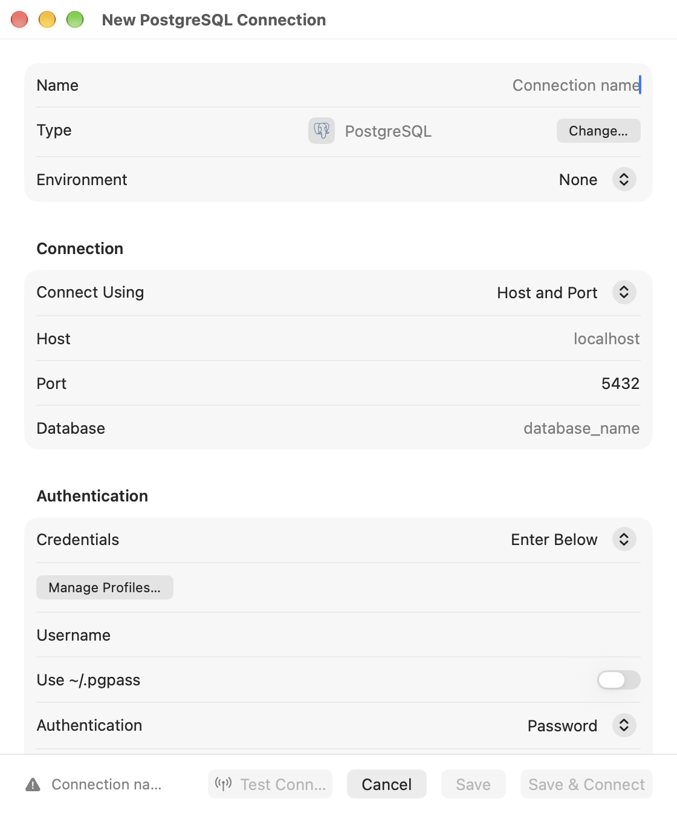
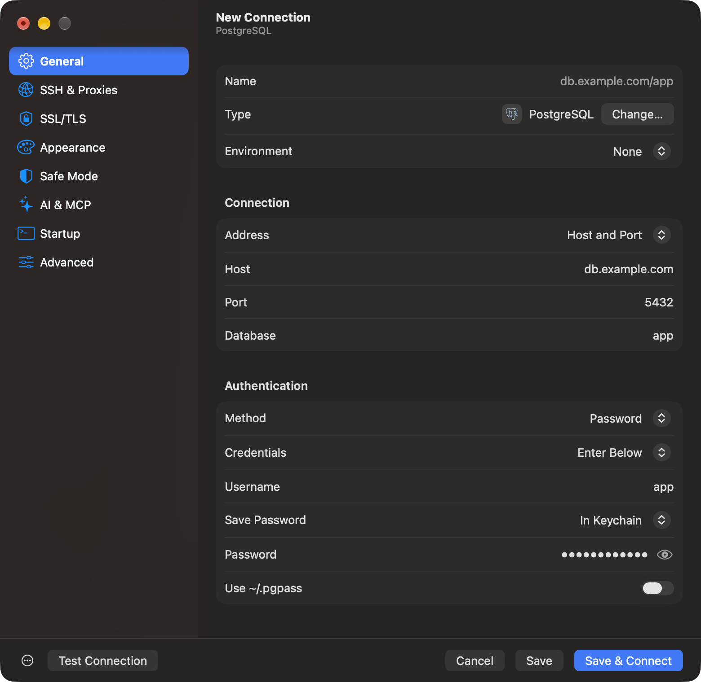
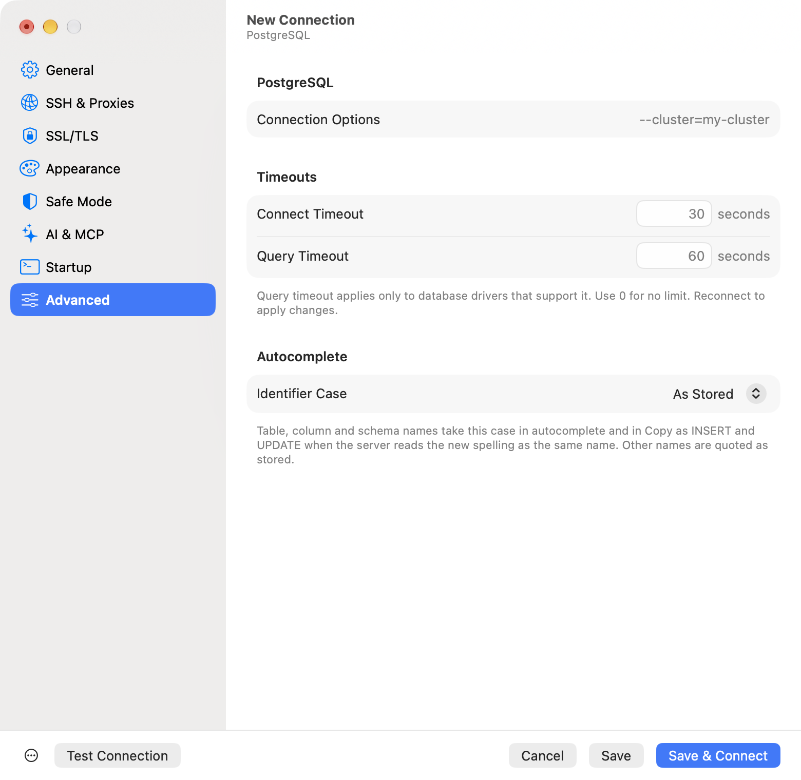
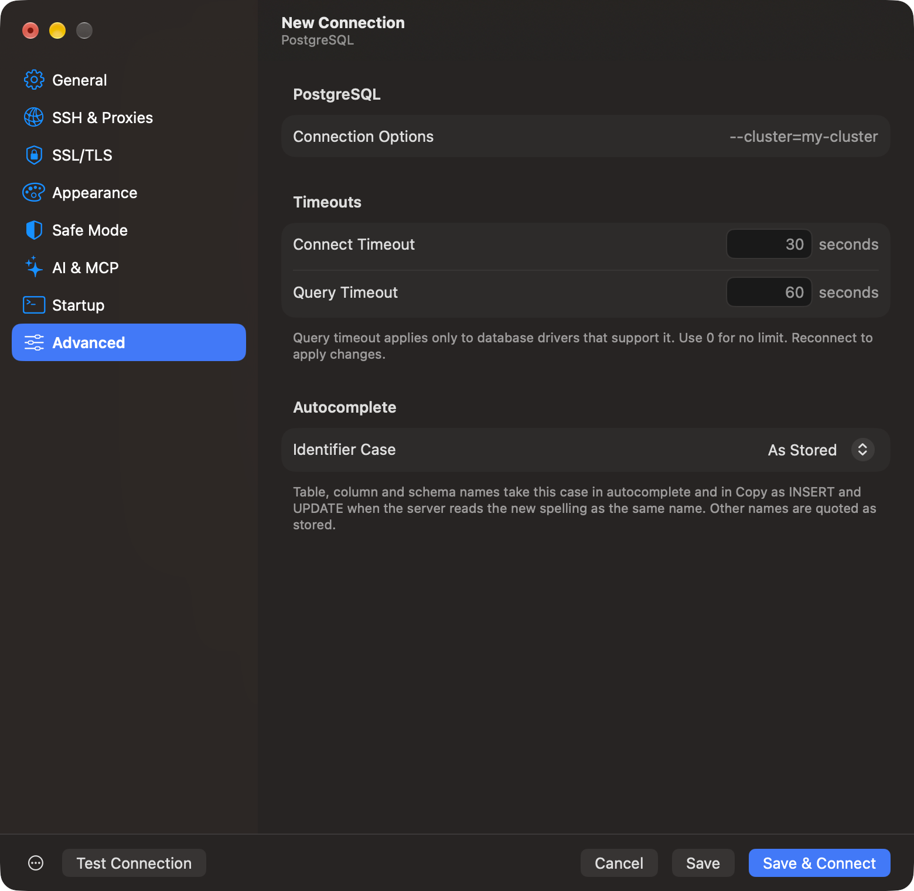

import LocalCredentialConsent from "/snippets/local-credential-consent.mdx";

A new connection starts with its database type. Press `Cmd+N`, type a few letters to filter the **Choose a Database** sheet, select a type and click **Continue**. The editor opens on **General** with the cursor in **Host**, or in **File Path** for a database file. To change a saved connection, right-click it in the welcome window and choose **Edit…**.

<Frame caption="A new PostgreSQL connection on General">
  
  
</Frame>

## Panes

The sidebar lists the panes in this order and leaves out the ones that do not apply to the connection.

| Pane | Holds | Left out when |
|------|-------|---------------|
| [**General**](#general) | Name, type, environment, where the database lives, and the sign-in | Never |
| [**SSH & Proxies**](#ssh-%26-proxies) | How the connection reaches the server: directly, through an SSH tunnel, a proxy, or a tunnel command | The driver offers no transport, or **Connect Using** is **Socket**. SQLite names it **Remote File** |
| [**SSL/TLS**](#ssl%2Ftls) | **SSL Mode** and the certificate files | The driver has no SSL settings, or a PostgreSQL connection uses a socket |
| [**Appearance**](#appearance) | Icon, color, tags and group | Never |
| [**Safe Mode**](#safe-mode) | Safe Mode, Manual Commit and masking rules | Never |
| [**AI & MCP**](#ai-%26-mcp) | What MCP clients, scripts and the AI assistant may do with the connection | Never |
| [**Startup**](#startup) | Startup commands and connection scripts | Never |
| [**Advanced**](#advanced) | Driver options, timeouts, and settings most connections leave alone | Never |

**General** holds everything a typical server connection needs. Open another pane only to change how the connection travels or behaves.

**Save** stays dimmed while a field needs fixing, and the bar along the bottom names the first one. Click that text to open the pane and put the cursor in the field. Once you have edited a field or clicked **Test Connection**, a pane that still holds a field to fix shows a red warning triangle beside its name.

## The bar along the bottom

| Control | What it does |
|---------|--------------|
| **More** (the circled ellipsis) | **Copy as URL** copies the connection as a [connection URL](/connections/urls) with every password left out. **Delete…**, on a saved connection, deletes it after a confirmation |
| **Test Connection** | Connects with what the form holds now, saved or not, and shows the result beside the button. While it runs, it reads **Cancel Test** |
| **Cancel** | Closes the editor, asking first when there are unsaved changes |
| **Save** | Saves without connecting |
| **Save & Connect** | New connections only. Saves and opens the connection |

`Return` presses **Save & Connect** on a new connection and **Save** on a saved one.

A test that connects reads **Connected to PostgreSQL 16.4 in 42 ms**: the type, the server's version where the driver reports one, and how long the connect took. A server that accepted the login with a warning, such as a password about to expire, gets a yellow mark and an info button that shows the warning. A failed test names the step that failed, such as **SSH Tunnel failed**, **TLS handshake failed**, **Sign-in failed** or **Server not reachable**. Its info button opens the server's own message and what to check, plus a button for the fix when TablePro can make it. Errors the driver recognizes open a diagnostic sheet instead, with suggested fixes and **Copy Diagnostic Info**. Changing a field clears the result.

Closing the window, `Cmd+W`, `Escape`, **Cancel** and quitting TablePro all ask about unsaved changes, with **Save**, **Don't Save** and **Cancel**. While a field still needs fixing, the alert names it and offers only **Don't Save** and **Cancel**. `Escape` in a text field ends the edit first; press it again to close.

## General

| Field | Description |
|-------|-------------|
| **Name** | Optional. Left empty, the connection saves under the suggestion shown in the field: the host and database (`db.example.com/shop`), the file's name for a database file, or the type. A saved connection with its name cleared keeps the name it had |
| **Type** | The database type. **Change…** picks another; see [Changing the type](#changing-the-type) |
| **Environment** | **Production**, **Staging**, **Development**, **Local**, or **None**. Shows with a colored symbol beside the connection's name in the welcome window and in **Switch Connection**. Choosing **Production** on a new connection sets **Safe Mode** to **Alert** until you pick a level yourself |
| **Connect Using** | MySQL, MariaDB, and PostgreSQL. **Host and Port**, or **Socket** for a server on this Mac. See Unix socket for [MySQL](/databases/mysql#unix-socket) and [PostgreSQL](/databases/postgresql#unix-socket) |
| **Host** | Empty falls back to the driver's own default, usually `localhost`. A connection URL pasted here fills the form; see [Pasting a connection URL](#pasting-a-connection-url) |
| **Port** | Pre-filled from the database type |
| **Socket** | Replaces Host when **Connect Using** is **Socket**. MySQL and MariaDB take the socket file, such as `/tmp/mysql.sock`, and drop Port. PostgreSQL takes the folder, such as `/tmp`, and keeps Port, which names the file |
| **Database** | Optional on drivers that browse every database from one session. PostgreSQL and Redshift do not connect without one |
| **Credentials** | Under **Authentication**. **Enter Below** keeps the username and password on this connection; a [credential profile](/connections/credential-profiles) supplies both instead |
| **Username** | Not pre-filled. Empty means the driver's own default |
| **Password** | Stored in the macOS Keychain. The eye button shows a saved one after Touch ID or your Mac's password. The menu beside the field switches between **Store in Keychain** and **Ask Every Time**, which stores nothing and asks on every connect. Reads **API Token** on API-only drivers. A connection whose password comes from a [password source](/features/connection-sharing#password-sources) shows the source here, with **Test Source** |
| **Use ~/.pgpass** | PostgreSQL, Redshift, CockroachDB, and KingbaseES. Off by default. See [Password file](/databases/postgresql#password-file) for lookup rules and file permissions |

A driver's own fields sit under **Connection** or **Authentication** on General, or in a section named after the database type on [**Advanced**](#advanced). Each database page says which.

SQLite, DuckDB, libSQL, and Beancount replace the host fields with a file path. **Choose…** picks a file that exists. **New…** names one that does not, and the file is made when you connect; Beancount opens only an existing ledger, so it has no **New…**.

### Pasting a connection URL

Paste a URL such as `postgresql://app@db.example.com:5432/shop` into **Host** and the form fills from it, the way [Import from URL](/connections#import-from-url) does. A note under **Host** lists what changed, with **Undo**; **Edit > Undo** reverts it too. A URL never brings a tunnel command, startup commands or a script.

On a saved connection the paste is careful with what is already there. It never renames the connection, lowers **Safe Mode**, weakens **SSL Mode**, or adds raw driver options. A database, username or password the URL leaves out keeps its current value. A URL for another database type asks first when the change would drop values.

### Changing the type

**Change…** on the **Type** row opens the **Change Database Type** sheet. Host, port, username, password, SSH and SSL settings carry over when the new type supports them, and a port still at the old type's default takes the new one. Anything the new type cannot hold is listed in an alert, **Changing to \<type\> removes:**, and nothing changes until you click **Change Type**.

## Sign-ins from this Mac

<LocalCredentialConsent />

## SSH & Proxies

**Connect Via** is a single choice, and the fields under it belong to whichever transport is selected. A connection uses one transport or none.

| Choice | What it does |
|--------|--------------|
| **Direct** | Connects straight to the host and port on General |
| **SSH Tunnel** | Forwards a local port through an SSH server. See [SSH Tunneling](/connections/ssh-tunneling) |
| **Cloudflare Tunnel** | Runs `cloudflared access tcp`. See [Cloudflare Tunnel](/connections/cloudflare-tunnel) |
| **Cloud SQL Auth Proxy** | MySQL, PostgreSQL, and SQL Server. See [Cloud SQL Auth Proxy](/connections/cloud-sql-proxy) |
| **SOCKS Proxy** | Routes through a SOCKS5 proxy, which also resolves the hostname. See [SOCKS Proxy](/connections/socks-proxy) |
| **Tunnel Command** | Holds a `kubectl port-forward`, an AWS SSM session, or a command of your own. See [Tunnel Command](/connections/tunnel-command) |

Leave it on **Direct** unless the database is unreachable from this Mac. Switching to another transport keeps what you typed into the previous one, so switching back costs nothing.

SQLite calls the pane **Remote File**, and its only choice is **Location**: **This Mac**, or **Remote Server over SSH** for a database file on an SSH server. **Open** then picks **On the Server**, which runs statements there, or **As a Read-Only Copy**. See [Remote Database Files](/connections/remote-database-files).

A connection set to **Socket** on General has no **SSH & Proxies** pane, since a tunnel cannot reach a socket file on this Mac. A PostgreSQL socket also has no **SSL/TLS** pane.

**Socket Path**, under **Forward To** with **SSH Tunnel** selected, forwards to a unix socket instead of Host and Port, which are then unused. See [Forwarding to a unix socket](/connections/ssh-tunneling#forwarding-to-a-unix-socket).

## SSL/TLS

**SSL Mode** picks how the connection is encrypted, and the certificate rows under it appear once the mode is anything but **Disabled**. [SSL/TLS](/connections/ssl) covers the modes, each driver's default, and what each certificate field takes.

## Appearance

**Icon** replaces the database logo in the connection list, **Switch Connection**, the connections strip and the toolbar. Click it, type to search the symbols, then click one or press `Return`. **Default** brings the logo back. The database type stays in the row's tooltip.

**Color** marks the connection in the connection list and its window. **Tags** and **Group** decide where it sits in the welcome window's tree.

Type a tag's name in **Tags** and press `Return` to add it: known tags complete as you type, and a new name becomes a new gray tag. Select a tag and press `Delete` to remove it. The tag menu beside the field shows each tag's color, and holds **Create New Tag…** for a tag with a color of your choice and **Manage Tags** to delete one.

## Safe Mode

| Field | Description |
|-------|-------------|
| **Safe Mode** | Confirms, authenticates or refuses queries before they run. A connection that cannot take a write shows its level as fixed text. See [Safe Mode](/features/safe-mode) |
| **Manual Commit** | Off by default. On, the first change opens a transaction and nothing is saved until you commit it. **Database > Manual Commit** is the same setting. Dimmed on engines that commit schema changes on their own. See [Manual Commit](/features/sql-editor#manual-commit) |
| **Masking** | **Add Rule** hides matching values in the grid, copies, exports, shared links, the AI assistant and MCP. See [Data Masking](/features/data-masking) |

## AI & MCP

| Field | Description |
|-------|-------------|
| **Access**, under **External Clients** | **Blocked**, **Read Only** (the default), or **Read & Write** for MCP clients such as Raycast, Cursor, and Claude Desktop, and for [AppleScript](/developers/applescript) and [Shortcuts](/integrations/shortcuts). A token's own scope cannot raise it. See the [integration security model](/developers#security-model) |
| **Policy**, under **AI** | **Use Default**, **Always Allow**, **Ask Each Time** or **Never**: when the in-app AI agents and MCP clients may read the connection. Shown even while **Enable AI Features** is off, since MCP clients follow it too. While it is on, each tool you gave **Always Allow** on an [assistant tool card](/features/ai-assistant#tool-calling) is listed under it by name, with **Forget**. After **Save**, a forgotten tool asks again on its next call |
| **AI Rules** | Guidance the AI reads on every chat turn for this connection: table conventions, columns to avoid, join hints. Shown while **Enable AI Features** is on. See [Per-connection AI rules](/features/ai-assistant#per-connection-ai-rules) |

## Startup

| Field | Description |
|-------|-------------|
| **Startup Commands** | SQL to run after every connect. See [Startup commands](#startup-commands) |
| **Pre-Connect Script** | Shell script run before connecting. A non-zero exit aborts the connect. See [Connection scripts](#connection-scripts) |
| **Timeout** | Seconds each connection script may run. Empty uses 10; valid values are 1 to 300 |
| **Post-Disconnect Script** | Shell script run once the session ends, after a pre-connect script ran. See [Connection scripts](#connection-scripts) |

### Startup commands

Statements split on semicolons and newlines outside quotes and comments, and run in order on the connection that just opened, after every connect including an automatic reconnect. They all run on one connection, so write one dialect.

<CodeGroup>
```sql MySQL
SET time_zone = '+00:00';
SET NAMES utf8mb4;
```

```sql PostgreSQL
SET search_path TO myschema, public;
```
</CodeGroup>

A statement that fails is logged and skipped, and the connection still opens.

### Connection scripts

Put whatever has to happen before the database answers in **Pre-Connect Script**: a VPN profile coming up, `aws sso login`, a credential refresh. The script runs in `bash`, and a non-zero exit stops the connect with the script's standard error in the message. Homebrew's `/opt/homebrew/bin` and `/usr/local/bin` are on `PATH` even when TablePro was opened from the Dock.

Both scripts get the connection in their environment, so one script can serve every connection that needs it:

| Variable | Value |
|---|---|
| `TABLEPRO_CONNECTION_NAME` | The connection's name |
| `TABLEPRO_HOST` | **Host**, as typed, even when an SSH tunnel or proxy carries the connection |
| `TABLEPRO_PORT` | **Port**, as typed |
| `TABLEPRO_USER` | **Username**, or the linked credential profile's |
| `TABLEPRO_DATABASE` | **Database** |

The password is never passed.

```bash
scutil --nc start "Office VPN"
until nc -z "$TABLEPRO_HOST" "$TABLEPRO_PORT"; do sleep 1; done
```

A script still running at **Timeout** is stopped and the connect fails. Raise it for a VPN that takes 15 seconds to come up or a sign-in that waits on the browser. Canceling the connect stops the script too.

**Post-Disconnect Script** undoes what the pre-connect script started. It runs once per session, after the session ends by **Disconnect**, by closing its last window, by quitting TablePro, or by a connect that fails after the pre-connect script succeeded. A connection with no pre-connect script never runs it. It gets the same variables and the same timeout, and a failure goes to the log rather than an alert.

```bash
scutil --nc stop "Office VPN"
```

Neither script runs unprompted. A **Pre-Connect Script** alert shows both scripts and waits for **Run Script**, every time, whatever opens the connection: its window, a link, Compare, **Copy To**, the AI assistant, an MCP client or a script. With no answer in 60 seconds the alert closes as **Cancel**.

A connect you did not start never runs the script. A restored window at launch, a table loading on its own and a reconnect after a tunnel drops all stop at a **Connect** button instead. Links, exports and the Team Library carry neither script.

## Advanced

| Field | Description |
|-------|-------------|
| Driver fields | Options only that driver has, such as MongoDB's **Replica Set**, in a section named after the database type |
| **Attached Databases** | SQLite, DuckDB, and libSQL in Local File mode. More database files, attached on every connect. See [Attached databases](/databases/sqlite#attached-databases) |
| **Extensions** | SQLite, and libSQL in Local File mode. Libraries loaded into the database file on every connect. See [Extensions](/databases/sqlite#extensions) |
| **Connect Timeout** | Maximum seconds for the network transport and remote database to finish connecting. Empty uses 30 seconds; valid values are 1 to 600 |
| **Query Timeout** | Override of **Settings > General** for this connection. Empty inherits the global value; `0` means no limit. Only drivers that support query timeouts enforce it |
| **Binary Value Limit** | MySQL and MariaDB. A binary value above this many KB loads when you open, copy or export it. Empty uses 64; valid values are 1 to 1048576. See [Large binary values](/features/data-grid#large-binary-values) |
| **Identifier Case** | PostgreSQL, PGlite, Oracle and Snowflake. The case table, column and schema names take in autocomplete and in **Copy as INSERT Statements** and **Copy as UPDATE Statements**. See [Identifier case](/features/autocomplete#identifier-case) |
| **Local Only** | Under **iCloud Sync**. Keeps this connection and its passwords off iCloud. Saving an existing synced connection as Local Only removes its passwords from iCloud Keychain, so your other devices ask for them again. Shown while **Sync this Mac with iCloud** is on. See [iCloud Sync](/features/icloud-sync#keeping-a-connection-off-icloud) |

The connect timeout is one deadline for the whole network attempt, not a new timeout for each step.
It includes the selected SSH tunnel or proxy, TCP, TLS and database authentication. Local SQLite and
local libSQL file opens have no network deadline. If an SSH bastion stalls, the timeout error names
that server rather than the database behind it. Reconnect after changing either timeout so the open
session picks it up.

<Frame caption="Both timeouts left empty, so they use their defaults">
  
  
</Frame>

## Connection health

Every active connection is checked on the interval set by **Check connections** in Settings >
General, every 30 seconds by default, and the check is skipped while any query, export, import, or
other tracked operation is running. A failed check starts a
[reconnect](/connections#when-a-connection-drops): the rows stay on screen and the connection tries
10 times over about 10 minutes before it shows as lost. An authentication failure stops the
retries and shows the connection as lost at once. So does a TLS failure
that needs an edit to the connection: TLS off where the server requires it, TLS on where the server
refuses it, a client certificate the server requires, or a client key that cannot be read or
decrypted. A server certificate that fails verification or does not match the host keeps the
retries going, and the reconnect bar names that certificate error as the cause in place of a
generic one. A reconnect rebuilds the tunnel, restores the selected database and schema, and
re-runs the startup commands; the connection shows as reconnecting throughout.

The check is a query, so on a database that sleeps when idle or bills per query it is not free. **Only when I use the connection** stops it: TablePro sends nothing on its own, and instead checks the connection the first time you use it after five quiet minutes. Waking the Mac from sleep counts as a quiet period, so the first thing you do after opening the lid checks too.

A Server Dashboard tab keeps its own refresh running on its own interval, which **Check connections** does not change. Close the tab or set its interval to Off.

SQLite, DuckDB, Beancount, Snowflake, and Teradata are not checked.

Metadata connections are the extra ones opened to read a database's object list and structure. While many reads run at once, as after a Refresh with many databases expanded, more than six can be open; as that work ends, a connection closes the ones unused longest until six are left. One left unused for 10 minutes closes and reopens on the next read.

## Which drivers get which transports

| Database | Default port | SSH tunnel | SSL/TLS | Cloudflare Tunnel | Cloud SQL Proxy | SOCKS Proxy | Tunnel Command |
|----------|-------------|-----------|---------|-------------------|-----------------|-------------|----------------|
| [MySQL](/databases/mysql) | 3306 | Yes | Yes | Yes | Yes | Yes | Yes |
| [MariaDB](/databases/mariadb) | 3306 | Yes | Yes | Yes | No | Yes | Yes |
| [TiDB](/databases/tidb) | 4000 | Yes | Yes | Yes | No | Yes | Yes |
| [Databend](/databases/databend) | 3307 | Yes | Yes | Yes | No | Yes | Yes |
| [OceanBase](/databases/oceanbase) | 2881 | Yes | Yes | Yes | No | Yes | Yes |
| [StarRocks](/databases/starrocks) | 9030 | Yes | Yes | Yes | No | Yes | Yes |
| [PostgreSQL](/databases/postgresql) | 5432 | Yes | Yes | Yes | Yes | Yes | Yes |
| [Amazon Redshift](/databases/redshift) | 5439 | Yes | Yes | Yes | No | Yes | Yes |
| [CockroachDB](/databases/cockroachdb) | 26257 | Yes | Yes | Yes | No | Yes | Yes |
| [PGlite](/databases/pglite) | 5432 | No | No | No | No | No | No |
| [Microsoft SQL Server](/databases/mssql) | 1433 | Yes | Yes | Yes | Yes | Yes | Yes |
| [Oracle](/databases/oracle) | 1521 | Yes | Yes | Yes | No | Yes | Yes |
| [Dameng DM8](/databases/dameng) | 5236 | Yes | No | Yes | No | Yes | Yes |
| [ClickHouse](/databases/clickhouse) | 8123 | Yes | Yes | Yes | No | Yes | Yes |
| [Teradata](/databases/teradata) | 1025 | Yes | Yes | Yes | No | Yes | Yes |
| [Trino](/databases/trino) | 8080 | Yes | Yes | Yes | No | Yes | Yes |
| [Presto](/databases/trino) | 8080 | Yes | Yes | Yes | No | Yes | Yes |
| [MongoDB](/databases/mongodb) | 27017 | Yes | Yes | Yes | No | Yes | Yes |
| [Redis](/databases/redis) | 6379 | Yes | Yes | Yes | No | Yes | Yes |
| [Cassandra / ScyllaDB](/databases/cassandra) | 9042 | Yes | Yes | Yes | No | Yes | Yes |
| [etcd](/databases/etcd) | 2379 | Yes | Yes | Yes | No | Yes | Yes |
| [SurrealDB](/databases/surrealdb) | 8000 | Yes | Yes | Yes | No | Yes | Yes |
| [Elasticsearch](/databases/elasticsearch) | 9200 | Yes | Yes | Yes | No | Yes | Yes |
| [Typesense](/databases/typesense) | 8108 | Yes | Yes | Yes | No | Yes | Yes |
| [Weaviate](/databases/weaviate) | 8080 | Yes | Yes | Yes | No | Yes | Yes |
| [Qdrant](/databases/qdrant) | 6333 | Yes | Yes | Yes | No | Yes | Yes |
| [SAP HANA](/databases/sap-hana) | 443 | No | Yes | No | No | No | No |
| [Snowflake](/databases/snowflake) | 443 | No | No | No | No | No | No |
| [SQLite](/databases/sqlite) | File | No | No | No | No | No | No |
| [DuckDB](/databases/duckdb) | File, or 9494 remote | Remote only | Remote only, on General | Remote only | No | Remote only | Remote only |
| [Beancount](/databases/beancount) | File | No | No | No | No | No | No |
| [DynamoDB](/databases/dynamodb) | AWS API | No | No | No | No | No | No |
| [BigQuery](/databases/bigquery) | Cloud API | No | No | No | No | No | No |
| [Bigtable](/databases/bigtable) | Cloud API | No | No | No | No | No | No |
| [Spanner](/databases/spanner) | Cloud API | No | No | No | No | No | No |
| [Firestore and Firebase Realtime Database](/databases/firebase) | Cloud API | No | No | No | No | No | No |
| [Cloudflare D1](/databases/cloudflare-d1) | Cloud API | No | No | No | No | No | No |
| [Cloudflare R2 SQL](/databases/cloudflare-r2-sql) | Cloud API | No | No | No | No | No | No |
| [libSQL / Turso](/databases/libsql) | URL | No | No | No | No | No | No |

SQLite is the one driver offering **Remote Server over SSH**, which reaches a database file on an SSH server without forwarding a port. A driver with no SSL/TLS column is either a local file or an HTTPS API that manages its own encryption. [SSL/TLS](/connections/ssl) has the per-driver defaults.
