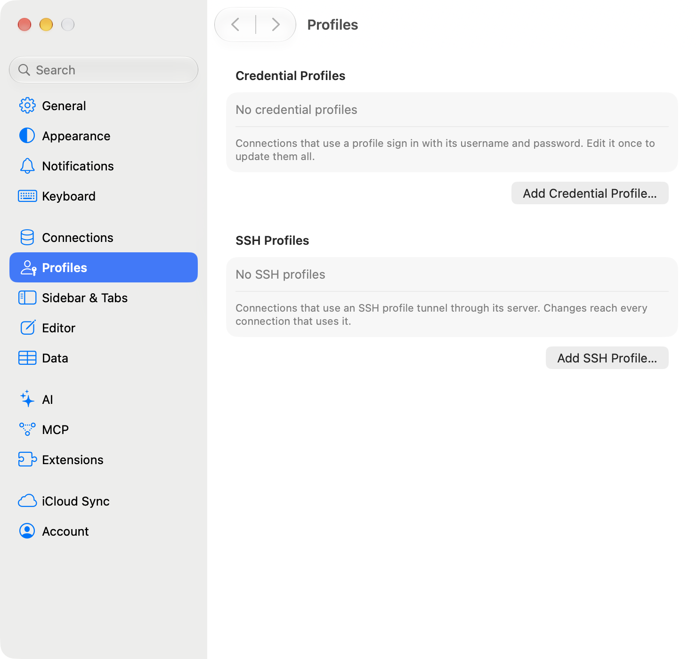
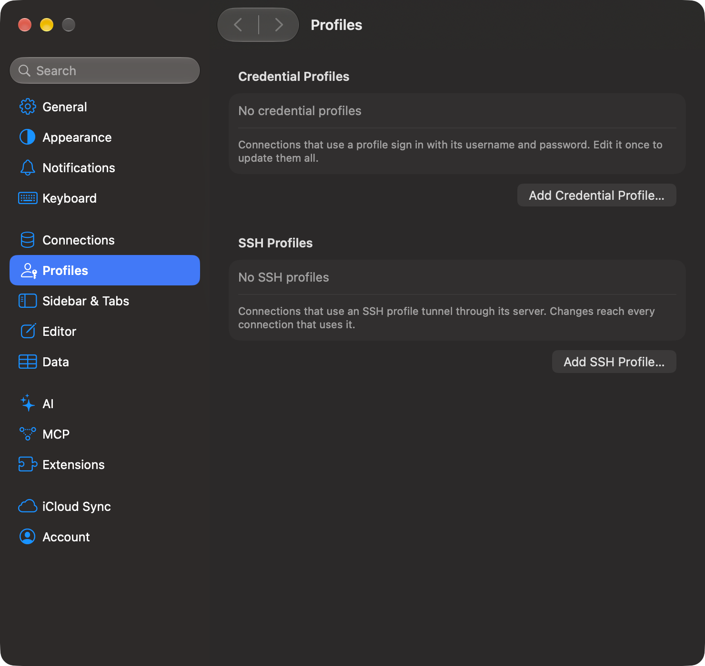

Rotating a database password used to mean opening every connection that used it. Create one profile in **Settings > Profiles**, point those connections at it, and the next rotation is a single edit.

## Create a profile

<Frame caption="Settings > Profiles">
  
  
</Frame>


<Steps>
  <Step title="Open Settings > Profiles">
    **Credential Profiles** is the first section.
  </Step>
  <Step title="Click Add Credential Profile…">
    Give it a name, a username, and pick where the password comes from.
  </Step>
  <Step title="Click Create">
    Every connection's **Credentials** picker now offers it.
  </Step>
</Steps>

**Save These as a Profile…** in a connection's **Credentials** menu does the same thing without retyping credentials already filled in. **New Profile…** there creates one from scratch, **Edit Profile…** opens the linked profile, and **Manage Profiles…** opens **Settings > Profiles**.

## Point a connection at one

<Frame caption="The Credentials picker on a connection's Authentication section">
  
  
</Frame>

**Credentials** sits in the **Authentication** section on General, after **Method** on a driver that has one. **Enter Below** is the default and keeps today's behavior: the username and password belong to that connection alone. Picking a profile replaces both fields with a read-only summary, and the connection signs in with whatever the profile holds at the moment it connects.

A linked connection keeps no password of its own. Linking deletes the one it had, so an encrypted export of it carries nothing and **Duplicate** copies the link rather than the secret.

## Where the password comes from

| Source | What happens on connect |
|---|---|
| **Saved in Keychain** | Read from the Keychain, under the profile's own id |
| **Ask Every Time** | Asked for once per profile each time TablePro runs, however many connections use it |
| **~/.pgpass** | Looked up by the host, port, database and username of the connection that is opening, when its form has **Use ~/.pgpass**. Any other connection asks for the password |
| **Password Source** | Resolved from a file, an environment variable, a command's output, 1Password, Vault, AWS Secrets Manager, or a Vault database role, picked under **Read From** |

Pick **Saved in Keychain** unless something else already owns the password. A **Password Source** never leaves this Mac and never syncs.

**Test Source** runs a **Password Source** without connecting. It shows the password hidden, or the error with what the command printed to stderr. **Show password** reveals it after Touch ID or your Mac's password, and does the same for a password saved in the Keychain. A connection using the profile has its own **Test Source**, which fills in that connection's host, port, user and database.

## Vault database roles

A role on Vault's database secrets engine hands out a new database user for every lease. Set **Source** to **Password Source** and **Read From** to **HashiCorp Vault database role**, then fill in:

| Field | Holds |
|---|---|
| Mount | Where the database secrets engine is mounted, such as `database` |
| Role | The role to read, as in `<mount>/creds/<role>` |
| Vault Address | The server, such as `https://vault.example.com:8200`. Leave it empty to use `VAULT_ADDR` |
| Sign In With | **Token** reads `VAULT_TOKEN`, then `~/.vault-token` from `vault login`. **AppRole** takes a role ID and a file holding the secret ID. **OIDC** opens your browser once per launch |

The username field is dimmed and reads **Generated by Vault**, because Vault generates the username too. **Test Source** shows the username and password the profile's connections sign in with, and reads a lease when none is held.

Everything on one profile signs in as one database user: the main connection, a second database, a backup, and a test. A backup tool that takes the password on its command line, such as SqlPackage, gets a user of its own, revoked when the backup ends. While in use, the lease renews before it expires. When Vault stops renewing it, at the role's maximum TTL or when renewal fails, the connection signs in again with a new lease. The lease is revoked when the last connection using it disconnects, after 10 minutes with nothing using it, and at quit, which waits up to 3 seconds for Vault. The generated password stays in memory: it never reaches the Keychain, `connections.json`, or iCloud.

Some databases refuse a user Vault has just created until they load it, such as Vitess or ProxySQL reloading users on a timer, or a MySQL replica catching up. When a MySQL-family server answers a new user with access denied (error 1045), the connect tries the same user again until 30 seconds after Vault created it, and the connection window shows *Waiting for the database to accept the new Vault user*. If the database still refuses it, the next attempt uses the same user. Any refused sign-in also asks Vault, by renewing the lease, whether it still exists, and a lease Vault no longer has is replaced on the next sign-in. A MySQL-family user the database accepted before and now refuses with error 1045 is replaced too, since Vault renews it without asking the database. On other engines, a user dropped in the database while Vault still has its lease stays in use until every connection on the profile disconnects.

An OIDC role must allow the redirect URI `http://localhost:8250/oidc/callback`, the one `vault login -method=oidc` uses. A connection that needs an OIDC sign-in offers **Sign In** instead of failing.

### A command that works for every connection

**The output of a command** runs in `bash` for whichever connection is opening. Write `{host}`, `{port}`, `{user}` and `{database}` where the command needs them, and each becomes that connection's value as one quoted word, with or without quotes around the placeholder. The same values arrive as `TABLEPRO_HOST`, `TABLEPRO_PORT`, `TABLEPRO_USER` and `TABLEPRO_DATABASE`, plus `TABLEPRO_CONNECTION_NAME`.

```bash
aws rds generate-db-auth-token --hostname {host} --port {port} --username {user}
```

`{host}` and `{port}` are the ones typed in the form, never the local port of a tunnel. `${host}` is left for `bash`.

**Reuse Result For** keeps the output for 5 minutes, 15 minutes, an hour or 8 hours, so a reconnect inside that window skips the command. Set it below the lifetime of whatever the command prints. The output stays in memory, and a connect that fails throws it away so the next one runs the command again.

## Additional secrets

Some engines sign in with more than a password: an AWS secret access key, a Snowflake private key, a service account JSON. **Additional Secrets** in the profile editor lists them per database type, picked under **Database**; only types that take such a secret are offered. A connection reads only the secrets its own type declares, so one profile can carry several engines' keys without them colliding.

## Rename, duplicate and delete

Click the info button on a row in **Settings > Profiles** to edit it, or right-click the row for **Edit…**, **Duplicate** and **Delete…**. The row's trailing label says how many connections use it.

**Delete Profile** is at the bottom of the editor. Deleting hands the username and the password to each connection that used it, as that connection's own credentials, so nothing stops connecting. Two profiles cannot share a name, since every picker offers them by name alone.

## Sharing and sync

An exported connection carries its profile by name, alongside the name, the username and where the password comes from. Importing on a Mac that has no profile of that name creates one set to **Ask Every Time**, whatever source the file names, `~/.pgpass` included. To read your own `~/.pgpass`, switch its source in **Settings > Profiles**. A profile already there is left as it is and the connection links to it. The password never travels, and a profile reading its password from a file or a command exports as one that asks.

With [iCloud Sync](/features/icloud-sync) on, **Credential Profiles** under **What Syncs** in **Settings > Sync** carries profiles between your Macs: the name, the username, and where the password comes from. The password and any additional secrets stay in the Keychain. They cross only while **Passwords** is on in the same pane, and only when saved after it was turned on. A profile set to **Password Source** arrives as **Ask Every Time**, and a source set on the second Mac stays on that Mac.

Which connections use a profile is kept on each Mac, so pick the profile in **Credentials** again on the second one. A profile arriving under a name already taken gets a number after it, such as `prod (2)`. Deleting a profile deletes it on your other Macs too.
