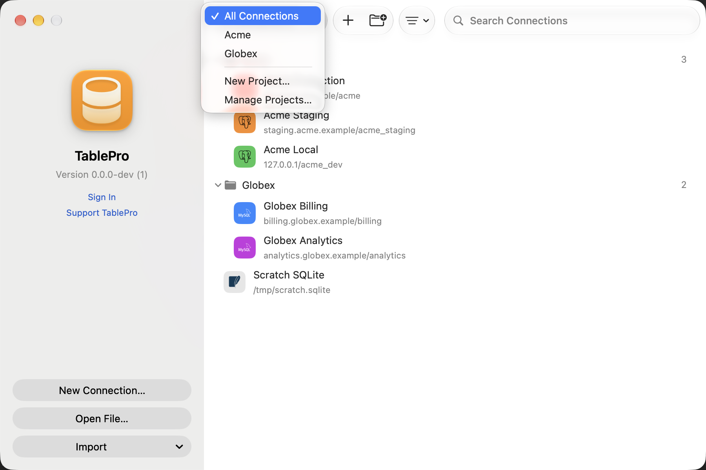
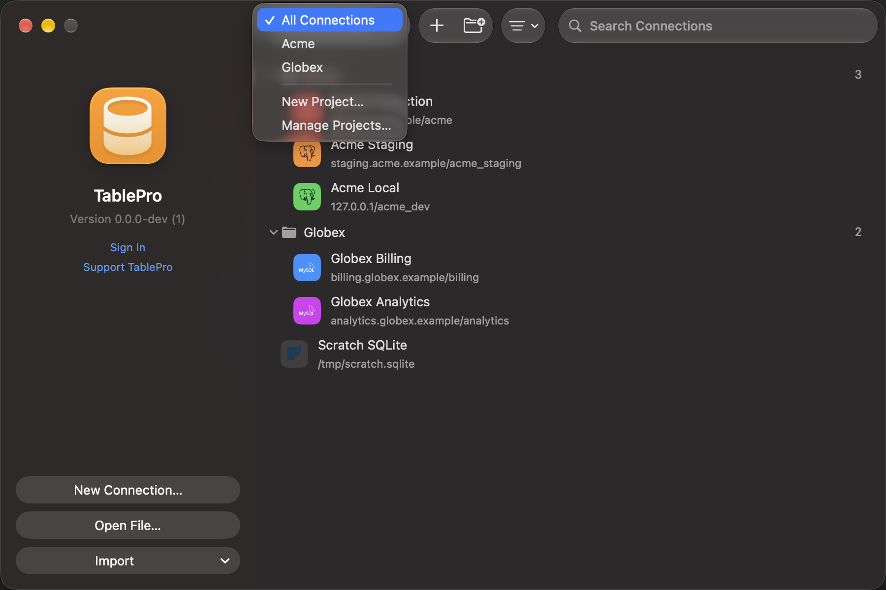
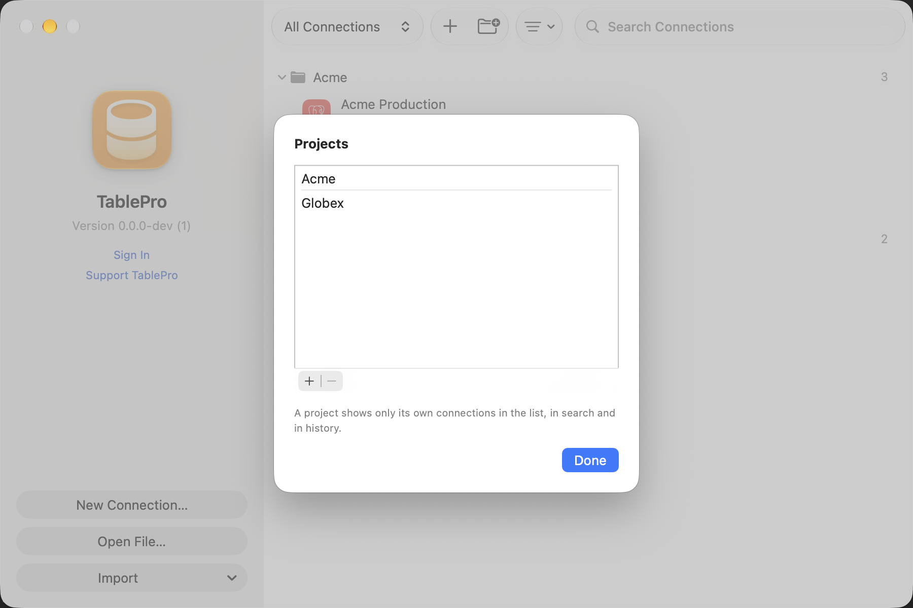
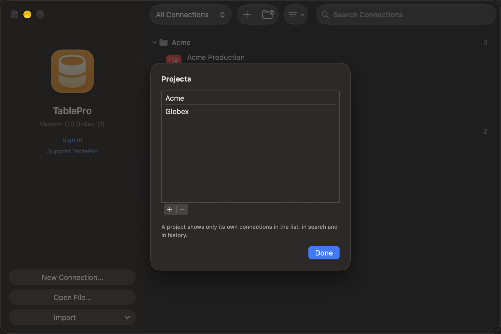

The pop-up button at the leading edge of the welcome window's toolbar names what the list shows. It starts on **All Connections**, which is built in and shows everything. Choose a project there, or under **File > Project**, and the connection list narrows to it, along with its search, **Favorites** and **Recent**.

<Frame caption="All Connections is checked until you choose a project">
  
  
</Frame>

## Create a project

<Steps>
  <Step title="Choose New Project…">
    It is at the foot of the pop-up button's menu and under **File > Project**.
  </Step>
  <Step title="Name it">
    Type a name and click **Create**. A name another project holds is refused, whatever its case.
  </Step>
  <Step title="Fill it">
    The list switches to the new project and reads **No Connections in** with its name. Add a connection with the button under that, or go back to **All Connections** and move connections in.
  </Step>
</Steps>

## Move connections into a project

A project holds top-level groups and ungrouped connections. Right-click one and choose **Move to Project**, then the project, or **None** to take it out of every project. Select several first to move them together. **Edit > Undo** puts a move back.

- A group takes its subgroups and their connections along.
- A connection inside a group has no **Move to Project**. Move its top-level group, or take the connection out of the group first.
- A connection is in one project at most.

While a project is active, a new connection, a new group and an import land in it. An imported file that names a project of its own keeps it: a project with that name is reused, and a missing one is created.

## What follows the active project

| Place | What it lists |
|---|---|
| Welcome window | The project's groups and connections. Search, **Favorites** and **Recent** stay inside it |
| [**Switch Connection**](/connections#switch-connections-and-databases) | The project's saved connections. A connection that is already open stays listed |
| [Query History](/features/query-history#filtering) and [Query Insights](/features/query-insights#filtering) | With the scope on all connections, the queries run on the project's connections |
| [Open Quickly](/features/open-quickly#across-connections) | Saved and recent queries of the project's connections, plus the window's own connection |
| [Compare & Sync](/features/compare-sync) and [Copy and duplicate](/features/copy-objects) | The project's connections in the connection pickers |
| The connection form | The project's groups under **Group** |
| The Dock menu | The project's connections under **Open Connection** |
| **File > Export > Export Connections…** | The project's connections |

Open windows stay open when you switch. A `tablepro://` link and a saved Shortcut still open a connection of another project, since they name it by id.

A search that finds nothing inside a project offers **Search All Connections**, which switches to **All Connections** and keeps the text you typed.

## Manage projects

Choose **Manage Projects…** from the pop-up button or from **File > Project**.

<Frame caption="Rename a project in its row">
  
  
</Frame>

| To | Do this |
|---|---|
| Add | Click **+** and type the name |
| Rename | Edit the name in its row and press `Return` |
| Reorder | Drag a row. The pop-up button and **File > Project** list projects in this order |
| Delete | Select the project and click **−**, then **Delete** |

Deleting a project keeps its connections and groups. They leave the project and show under **All Connections**, and when the deleted project was the active one, so does the list.

## Per device

Projects, and the one that is active, stay on the Mac they were set on. iCloud Sync does not carry them.

## Outside clients

Switching project also narrows what other programs are offered:

| Client | What follows the project |
|---|---|
| [MCP clients](/developers/mcp-tools#the-active-project) | `list_connections` and the connections resource. A call that names a connection of another project by id is refused |
| The [`tablepro` command](/integrations/terminal#what-a-query-may-do) | `connections`, and the names and ids `-c` accepts |
| [AppleScript](/developers/applescript#objects) | The `connections` list |
| [Shortcuts](/integrations/shortcuts) | The connections the picker offers. A shortcut that already holds a connection still runs |

The assistant inside TablePro is not narrowed: it works on its own window's connection. A project only narrows. Tokens, **External Clients** and approvals apply as before, so a client reaches nothing through a project that it could not reach without one.
