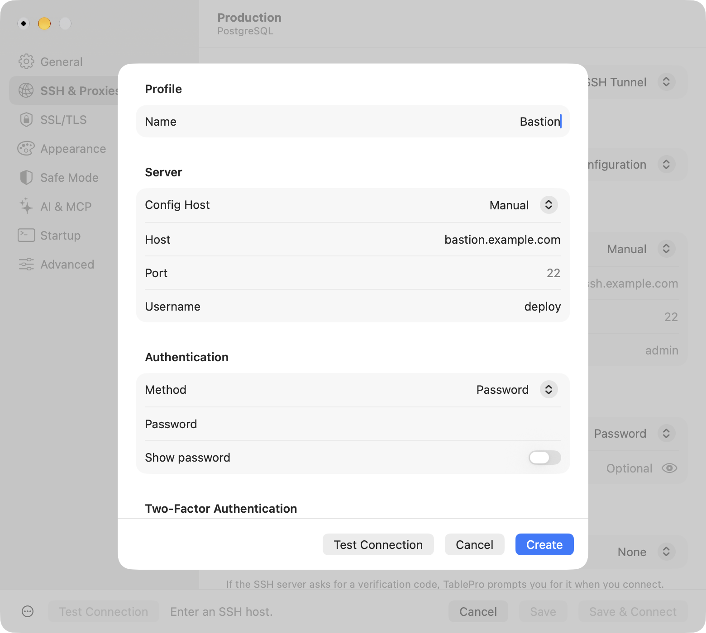
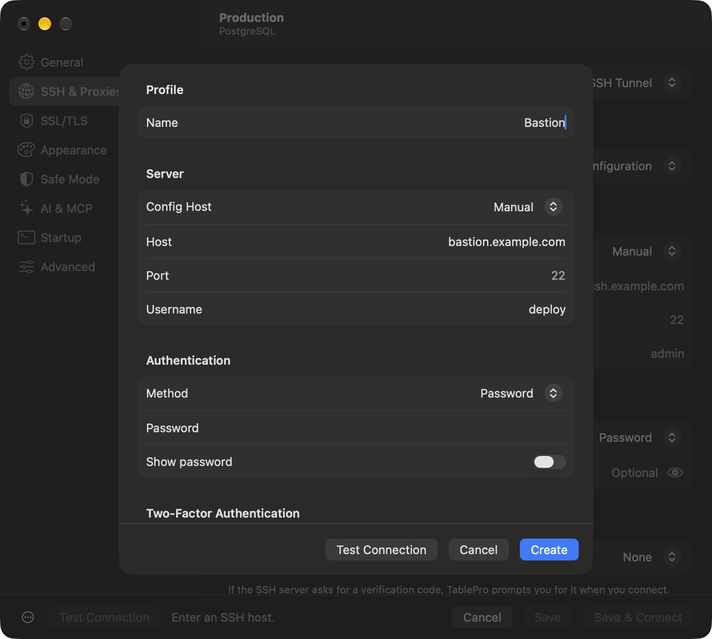

One bastion, many connections. A profile holds the server (host, port, username), the authentication method, the two-factor settings, and the jump hosts, so every connection through that bastion stops repeating them. How the tunnel itself behaves is on [SSH Tunneling](/connections/ssh-tunneling).

## Create a profile

<Steps>
  <Step title="Select SSH Tunnel on any connection">
    On the **SSH & Proxies** pane, choose **New Profile…** from the **SSH Profile** menu.
  </Step>
  <Step title="Fill in the server and authentication fields">
    The same fields an inline config has, plus a name.
  </Step>
  <Step title="Click Create">
    The profile now appears in the **SSH Profile** menu of every connection.
  </Step>
</Steps>

**Add SSH Profile…** under **SSH Profiles** in **Settings > Profiles** creates one without opening a connection, and the same section lists every profile with how many connections use it. Click a row's info button to edit it, or right-click it for **Edit…**, **Duplicate** and **Delete…**. A duplicate copies the password, key passphrase and TOTP secret too.

<Frame caption="Creating an SSH profile">
  
  
</Frame>

**Save These as a Profile…** in the same menu converts a connection that already has an inline config, and **Manage Profiles…** opens **Settings > Profiles**. Picking a profile swaps the inline fields for a read-only summary of its server, authentication and jump hosts; **Inline Configuration** brings the fields back for a tunnel that belongs to one connection alone.

## Test a profile

**Test Connection** in the profile editor runs the handshake, verifies the host key, and authenticates, without touching a database. Success shows a green **Connected** at the bottom of the editor; failure shows the error there in red. An interactive prompt, a verification code for instance, appears here exactly as it would on connect.

## Edit and delete

**Edit Profile…** in the **SSH Profile** menu opens the selected profile, and **Delete Profile** is at the bottom of that editor. An edit reaches every connection using the profile, on this Mac and on any Mac it syncs to: the server, the authentication method, the jump hosts, the password, the key passphrase and the TOTP secret all come from the profile on the next connect. A connection already open keeps the server and jump hosts it connected through. Once the profile points elsewhere, a reconnect TablePro starts on its own, a database switch that reconnects, and a connect asked for by an MCP client or a link stop with a message; **Reconnect** in the connection's window uses the new server. Approvals to sign in with this Mac's own credentials or environment variables are asked for again after a profile moves to another server.

Deleting a profile hands its configuration and its secrets to each connection that used it, as that connection's own inline tunnel. Nothing stops connecting, and the tunnel is now editable per connection on its **SSH & Proxies** pane.

## iCloud Sync

Profiles sync across Macs with iCloud Sync on and **SSH Profiles** on under **What Syncs** in **Settings > iCloud Sync**. Passwords, key passphrases, and TOTP secrets stay in the local Keychain unless **Passwords** is on too, and that covers newly saved credentials only: re-save an existing password to include it.

On [iPhone and iPad](/ios#ssh-profiles), a connection that uses a profile keeps the profile's server and jump hosts read only and signs in with the profile's password once it reaches iCloud Keychain. Turning **SSH Tunnel** off there unlinks the profile from that connection on every device.
