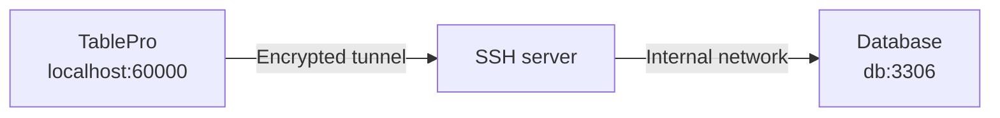

The database **Host** on the General section is resolved from the SSH server, not from your Mac. A database on the SSH server itself is therefore `localhost`, not the server's public name, and a database elsewhere on the private network is whatever the SSH server calls it (an RDS endpoint, for instance).

## Set up a tunnel

<Steps>
  <Step title="Turn the tunnel on">
    In the connection form, open the **Network** tab and set **Connect via** to **SSH Tunnel**. A connection uses one transport, so choosing this one switches off whichever was selected before.
  </Step>
  <Step title="Name the SSH server">
    Fill in **SSH Host**, **SSH Port** (22 by default), and **SSH User**. With `~/.ssh/config` entries present, a **Config Host** picker appears above the host field instead.
  </Step>
  <Step title="Pick an authentication method">
    Password, Private Key, SSH Agent, Keyboard Interactive, or None. [Authentication methods](#authentication-methods) has the fields for each.
  </Step>
  <Step title="Set the database Host from the server's point of view">
    Back on **General**, `localhost` reaches a database on the SSH server itself. One on a unix socket needs [Socket Path](#forwarding-to-a-unix-socket) instead.
  </Step>
  <Step title="Click Test Connection">
    A wrong host, a blocked forward, or an agent nothing answered on names the real reason instead of timing out. [Troubleshooting](#troubleshooting) has the messages the SSH side reports.
  </Step>
</Steps>

To share one SSH config across connections, save it with **Save Current as Profile…** or pick an existing one from the **Profile** picker; see [SSH Profiles](/connections/ssh-profiles). To fill the fields from a string instead, paste a `scheme+ssh://` URL into the [Import from URL…](/connections/urls#ssh-tunnel-format) sheet.

<Frame caption="Reusing a saved SSH profile">
  
  
</Frame>

**SSH Tunnel** is not offered on SQLite, DuckDB, PGlite, libSQL, Turso, Beancount, BigQuery, Bigtable, Spanner, Cloudflare D1, Cloudflare R2 SQL, DynamoDB, or Snowflake: each is reached over a local file, a loopback socket, or a vendor HTTP API. For SAP HANA, forward the port yourself, as its [Limitations](/databases/sap-hana#limitations) show.

## Authentication methods

| Method | What to fill in |
|---|---|
| **Password** | The SSH password. Prefer a key on anything production |
| **Private Key** | **Key File**, with **Browse** to pick one, and **Passphrase** if the key is encrypted. Leaving **Key File** empty auto-detects from `~/.ssh/config` and the default key locations |
| **SSH Agent** | **Agent Socket**: **SSH_AUTH_SOCK** for the `ssh-agent` macOS runs, **1Password** for its socket at `~/Library/Group Containers/2BUA8C4S2C.com.1password/t/agent.sock`, or **Custom Path** for Secretive or your own. **Identity File** takes a `.pub` and offers that key ahead of the others; empty offers every key the agent holds. Signing stays in the agent; the key is never read, and no key file is tried if the agent refuses |
| **Keyboard Interactive** | The SSH password, sent through SSH's challenge-response. Use it when the server rejects plain password auth, common with PAM |
| **None** | Nothing, for a server that authenticates the connection itself such as a [Tailscale SSH](https://tailscale.com/kb/1193/tailscale-ssh) host. A server that does want credentials fails the connect with a message naming the other methods |

**Private Key** is the one to pick unless the server only ever issued you a password.

### Verification codes and two-factor authentication

A keyboard-interactive challenge partway through authentication, from `google-authenticator` or `duo_unix` for example, is shown as the server worded it and your answer sent back. Every method except **None** supports this, a key or agent followed by a second factor included (`AuthenticationMethods publickey,keyboard-interactive`).

The **Two-Factor Authentication** section can answer TOTP codes instead. **None** and **Prompt at Connect** both ask when the server does; **Auto Generate** computes the code from the base32 **TOTP Secret** off your authenticator enrollment, with **Algorithm** (SHA1, SHA256, SHA512), **Digits** (6 or 8), and **Period** (30s or 60s) already set to what most servers use.

## Host keys

A first connection shows the server's key type and SHA-256 fingerprint, in `ssh-keygen -l` format, and waits for **Trust**. Trusted keys go to `~/Library/Application Support/TablePro/known_hosts`.

If a trusted server's key later changes, an **SSH Host Key Changed** alert lists the previous and current fingerprints. **Connect Anyway** does not answer the Return key. Escape picks **Disconnect**, which is what to take unless you know the server was reinstalled. With jump hosts, every hop's key is verified the same way.

The tunnel offers the post-quantum key exchange `mlkem768x25519-sha256` first, so a server that allows only post-quantum key exchange connects too. A server that allows only `sntrup761x25519-sha512` does not.

## Using ~/.ssh/config

Pick an alias from the **Config Host** picker and `HostName`, `User`, `Port`, `IdentityFile`, `IdentitiesOnly`, `IdentityAgent`, and `ProxyJump` are resolved from the config at connect time. Anything typed into the form overrides the file, which is re-read whenever it or an `Include`d file changes.

`Match` blocks take the criteria ssh does, `localnetwork` and `tagged` included. A tunnel counts as `sessiontype none` with an empty `command`, and a criterion TablePro does not know keeps its block from applying.

`CanonicalizeHostname` completes a short name with each `CanonicalDomains` suffix in turn, skipping a name with more dots than `CanonicalizeMaxDots`, and applies to a host reached through a jump only when set to `always`. The completed name is the one dialed and the one its host key is stored under. A DNS alias (CNAME) replaces it only where a `CanonicalizePermittedCNAMEs` rule covers both names. With `CanonicalizeFallbackLocal no`, a name no suffix resolves stops the connection instead of being dialed as typed.

`IdentityFile` picks which agent key is offered, not only which key file is read, and a `.pub` is enough. That is how a 1Password or Secretive key gets pinned to a host. `IdentitiesOnly yes` then drops every agent key the config did not name, which is what keeps a thirty-key agent inside a server's `MaxAuthTries`.

Once a connection opens, the hosts, ports and usernames it reached through the config sync to [iPhone and iPad](/ios#route-from-mac), so it opens there too. The config file, keys and key paths stay on the Mac.

<Frame caption="Picking a host from ~/.ssh/config">
  
  
</Frame>

### Tokens

Each keyword takes the tokens `ssh_config(5)` gives it, and no others. `Hostname %h` is the common one: it names the host the connection already asked for, which is what makes a catch-all `Host *.*` block work.

| Keyword | Tokens |
|---------|--------|
| `Hostname` | `%%` `%h` |
| `ProxyJump` | `%%` `%h` `%n` `%p` `%r` |
| `IdentityFile`, `IdentityAgent`, `Match exec` | `%%` `%C` `%d` `%h` `%i` `%j` `%k` `%L` `%l` `%n` `%p` `%r` `%u` |
| `Include` | `%%` `%d` `%i` `%L` `%l` `%u` |

`%h` is the host after any `HostName` substitution and `%n` the one the connection named; `%p`, `%r` and `%j` are the port, remote user and jump host in effect; `%d` and `%u` are your home directory and username; `%C` hashes `%l%h%p%r%j`, the way `ControlPath` does. `${VAR}` reads an environment variable in the same places, and a leading `~` or `~user` expands in any keyword naming a file.

A token a keyword does not take stops the connection and names both, rather than reaching the server as literal text. `Include` is the one narrowing: the file is read once for every connection, before any host is known, so a token naming the target is skipped with a note in Console.

## Jump hosts

For a database behind more than one bastion, expand **Jump Hosts** and add each hop in order. Each hop is an SSH session tunneled through the previous one, with no `ssh` subprocess involved.

| Field | Description |
|-------|-------------|
| **Host** | Hostname or IP of the jump host |
| **Port** | SSH port, 22 by default |
| **Username** | SSH username for this hop |
| **Auth** | **Private Key** or **SSH Agent**. Password auth is not offered for a hop |
| **Key File** | Private key path, under Private Key auth |

With the list left empty and an SSH host that matches a config entry carrying `ProxyJump`, that directive is followed instead. A hop's own `ProxyJump` is followed too, but in a list only the first hop's, as `ssh -J a,b` does. `ProxyJump none` turns it off, a hop written as `ssh://user@host:port` reads the same as `user@host:port`, and a hop with no `User` is named in the error before anything is dialed.

A connection with hops syncs to [iPhone and iPad](/ios#jump-hosts) with every hop, its port and its key path intact. A key path names a file on the Mac, so give each hop a key on the device before the connection opens there. The tunnel's own port and auth method make the same round trip: a port you left empty stays empty, so `~/.ssh/config` still decides it.

## Forwarding to a unix socket

Some servers listen on a unix socket with no TCP port open at all, a PostgreSQL box set up for `local` connections in `pg_hba.conf` being the usual case. Fill in **Socket Path** under **SSH Tunnel** and the forward targets that socket, the same thing `ssh -L 5434:/var/run/postgresql/.s.PGSQL.5432 server` does by hand. **Host** and **Port** are ignored while a socket path is set. Jump hosts still apply: the hops reach the SSH server, and the socket opens from there.

Point at the socket file, not the directory holding it:

| Database | Typical socket path |
|----------|---------------------|
| PostgreSQL | `/var/run/postgresql/.s.PGSQL.5432` |
| MySQL / MariaDB | `/var/run/mysqld/mysqld.sock` |
| Redis | `/var/run/redis/redis.sock` |

`peer` authentication works: the SSH server opens the socket as your SSH login user, so a `local all all peer` line authenticates you as the PostgreSQL role of that name.

A database on a socket cannot negotiate TLS, so SSL is switched off for the connection. The SSH tunnel still encrypts the whole path.

## If the tunnel drops

A keep-alive goes out every 30 seconds. When one fails the session drops to connecting and the tunnel is rebuilt, retrying at 2s, 4s, 8s and doubling to a 120-second ceiling, ten attempts at most. A query in flight dies with the tunnel and is not replayed. After ten failures the session ends with **SSH tunnel disconnected. Click to reconnect.**

If tunnels keep dropping on an idle network, the keep-alive is not the missing piece: check the server's `ClientAliveInterval` and the idle timeouts on any firewall or load balancer in between.

## What the tunnel is carrying

Press `Ctrl+Cmd+C` and read the footer under the connection list: bytes received and sent since the tunnel opened, and the rate beside each direction while traffic is moving. A rebuilt tunnel starts again from zero. See [transport activity](/connections#switch-connections-and-databases).

## Troubleshooting

### "The SSH server could not reach …"

SSH is fine and the forward is not. Almost always the **Host** field: that address is resolved from the SSH server, so a database bound to `127.0.0.1` (the MySQL and PostgreSQL default) needs **Host** set to `localhost`. Check what it is bound to with `ss -lntp` on the server. If the host is right, check `sshd_config` for `AllowTcpForwarding yes`.

### "The SSH server did not open a forwarding channel to …"

The destination took the connection and never answered, which usually means a firewall or security group dropping packets rather than refusing them. Test it from the SSH server: `ssh user@server "nc -zv db-host 3306"`.

### "The SSH server would not forward the socket …"

The socket path does not exist on the server, or `sshd_config` sets `AllowStreamLocalForwarding no`. That is a separate setting from `AllowTcpForwarding`.

### "No SSH agent answered on the socket from …"

Nothing is listening where that socket points, and the message names which of the three set it: **Agent Socket** under **SSH Tunnel**, an `IdentityAgent` line for the host in `~/.ssh/config`, or `SSH_AUTH_SOCK`. Change it in the place the message names.

`SSH_AUTH_SOCK` is the one that catches people out. An app launched from Finder gets it from launchd, which means the `ssh-agent` macOS runs, whatever a shell profile exports. 1Password and Secretive are reached by naming their own socket: switch **Agent Socket** to **1Password**, or to **Custom Path**.

A jump host has no **Agent Socket** field of its own, so its agent comes from `IdentityAgent` or `SSH_AUTH_SOCK`.

`IdentityAgent SSH_AUTH_SOCK` means that variable, as it does for ssh. `IdentityAgent none` turns the agent off: a jump host from `~/.ssh/config` then signs in with its `IdentityFile` keys, and a tunnel set to **SSH Agent** stops with an error naming that line.

### "The SSH agent from … holds no keys."

The agent answered and offered nothing. 1Password serves keys only while it is running and unlocked, and Secretive only while its agent is loaded; unlock it and add the key there. `ssh-add` loads keys into the `SSH_AUTH_SOCK` agent alone, so it is the fix only when that is the socket in the message.

### "The SSH agent from … holds no key matching the identity file set for this host. …"

The agent has keys, and none of them is the one `IdentityFile` or **Identity File** names. List what that agent holds with `SSH_AUTH_SOCK=<the socket the message names> ssh-add -L`, since a bare `ssh-add` reads the shell's `SSH_AUTH_SOCK` rather than the socket TablePro used. Point the setting at a key in that list, or clear it to go back to offering every key.

### "No public key could be read from the identity file set for this host, …"

`IdentityFile` or **Identity File** names a path, and neither it, its `.pub` sidecar, nor its `-cert.pub` parses as an OpenSSH public key. Check the path, and run `ssh-keygen -l -f <path>` to confirm the file itself. `ssh-keygen -y -f <private key> > <private key>.pub` writes the sidecar when only the private key exists.

### "SSH agent did not authenticate. …"

The agent offered keys and the server accepted none of them. Check the public key is in `~/.ssh/authorized_keys` on the server for the **SSH User** you filled in, and that the key you expect is in the agent rather than only on disk.

### "The SSH server closed the connection while the agent's keys were being offered. …"

The server reached `MaxAuthTries`, 6 by default, before a key it accepts came up. Count that agent's keys with `SSH_AUTH_SOCK=<the socket in **Agent Socket**> ssh-add -L`: past six, the right one may never be offered. Name it with `IdentityFile` and `IdentitiesOnly yes` for the host in `~/.ssh/config`, or fill in **Identity File** on the connection.

### "TablePro and the SSH server have no … in common."

The server allows only key exchange methods, host key types, ciphers or MAC algorithms TablePro lacks. The message names the step that found nothing in common, the software in the server's banner, and every method TablePro has for that step. Run `sudo sshd -T` on the server to see what it allows, and ask its administrator to add one of TablePro's methods to `KexAlgorithms`, `HostKeyAlgorithms`, `Ciphers` or `MACs` in `sshd_config`.

When the message goes on with "The server offers only … TablePro no longer supports", the server allows nothing but methods built on SHA-1, MD5, RIPEMD-160 or an old cipher. TablePro does not offer these:

| `sshd_config` | No longer offered | Add one of |
|---|---|---|
| `KexAlgorithms` | `diffie-hellman-group1-sha1`, `diffie-hellman-group14-sha1`, `diffie-hellman-group-exchange-sha1` | `curve25519-sha256`, `ecdh-sha2-nistp256`, `diffie-hellman-group14-sha256` |
| `HostKeyAlgorithms` | `ssh-rsa`, `ssh-rsa-cert-v01@openssh.com` | `ssh-ed25519`, `rsa-sha2-512`, `rsa-sha2-256` |
| `Ciphers` | `3des-cbc`, `blowfish-cbc`, `cast128-cbc`, `arcfour`, `arcfour128` | `chacha20-poly1305@openssh.com`, `aes128-gcm@openssh.com`, `aes128-ctr` |
| `MACs` | `hmac-sha1`, `hmac-sha1-96`, `hmac-sha1-etm@openssh.com`, `hmac-md5`, `hmac-md5-96`, `hmac-ripemd160`, `hmac-ripemd160@openssh.com` | `hmac-sha2-256-etm@openssh.com`, `hmac-sha2-256`, `hmac-sha2-512` |

An RSA host key keeps working once the server signs with `rsa-sha2-512` or `rsa-sha2-256`, which takes OpenSSH 7.2 or later. DSA (`ssh-dss`) host keys are not supported.

### "TablePro and the SSH server have no signature algorithm in common for this key."

The key is RSA, and the server accepts RSA keys only with `ssh-rsa` signatures, which use SHA-1. TablePro signs RSA keys with `rsa-sha2-256` or `rsa-sha2-512`. Add those to `PubkeyAcceptedAlgorithms` in `sshd_config` (`PubkeyAcceptedKeyTypes` before OpenSSH 8.5), or sign in with an Ed25519 or ECDSA key. A server older than OpenSSH 7.2 cannot check either signature, so it needs a key of another type.

### "The SSH host … contains characters ssh does not allow in a host name." / "The SSH user … contains characters ssh does not allow in a user name."

The name in the message holds a character `ssh` refuses, such as a quote, a backtick, one of `;&|<>(){}`, or a leading `-`. A host also refuses whitespace, `$`, `,` and a backslash. Find the name in **SSH Host**, **SSH User**, a jump host, or a `HostName` line in `~/.ssh/config`, and correct it.

### "… was not found in any of the CanonicalDomains in ~/.ssh/config, and CanonicalizeFallbackLocal is set to no."

None of the `CanonicalDomains` suffixes turned the host into a name DNS resolves, and the config forbids dialing the short name. Check that the full name resolves for the domain you expect: `dscacheutil -q host -a name db.example.com`. Add the missing domain to `CanonicalDomains`, or set `CanonicalizeFallbackLocal yes` for that host.

### "Jump host … failed: …"

The step after the colon failed on that jump host, not on the SSH server. Check that hop's **Host**, **Port**, **Username** and **Key File** under **Jump Hosts**, or its `Host` block in `~/.ssh/config`. "Could not open a channel" there means the jump host's `sshd_config` sets `AllowTcpForwarding no`, or it cannot reach the next host.

### The tunnel connects and the database refuses the login

The database credentials are separate from the SSH ones. Check you did not carry one set into the other.

### A firewall prompt on connect

The local end of the tunnel listens on a port between 60000 and 65000. Allow it.

### SSH fails instantly against a server on your own network

macOS 15 and later put outbound connections to local network addresses behind a Local Network permission. With it off, the window reads **Local Network Access Required** and names the SSH server, or the first jump host, it could not reach. **Open System Settings** takes you to **Privacy & Security**, where **Local Network** lists TablePro. Servers over the internet, and anything on `127.0.0.1`, are unaffected.

### SSH itself fails

Try the same host, user, and key in Terminal with `ssh -v user@server`. If that fails too, the problem is server-side.
