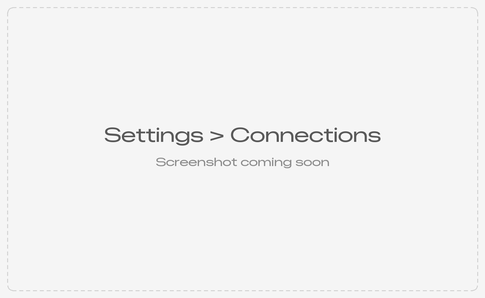
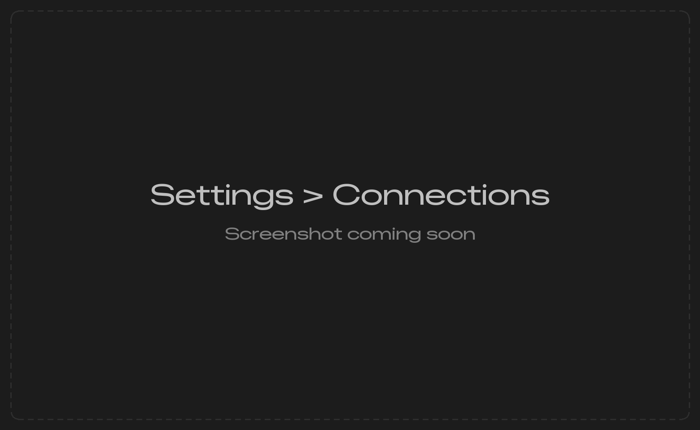

**Settings > Connections** holds what every connection shares. One connection can override the query timeout in its own form.

<Frame caption="The Connections pane">
  
  
</Frame>

## Connection checks

**Check open connections** sets how often each open connection is checked for a dropped session: **Every 30 seconds** (the default), **Every 5 minutes**, **Every 15 minutes**, or **Only when used**, for a database that sleeps when idle or bills per query. A new choice reaches connections already open. What a failed check starts is under [Connection health](/connections/connection-form#connection-health).

## Query timeout

How long a query runs before it is cancelled. The default is 1 minute; the menu offers 10 seconds to 10 minutes and **No limit**. The value is read when a connection opens, so a change reaches an open connection only after you reconnect.

A connection can override this value under **Options > Query timeout**. Leave that field empty to inherit this setting: the field shows the value it inherits, such as **Global (60)**, or **No limit**. Enter `0` for no limit on that connection alone. The same section has a separate connect timeout for tunnels, proxies and database sign-in; it does not change how long a query can run.

Where the engine can enforce it, the timeout becomes a server-side setting: `statement_timeout` on PostgreSQL, `max_execution_time` on MySQL and ClickHouse, `max_statement_time` on MariaDB, `ob_query_timeout` on OceanBase, `query_timeout` on StarRocks. On SQLite it bounds how long a statement waits for a locked database instead. Drivers that talk HTTP (BigQuery, Bigtable, Spanner, Cloudflare D1, LibSQL, Etcd, DynamoDB, Elasticsearch, Typesense, and ClickHouse) bound the request at the timeout plus 30 seconds, and Oracle enforces it in the client: the connection is closed to unblock the call, and the next query reconnects and restores your current schema. SAP HANA ends the statement with the same `ALTER SYSTEM CANCEL SESSION` that **Stop** sends.

Older servers have neither: MySQL before 5.7.8, MariaDB before 10.1.1. A statement that passes the timeout there is stopped with `KILL QUERY` from a second connection, which reaches a `SELECT` on MySQL and any statement at all on MariaDB. A server behind a proxy that reports a version it does not have still gets the right one of the two.

**No limit** still caps an HTTP request at one hour, because the transport needs a ceiling.

An export, **Copy To**, a table transfer and a data comparison read with the timeout off and put it back when they finish. Their reads wait for the side that writes, so a long copy would otherwise be cancelled part way. MySQL and MariaDB give up on a read left waiting for 10 minutes, and TablePro raises the session's `net_write_timeout` to that when a read starts.

On InfluxDB and Typesense such a read is one HTTP response that lasts as long as the copy, so the one-hour cap does not apply to it.

## Recent connections

**Show recent connections** is on out of the box and puts a [Recent section](/connections#organize-connections) in the welcome window and **Switch Connection**. Turning it off hides the section and keeps the history. **Clear Recent**, on the **Connection history** row, forgets it, which also starts sorting by **Last Connected** over. The switch and the history both stay on this Mac.

## Linked folders

Click **Linked Folders** to add a folder of shared `.tablepro` files and see what each folder's last scan found. The row shows how many folders are linked. See [Linked Folders](/features/connection-sharing#linked-folders).

## Trusted links

Click **Trusted Links** for the links you chose to always allow; the row shows how many there are. **Forget** removes one approval, and **Forget All** removes every one after a confirmation. Nothing here grants trust; see [Trusting a link](/integrations/terminal#trusting-a-link) for which links qualify and when they still ask.
