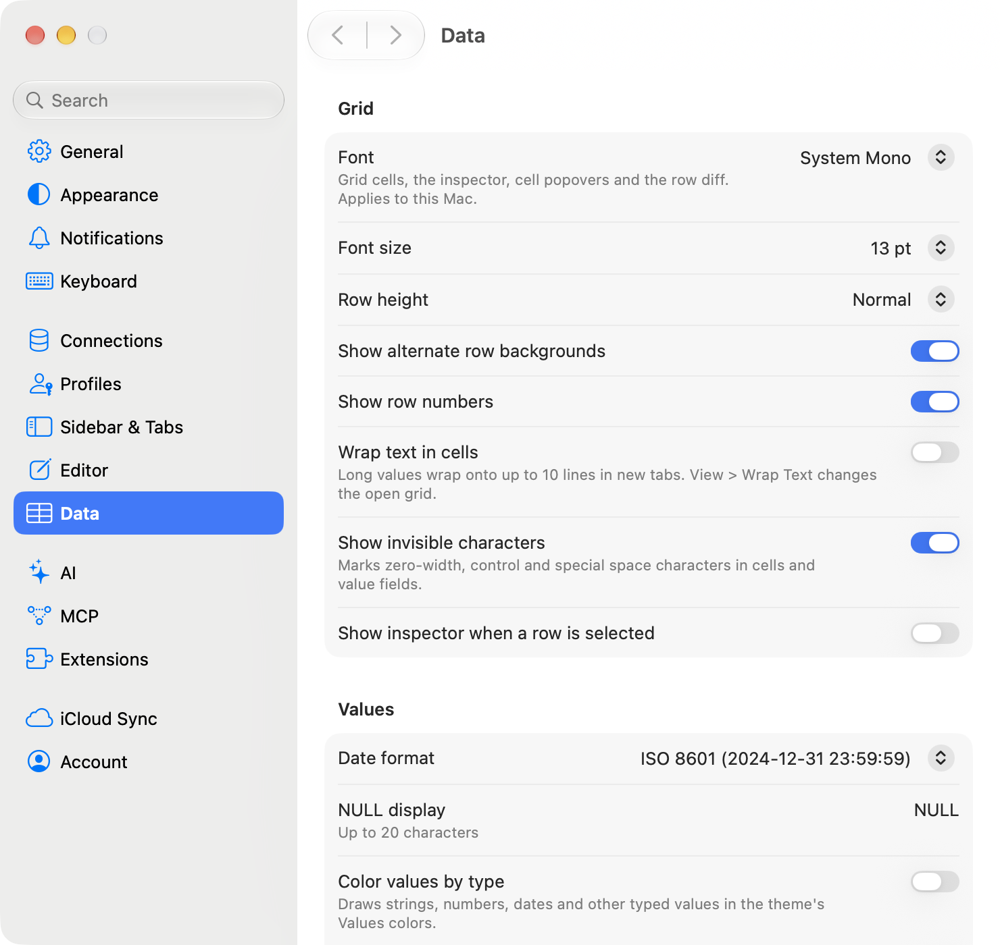
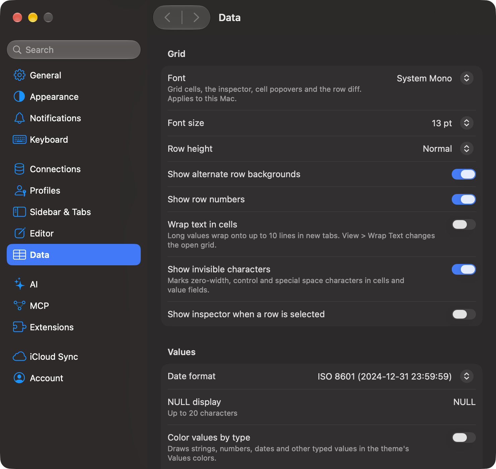

Browsing a table pages 1,000 rows at a time, and a query that returns more than 10,000 rows stops there. Both numbers, and the rest of what the grid does before you touch anything, are on **Settings > Data**.

The pane is app-wide, so these values apply to every connection you open; filters, column widths, and the sort you clicked are remembered per table instead. The font here is set per Mac, not per theme, and is not synced.

<Frame caption="The Data pane in Settings">
  
  
</Frame>

## Grid

| Setting | Default | Notes |
|---------|---------|-------|
| Font | System Mono | The monospaced families installed on your Mac. Applies to grid cells, the inspector, the cell popovers and the Compare row diff |
| Font size | 13 pt | 10 to 24 pt. With a data grid focused, `Cmd+=` and `Cmd+-` change the size over the same range |
| Row height | Normal | Compact, Normal, Comfortable, Spacious. A font too tall for the chosen height raises the rows to fit it |
| Show alternate row backgrounds | On | |
| Show row numbers | On | |
| Wrap text in cells | Off | New tabs open with long values wrapped onto up to 10 lines. Open tabs keep their own choice. See [Wrap text](/features/data-grid#wrap-text) |
| Show invisible characters | On | Marks zero-width, control and special space characters in cells and value fields. See [Invisible characters](/features/data-grid#invisible-characters) |
| Show inspector when a row is selected | Off | Opens the inspector on selecting a row, in a query result as well as a table. A pane you left on the assistant stays on it |

## Values

| Setting | Default | Notes |
|---------|---------|-------|
| Date format | ISO 8601 | ISO 8601, ISO Date, US Long, US Short, EU Long, EU Short. Sub-second digits and a UTC offset stored with the value are printed wherever the format renders a time, as the server wrote them: `2024-12-31 23:59:59.123456+07`. A value stored without an offset, such as a MySQL `DATETIME`, never gains one, and a fraction of nothing but zeros is not printed |
| NULL display | `NULL` | Text shown for NULL cells, up to 20 characters. Press `Return` or leave the field to apply it, or `Escape` to go back to the saved text. An empty field restores `NULL` |
| Color values by type | Off | Draws strings, numbers, dates, binary, JSON, UUID and enum values in the theme's **Values** colors. See [Appearance](/customization/appearance#editing-a-theme) |
| Smart value detection | On | Reads id-like binary columns as UUIDs, timestamp-named integer columns as dates, and binary columns holding UTF-8 as text. Override per column with Display As, see [Cell and Row Viewers](/features/json-viewer) |
| Default JSON view | Text | Text or Tree. Switching modes inside the [JSON viewer](/features/json-viewer) writes the choice back to this setting |

## Sorting

| Setting | Default | Notes |
|---------|---------|-------|
| Default sort | Primary key | Or First column, No sorting (engine order). Applied when a table first opens; a table with no primary key keeps the engine's order; clicking a column header overrides it |
| Sort direction | Ascending | Or Descending. Sets the default sort's direction and which way the first click on a column header sorts |

## Copying

| Setting | Default | Options |
|---------|---------|---------|
| Copy rows as | TSV | TSV, TSV with Headers, JSON, CSV, CSV with Headers, Markdown |

`Cmd+C` writes this format for whole rows, picked by their row numbers or with `Cmd+A`, in any grid that shows rows of data; the Structure tab keeps copying its columns and indexes. A cell range copies as tab-separated cells, and a clicked cell as its value. Every format, IN Clause and the statements included, is also under **Edit > Copy Special** and the grid's **Copy as** menu; see [Copying](/features/data-grid#copying).

## Pages and limits

| Setting | Default | Options |
|---------|---------|---------|
| Page size | 1,000 rows | 100, 500, 1,000, 5,000, 10,000 rows |
| Exact row count | Under 100,000 rows | Under 1,000, 10,000, 100,000 or 1,000,000 rows, or Always |
| Query result limit | 10,000 rows | No limit; 100; 1,000; 5,000; 10,000; 50,000; 100,000; 500,000 rows |
| Results kept per run | No limit | No limit; 10; 20; 50; 100; 200; 500; 1,000 |

### Exact row count

Tables with more estimated rows than the threshold show an approximate count instead of running a slow `COUNT(*)`. A table or view with no estimate is counted up to the threshold. Past it the total stays blank until you click **Count Exactly**. **Always** runs the full `COUNT(*)` whatever the table's size.

A total stays in place while you page through the table, and is counted again when you refresh or change the filters. A save counts it again, except past the threshold, where the total stays as an estimate. Spanner, Cloudflare D1 and SurrealDB tables are counted only through **Count Exactly**, because a count there reads the whole table.

### Query result limit

The limit applies to the rows read back, not the statement: your SQL reaches the server exactly as you typed it, and a query carrying its own `LIMIT` is untouched. **No limit** reads every row. What a limited result offers instead is in [Query Results](/features/query-results#the-row-cap).

### Results kept per run

A run that returns more results with rows keeps only the newest ones, and each of them reads, for example, "150 earlier results were dropped." under the grid. The statements that return no rows share one result and never count, and pinned results always stay. A change leaves the results on screen as they are. On SQL Server one batch keeps at most 100 result sets whatever the setting: the first 100 when it returns more, the last 100 across its `GO 5` repeats.

## Query history

Click **Query History** at the bottom of the pane.

| Setting | Default | Description |
|---------|---------|-------------|
| **Remove old entries automatically** | On | Applies the two limits under it at launch, every 100 queries and when a limit changes. Turn it off and nothing is pruned |
| **Maximum entries** | 10,000 | 100 to 10,000, or No limit. Dimmed while the switch is off |
| **Keep entries for** | 90 days | 7 days to 1 year, or Forever. Earlier versions of query tabs are kept this long too, up to 30 days |

**Clear History…**, on the **Clear query history** row, wipes all history, for every connection, after confirmation. It also clears the saved changes kept for [Data Rewind](#data-rewind) and the [earlier versions](/features/sql-editor#earlier-versions) of query tabs.

To clear only what you are looking at, use the trash button in the history drawer instead: it respects the drawer's connection scope and date range.

## Data Rewind

Pro license. Click **Data Rewind** at the bottom of the pane; the row says **On** or **Off**. What a row held before a save is kept here, so [Restore Previous Values](/features/change-tracking#restoring-a-save) has something to put back.

| Setting | Default | Description |
|---------|---------|-------------|
| **Keep saved changes for restoring** | On | Off stops the capture. Saves made while it is off cannot be restored later |

**Clear Saved Changes…**, on the **Clear saved changes** row, deletes everything kept, for every connection, after confirmation. It works without a license too.

Values are stored encrypted on this Mac, for 7 days, and never leave it. A save is dropped early when it is over 32 MB in total, or when its table already has 50 newer ones.
