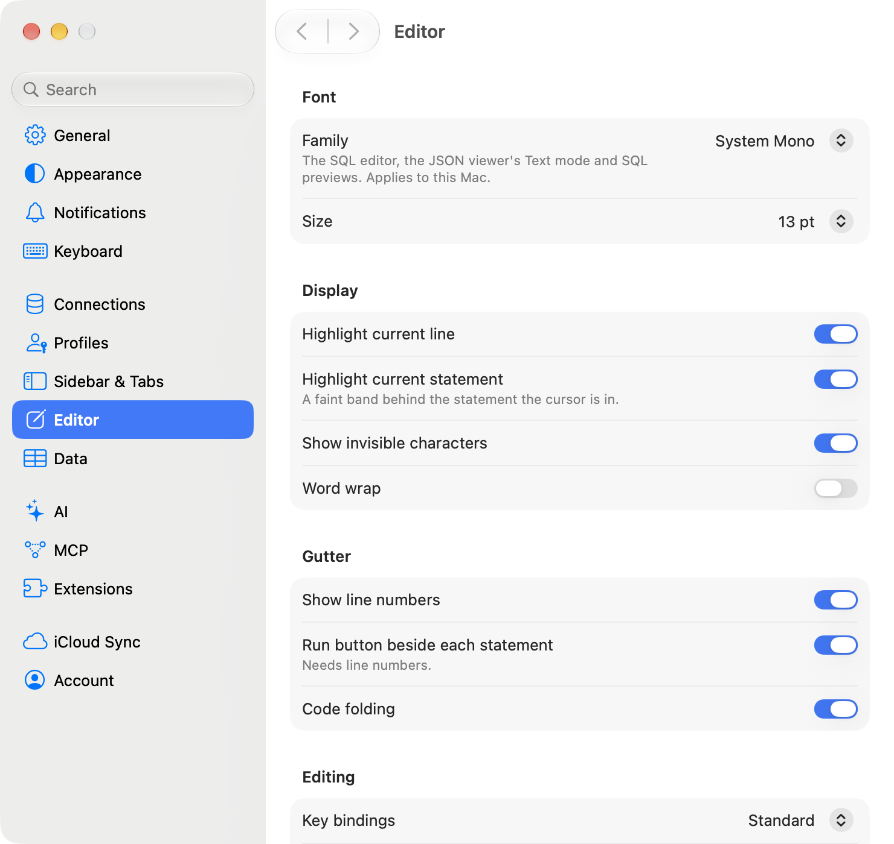
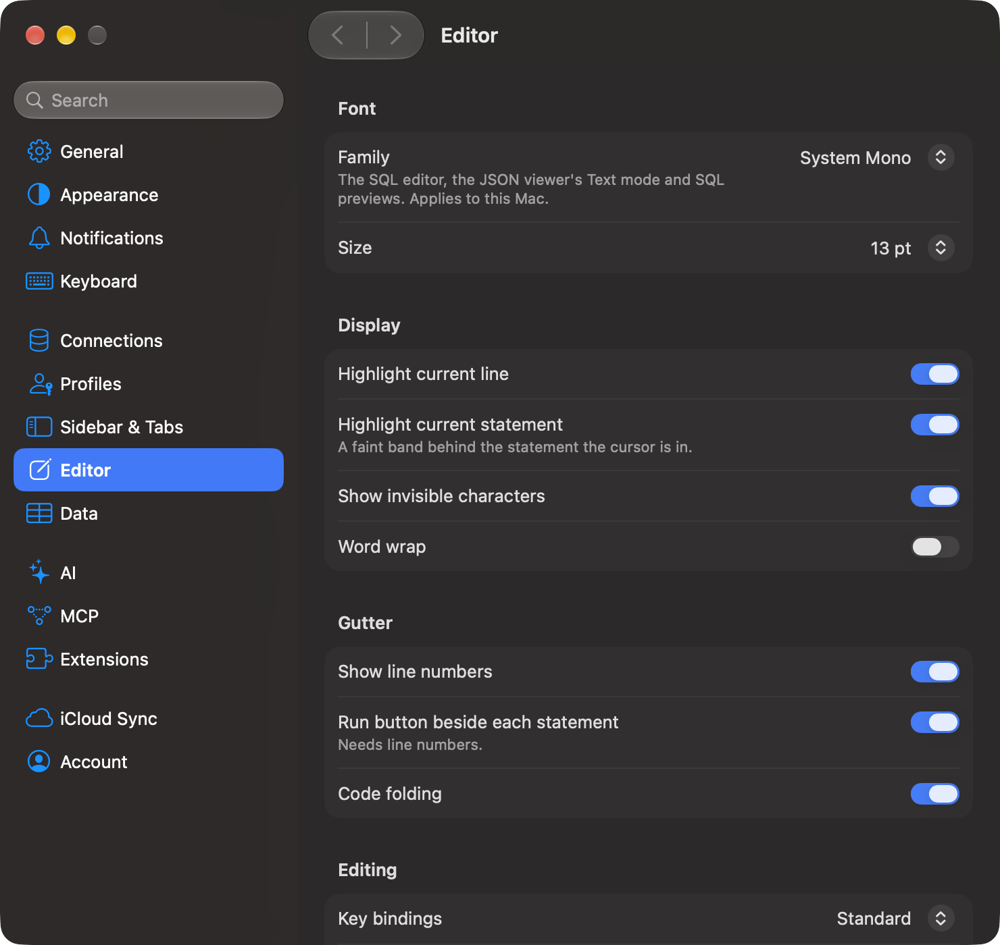
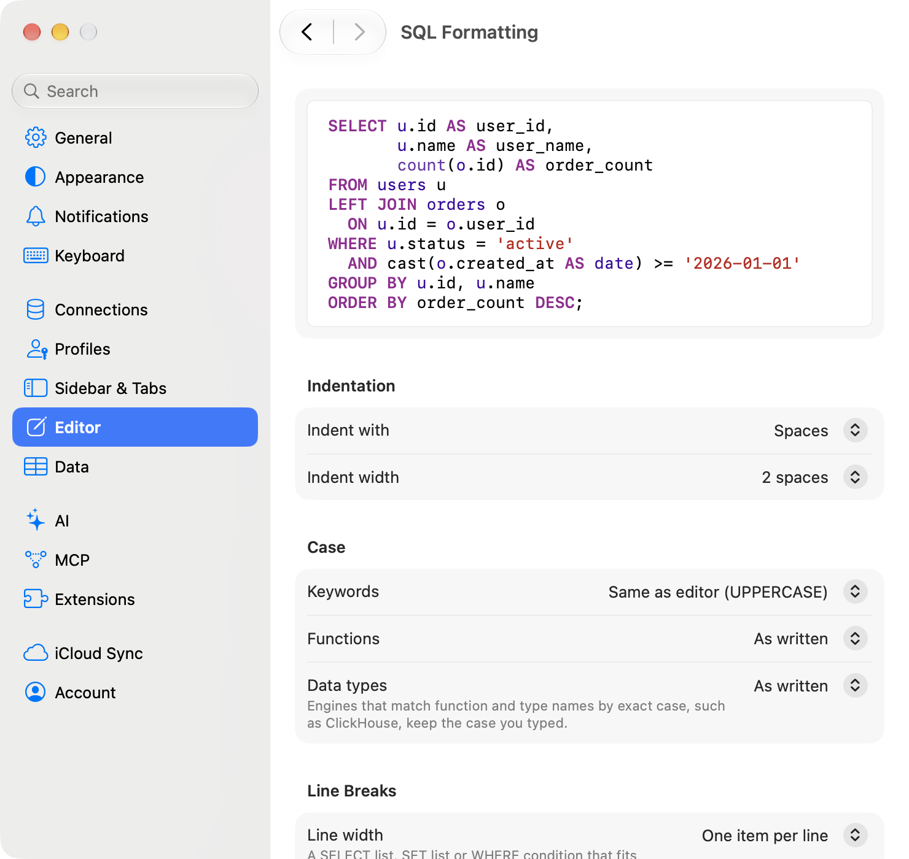
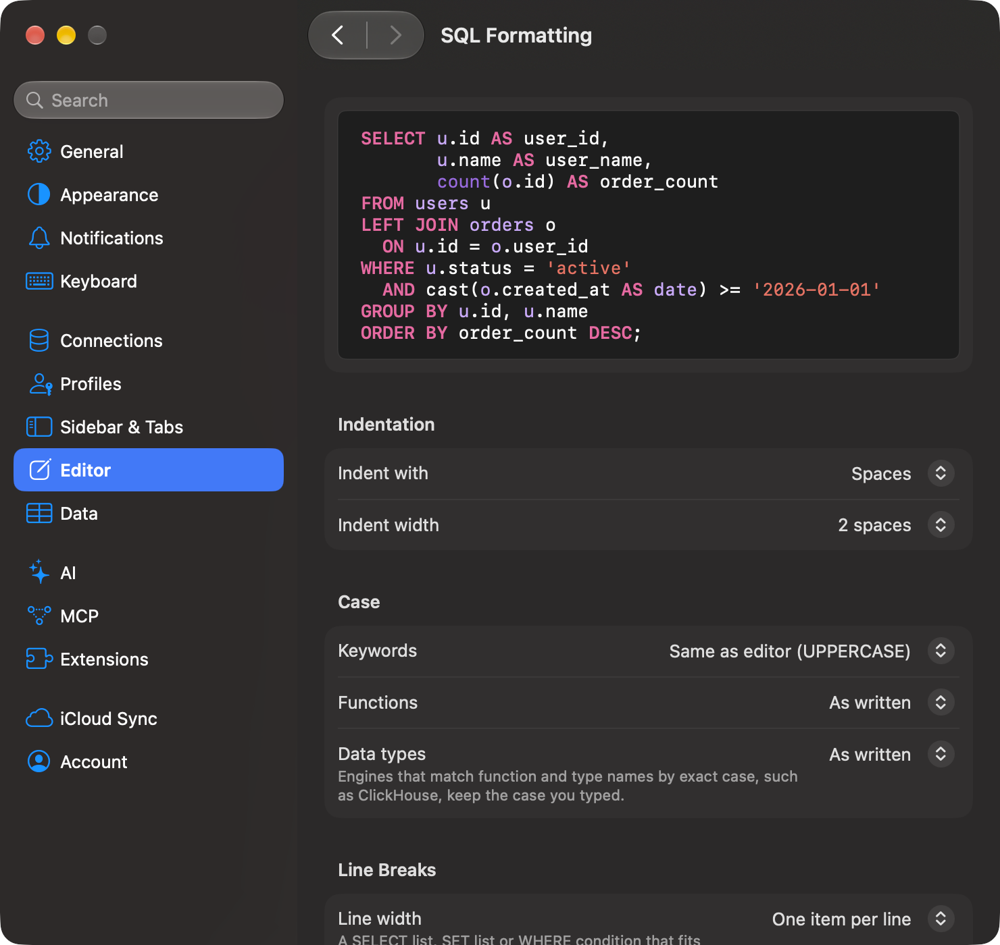

**Settings > Editor** covers typing and how SQL is displayed. Grid, page size, result limit and JSON viewer settings are on the [Data](/customization/data-settings) pane instead.

The font here is set per Mac, not per theme, and is not synced.

<Frame caption="Editor settings">
  
  
</Frame>

## Font

| Setting | Default | Notes |
|---------|---------|-------|
| Family | System Mono | The monospaced families installed on your Mac. Applies to the SQL editor, the JSON viewer's Text mode, and the DDL, trigger and import previews |
| Size | 13 pt | 10 to 24 pt. `Cmd+=` and `Cmd+-` change the size over the same range, except while a diagram or a data grid has focus |

## Display

| Setting | Default | Notes |
|---------|---------|-------|
| Highlight current line | On | |
| Highlight current statement | On | A faint band behind the statement the cursor is in. See [Statement markers](/features/sql-editor#statement-markers) |
| Show invisible characters | On | See [Invisible characters](/features/sql-editor#invisible-characters) |
| Word wrap | Off | Off means long lines scroll horizontally |

## Gutter

| Setting | Default | Notes |
|---------|---------|-------|
| Show line numbers | On | Off removes the gutter, and the run buttons with it |
| Run button beside each statement | On | Gutter run buttons, revealed when the pointer is over the gutter. Dimmed while line numbers are off |
| Code folding | On | Shows the fold ribbon in the gutter. See [Code Folding](/features/code-folding) |

## Editing

| Setting | Default | Notes |
|---------|---------|-------|
| Key bindings | Standard | **Vim** for modal editing, see [Vim Mode](/features/vim-mode); **Emacs** for Emacs movement, kill and yank, see [Emacs Mode](/features/emacs-mode) |
| Tab width | 4 spaces | 2, 4, or 8 |
| Keyword case | Match what I type, otherwise UPPERCASE | The case completed keywords and functions take. `UPPERCASE` and `lowercase` also rewrite keywords as you type them, leaving strings, comments and quoted identifiers untouched. **Format Query** follows it while the formatter's own **Keywords** case is **Same as editor**. See [Keyword case](/features/autocomplete#keyword-case) |
| Query parameters | On | Detects `:name` placeholders and asks for their values before the query runs. See [Query Parameters](/features/query-parameters) |

Autocomplete is always on; see [Autocomplete](/features/autocomplete). Editor shortcuts are listed and customized on [Keyboard Shortcuts](/features/keyboard-shortcuts).

## SQL formatting

**Query > Format Query** (`Cmd+Shift+L`) follows these rules. Click **SQL Formatting** at the bottom of the Editor pane to open them. The preview at the top of the page formats a sample statement with them, in the editor theme. The defaults produce the layout shown under [Formatting](/features/sql-editor#formatting).

<Frame caption="Each change shows in the preview at once">
  
  
</Frame>

| Section | Setting | Default | Notes |
|---------|---------|---------|-------|
| Indentation | Indent with | Spaces | Tabs indent each level with one tab, then line items up with spaces |
| Indentation | Indent width | 2 spaces | 2, 4 or 8, or **Same as editor**, which follows **Tab width** under Editing. With **Tabs**, the widths read as columns |
| Case | Keywords | Same as editor | `UPPERCASE`, `lowercase`, or **As written**. **Same as editor** writes `lowercase` when **Keyword case** under Editing prefers lowercase, otherwise `UPPERCASE` |
| Case | Functions | As written | Applies to a call, `count(*)`, never to a column that shares a function's name. ClickHouse keeps the case you typed, since it matches function names by exact case |
| Case | Data types | As written | Applies to type names such as `date` in `CAST(x AS date)` and in column definitions. ClickHouse keeps the case you typed, since it matches type names by exact case |
| Line Breaks | Line width | One item per line | At 80, 100 or 120 characters, a SELECT list, SET list or WHERE condition that fits stays on one line |
| Line Breaks | Clause items | Beside the keyword | **Below the keyword** starts a broken SELECT list, SET list, WITH list, or WHERE or HAVING condition on the line under its keyword, one level in. A single item stays beside its keyword |
| Line Breaks | Commas | At the end of the line | **At the start of the line** puts `, ` before each item of a SELECT list, SET list and CREATE TABLE column list |
| Line Breaks | AND and OR | At the start of the line | **At the end of the line** ends each broken line of a WHERE or HAVING condition with its `AND` or `OR` |
| Line Breaks | Join condition | On its own line | **On the JOIN line** writes `LEFT JOIN orders o ON u.id = o.user_id` |
| Line Breaks | Align column aliases | Off | Lines up the `AS` of each SELECT item that sits on one line |

**Restore Defaults**, at the bottom of the page, puts every formatting rule back.

### Share the rules

Click **Export…** on the **Rules file** row to save the rules as `sql-formatter.json`. The file holds the resolved values: a width that follows **Tab width** is written as the number, and **Same as editor** as the case it means, so the file formats the same on every Mac. Click **Import…** on another Mac to load it into Settings.

To apply the rules to a [linked SQL folder](/features/favorites#linked-sql-folders) instead, save the file in that folder as `.sql-formatter.json`. A file opened from the folder then formats with it rather than with Settings. The nearest `.sql-formatter.json` wins, from the file's own folder up to the linked folder; nothing above the linked folder is read. A rules file that cannot be read stops Format Query with an error naming it.

The npm `sql-formatter` package reads the same file, so one `.sql-formatter.json` drives both tools.

```json
{
  "alignAliases" : false,
  "clauseItems" : "sameLine",
  "commaPlacement" : "trailing",
  "dataTypeCase" : "preserve",
  "functionCase" : "preserve",
  "joinCondition" : "newLine",
  "keywordCase" : "upper",
  "lineWidth" : 0,
  "logicalOperatorNewline" : "before",
  "tabWidth" : 2,
  "useTabs" : false
}
```

| Key | Values | `sql-formatter` reads it |
|-----|--------|--------------------------|
| `useTabs` | `true`, `false` | Yes |
| `tabWidth` | 1 to 16 | Yes |
| `keywordCase`, `functionCase`, `dataTypeCase` | `upper`, `lower`, `preserve` | Yes |
| `logicalOperatorNewline` | `before`, `after` | Yes |
| `commaPlacement` | `trailing`, `leading` | No |
| `lineWidth` | 0 to 1000. 0 puts each item on its own line | No |
| `joinCondition` | `newLine`, `sameLine` | No |
| `clauseItems` | `sameLine`, `newLine` | No |
| `alignAliases` | `true`, `false` | No |

A key the file leaves out takes the default shown in the example, not your Settings value. For `keywordCase` that is `upper`, where `sql-formatter` keeps the case as written. A key only `sql-formatter` has, such as `language` or `expressionWidth`, is ignored. `indentStyle` takes `sql-formatter`'s values, `standard`, `tabularLeft` and `tabularRight`, and changes nothing here. Any value TablePro cannot read is an error that names its key.

### A rules file from TablePro 0.83

A file exported by 0.83 uses older key names. Format Query and **Import…** refuse it with "The value of “indentStyle” is not valid." Export it again from Settings, or rename the keys:

| 0.83 key | Key now |
|----------|---------|
| `indentStyle: "spaces"`, `indentStyle: "tabs"` | `useTabs: false`, `useTabs: true` |
| `indentWidth` | `tabWidth` |
| `commaPosition` | `commaPlacement` |

The other keys keep their names.
