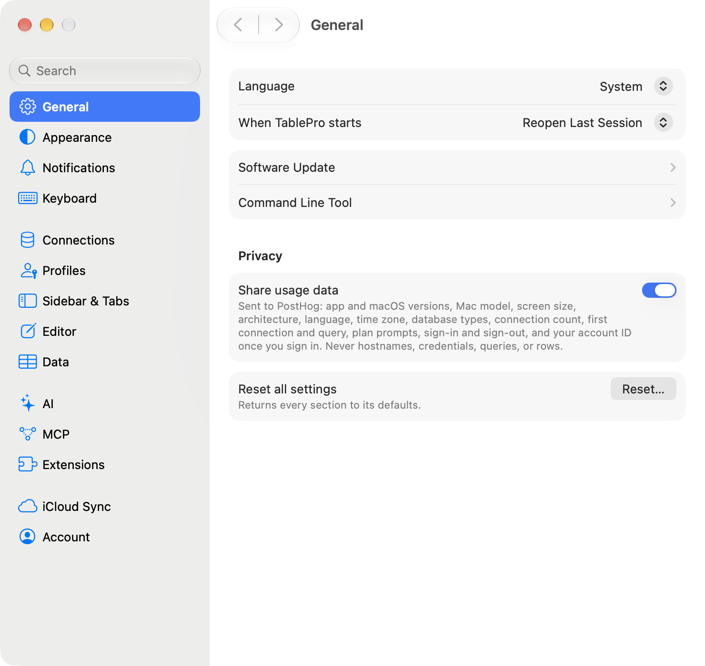
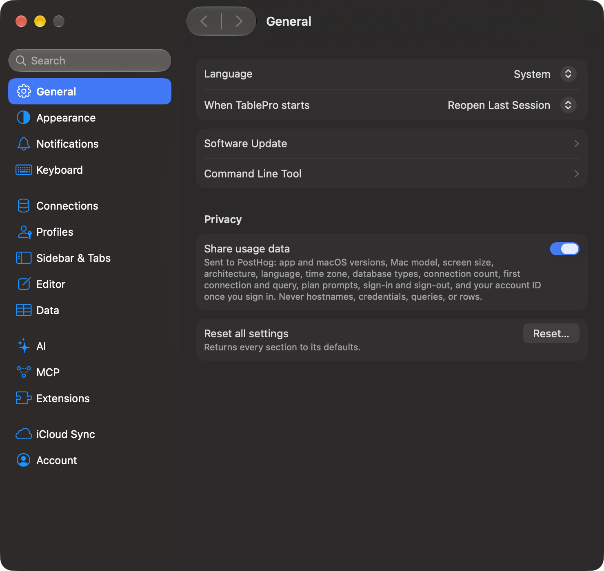

A new language waits for a relaunch. Everything else on this pane takes effect the moment you click. Sidebar, tab and connection settings have panes of their own: [Sidebar & Tabs](/customization/sidebar-and-tabs) and [Connections](/customization/connection-settings).

<Frame caption="The General pane">
  
  
</Frame>

## Language

System (the default), English, Tiếng Việt, 简体中文, 繁體中文, 한국어, Türkçe, Français. Pick a different one and the pane offers **Relaunch** to finish the switch.

## Startup

**When TablePro starts** takes **Reopen Last Session** (the default) or **Show Welcome Screen**. What a reopened session brings back, and what it does when a server is down, is on [Tabs](/features/tabs#what-survives-a-restart).

A relaunch from **Relaunch to Update**, or from a **Relaunch** button in Settings, reopens the last session once, whichever you pick.

## Software update

Click **Software Update** to open its page. The top row says where updates stand, and its button takes the next step:

| State | The row reads | Button |
|-------|---------------|--------|
| Nothing waiting | TablePro and your version, over "Last checked:" and a date, or "never" | **Check Now** |
| A background check found a version that has not downloaded | "TablePro … is available" | **Install Update…** opens the update window |
| A version downloaded in the background | "TablePro … is ready to install" | **Relaunch** |
| Plugin updates staged, no app update | "… updates when TablePro relaunches.", with the plugin's name and version, or a count for two or more | **Relaunch** |

**Check Now** and **TablePro > Check for Updates…** check at once. A check you start ignores the schedule and any staged rollout, so it always offers the newest build.

**What's New**, under the status row, opens the highlights of the version you are running, with a button to the full changelog. It is also **Help > What's New**.

The two switches under **Automatic Updates** are on out of the box. The first one stops the daily check, the second stops the install.

**Automatically check for updates** runs the check in the background once a day. Turn it off and nothing reaches the network until you start a check yourself.

**Download and install updates automatically** fetches the new version in the background and swaps it in the next time TablePro quits, with no dialog. Turn it off to be asked first. With the check switched off the switch is dimmed and installs never run.

**Update channel** is **Stable** out of the box. Pick **Beta** to be offered each new version as a beta before its stable release. [Beta updates](/beta-updates) covers going back to stable.

Updates arrive through [Sparkle](https://sparkle-project.org/) and are signature-checked before they install. An administrator can pin the channel, both switches and the interval across a fleet. See [Managed updates](/security/managed-updates).

### When an update is waiting

A waiting update shows in four places: a button at the trailing end of each connection window's title bar, a link under the version on the welcome window, the **TablePro > Check for Updates…** menu item, and **Software Update** in Settings, beside its row on the General pane and in the page's top row. There is no notification and no Dock badge. With nothing waiting, the button and the link are gone.

The button and the link take one of two names:

- **Update Available**: a background check found a new version that has not downloaded, which is what happens with **Download and install updates automatically** off. Click it to open the update window.
- **Relaunch to Update**: a new version downloaded in the background, or plugin updates are staged. In a connection window it opens a popover with the version, **Release Notes**, the plugins that update too, **Later** and **Relaunch Now**. On the welcome window it relaunches straight away.

The menu item follows the same state: **Check for Updates…**, **Update Available…** or **Relaunch to Update**. So do the button on a plugin that needs a newer app, in **Settings > Extensions**, and the one on the iCloud **Update Required** notice.

A relaunch quits the usual way: unsaved edits and a running sync still ask first, and backing out leaves the update waiting. Otherwise a downloaded update installs, staged plugins load, and TablePro opens on your last session.

## Command line tool

Click **Command Line Tool** for a page that shows whether the `tablepro` command links to this copy of the app, with the Terminal line to install or remove the link. See [Terminal](/integrations/terminal#install) for installation and commands.

## Privacy

Turn off **Share usage data** under **Privacy** to stop app usage events. It starts on. From 0.86.0, events go directly to PostHog and can link to your account. The switch does not stop account requests or server analytics. [Privacy](/security/privacy#usage-data) lists the fields and older-version behavior.

## Reset

Click **Reset…** on the **Reset all settings** row at the bottom of the pane. What it restores and what it leaves alone is under [Where settings live](/customization/settings#where-settings-live).
