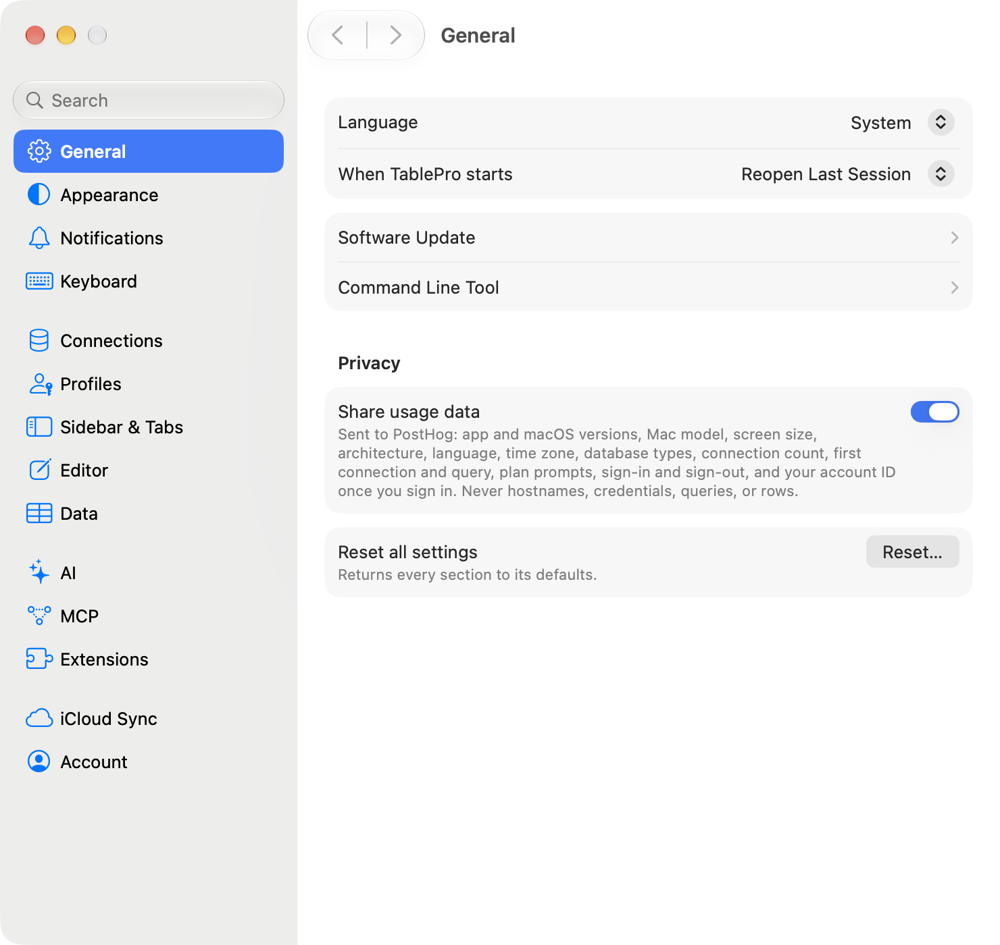
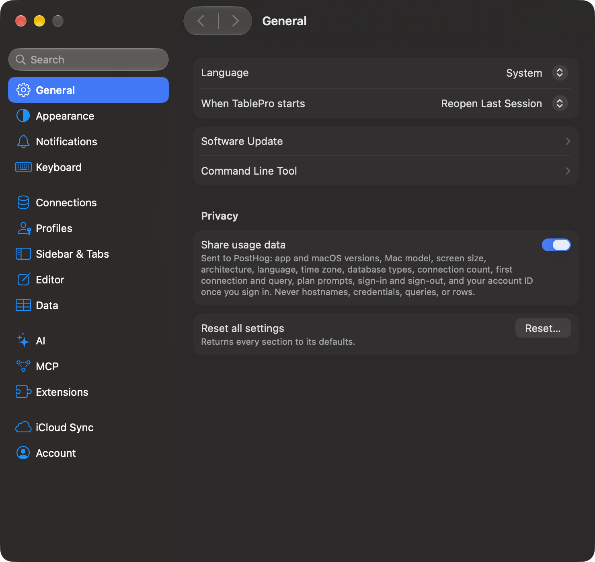

The settings window is app-wide: a value on any pane holds for every connection you open. `Cmd+,` opens it; what belongs to one connection is in that connection's form instead.

<Frame caption="Panes in the sidebar, the selected one on the right">
  
  
</Frame>

## Find a setting

Type in the search field at the top of the sidebar. It matches pane names, the labels on each pane, page names such as **Linked Folders**, and the names of your plugins and AI providers. A matching page is listed under its pane; select it to go straight there. Press `Escape` to clear the search.

A row with a chevron opens a page of its own. **Back** and **Forward** in the toolbar step through the panes and pages you visited, as do **View > Back** (`Ctrl+Cmd+[`) and **View > Forward** (`Ctrl+Cmd+]`). Closing the window clears the history, and the next `Cmd+,` opens the pane you last picked in the sidebar.

A link can open any pane or page directly: see [Open a settings pane](/developers/url-scheme#open-a-settings-pane).

## Panes

<CardGroup cols={2}>
  <Card title="General" icon="gear" href="/customization/general-settings">Language, startup, software update, the command line tool, privacy, reset.</Card>
  <Card title="Appearance" icon="palette" href="/customization/appearance">Appearance mode, light and dark themes, Manage Themes.</Card>
  <Card title="Notifications" icon="bell" href="/customization/notifications">Notifications for work that finishes out of sight.</Card>
  <Card title="Keyboard" icon="keyboard" href="/features/keyboard-shortcuts#customizing-shortcuts">Custom shortcuts.</Card>
  <Card title="Connections" icon="plug" href="/customization/connection-settings">Connection checks, query timeout, recent connections, linked folders, trusted links.</Card>
  <Card title="Profiles" icon="id-card" href="/connections/credential-profiles">Credential profiles and SSH profiles, and which connections use each.</Card>
  <Card title="Sidebar & Tabs" icon="table-columns" href="/customization/sidebar-and-tabs">Connections strip, sidebar objects, layout, preview tabs.</Card>
  <Card title="Editor" icon="code" href="/customization/editor-settings">SQL editor, key bindings, gutter, SQL formatting.</Card>
  <Card title="Data" icon="table" href="/customization/data-settings">Data grid, values, sorting, page size, result limit, query history, Data Rewind.</Card>
  <Card title="AI" icon="sparkles" href="/features/ai-assistant">Providers, inline suggestions, context, slash commands, default AI policy.</Card>
  <Card title="MCP" icon="network-wired" href="/features/mcp">MCP server, approvals, tokens, clients, outside servers.</Card>
  <Card title="Extensions" icon="puzzle-piece" href="/features/plugins">Modules, drivers and formats.</Card>
  <Card title="iCloud Sync" icon="cloud" href="/features/icloud-sync">iCloud sync and what it carries.</Card>
  <Card title="Account" icon="key" href="/features/licensing">Sign-in, plan, devices, teams, offline file and license key.</Card>
</CardGroup>

## Stock values

What a fresh install ships with, so one glance down this column says what you changed. Each pane's page explains what a setting does and which other values it takes.

| Pane | Setting | Default |
|------|---------|---------|
| General | Language | System |
| General | When TablePro starts | Reopen Last Session |
| General | Share usage data | On |
| General > Software Update | Automatically check for updates | On |
| General > Software Update | Download and install updates automatically | On |
| General > Software Update | Update channel | Stable |
| Appearance | Appearance | System |
| Appearance | Light theme | Default Light |
| Appearance | Dark theme | Default Dark |
| Notifications | Show notifications | On |
| Notifications | Treat work as long-running after | 20 seconds |
| Connections | Check open connections | Every 30 seconds |
| Connections | Query timeout | 1 minute |
| Connections | Show recent connections | On |
| Sidebar & Tabs | Show connections | On |
| Sidebar & Tabs | Show recent tables | Off |
| Sidebar & Tabs | Default layout | List |
| Sidebar & Tabs | Show icons | On |
| Sidebar & Tabs | Show comments | On |
| Sidebar & Tabs | Show system databases and schemas | Off |
| Sidebar & Tabs | Show partitions | On |
| Sidebar & Tabs | Row size | Match System |
| Sidebar & Tabs | Enable preview tabs | On |
| Editor | Family | System Mono |
| Editor | Size | 13 pt |
| Editor | Highlight current line | On |
| Editor | Highlight current statement | On |
| Editor | Show invisible characters | On |
| Editor | Word wrap | Off |
| Editor | Show line numbers | On |
| Editor | Run button beside each statement | On |
| Editor | Code folding | On |
| Editor | Key bindings | Standard |
| Editor | Tab width | 4 spaces |
| Editor | Keyword case | Match what I type, otherwise UPPERCASE |
| Editor | Query parameters | On |
| Data | Font | System Mono |
| Data | Font size | 13 pt |
| Data | Row height | Normal |
| Data | Show alternate row backgrounds | On |
| Data | Show row numbers | On |
| Data | Wrap text in cells | Off |
| Data | Show invisible characters | On |
| Data | Show inspector when a row is selected | Off |
| Data | Date format | ISO 8601 |
| Data | NULL display | `NULL` |
| Data | Color values by type | Off |
| Data | Smart value detection | On |
| Data | Default JSON view | Text |
| Data | Default sort | Primary key |
| Data | Sort direction | Ascending |
| Data | Copy rows as | TSV |
| Data | Page size | 1,000 rows |
| Data | Exact row count | Under 100,000 rows |
| Data | Query result limit | 10,000 rows |
| Data | Results kept per run | No limit |
| Data > Query History | Remove old entries automatically | On |
| Data > Query History | Maximum entries | 10,000 |
| Data > Query History | Keep entries for | 90 days |
| Data > Data Rewind | Keep saved changes for restoring | On |
| AI | Enable AI features | On |
| AI | Suggest SQL while typing | Off |
| AI | Delay | 500 ms |
| AI | Limit tool calls per reply | On |
| AI | Tool call limit | 25 |
| AI | Include database schema | On |
| AI | Maximum tables | 20 |
| AI | Include current query | On |
| AI | Include query results | Off |
| AI | Default AI policy | Ask Each Time |
| MCP | MCP server | Off |
| MCP | Approval | Ask Once for Each Connection |
| MCP | Allow apps to list connections hidden from AI | Off |
| MCP | Port | 23508 |
| MCP | Default row limit | 500 |
| MCP | Maximum row limit | 10,000 |
| MCP | Query timeout | 30 seconds |
| MCP | Log MCP queries in history | On |
| Extensions | Routine Debugger | Off |
| Extensions | Live Messages | Off |
| Extensions | Compare & Sync | Off. On for a Mac that ran an earlier version |
| iCloud Sync | Sync this Mac with iCloud | Off |
| iCloud Sync | Passwords | Off |

Keyboard, Profiles and Account are not in the table. Stock keyboard chords are on [Keyboard Shortcuts](/features/keyboard-shortcuts), and Profiles and Account hold no value of their own.

## Where settings live

The file is `~/Library/Preferences/com.TablePro.plist`. **Reset…** beside **Reset all settings** on the General pane puts every pane back to its stock value after a confirmation, and turns iCloud sync off, password sync included. Each module goes back to the default it had on that Mac. Saved connections, AI providers with their API keys, the **Enable AI features** switch, **Share usage data**, linked folders, trusted links, query history, and MCP tokens survive it.
