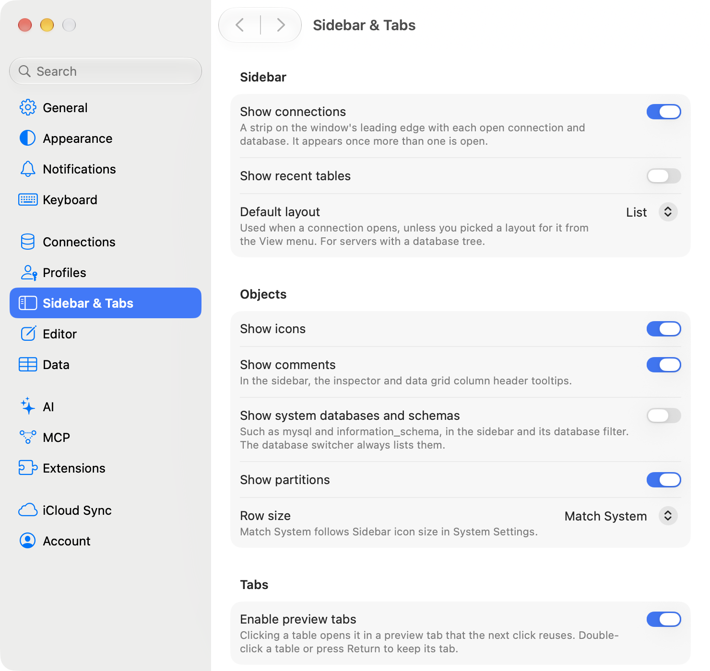
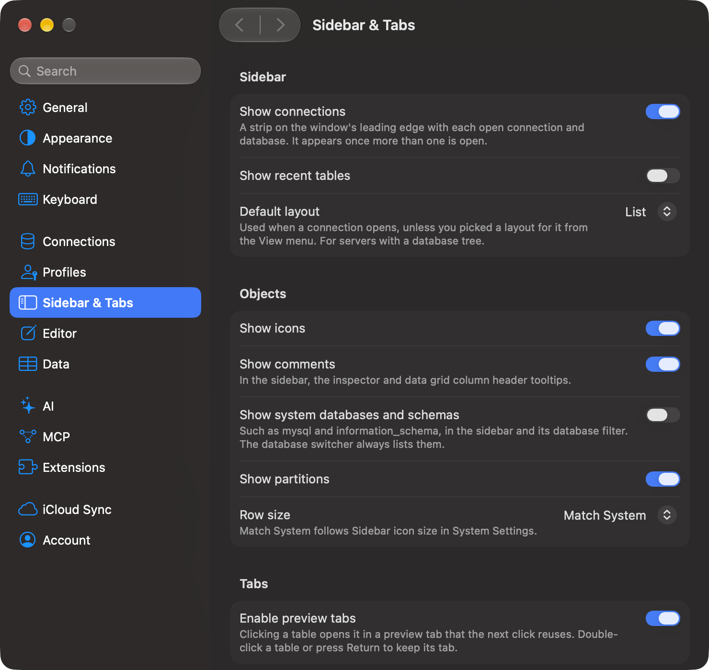

Changes reach every connection window at once, except **Default layout**, which a connection reads when it opens. Icons, comments, system databases and schemas, partitions, and row size are also under **View Options**, the button beside the sidebar's filter field, and right-clicking the empty space below the object list reaches the same options. Both places change the same setting.

<Frame caption="Every value at its default">
  
  
</Frame>

## Sidebar

| Setting | Default | What it does |
|---------|---------|--------------|
| **Show connections** | On | The [connections strip](/features/workspace-rail) on the window's leading edge. It appears once more than one connection or database is open |
| **Show recent tables** | Off | A [Recent section](/features/favorites#recent-tables) at the top of the sidebar |
| **Default layout** | List | List or Tree, on servers with a database tree. Used when a connection opens, unless you picked a layout for that connection from the **View** menu |

## Objects

| Setting | Default | What it does |
|---------|---------|--------------|
| **Show icons** | On | A type icon before each object name. Off gives a plain list of names |
| **Show comments** | On | Database object comments beside tables in the sidebar, in the inspector, and in a grid column header's tooltip |
| **Show system databases and schemas** | Off | `mysql`, `information_schema`, `master` and the other system databases and schemas in the sidebar tree and its database and schema filters. The database switcher lists them either way |
| **Show partitions** | On | A partitioned table's partitions listed under it, and how many it holds beside its name |
| **Row size** | Match System | Match System follows **Sidebar icon size** in **System Settings > Appearance**. Small, Medium, or Large overrides it to fit more objects on screen |

## Tabs

**Enable preview tabs** is on out of the box. Clicking a table opens it in a preview tab that the next click reuses; double-click a table, or select it and press `Return`, to keep its tab. When a preview tab turns permanent on its own is under [Preview tabs](/features/tabs#preview-tabs).
