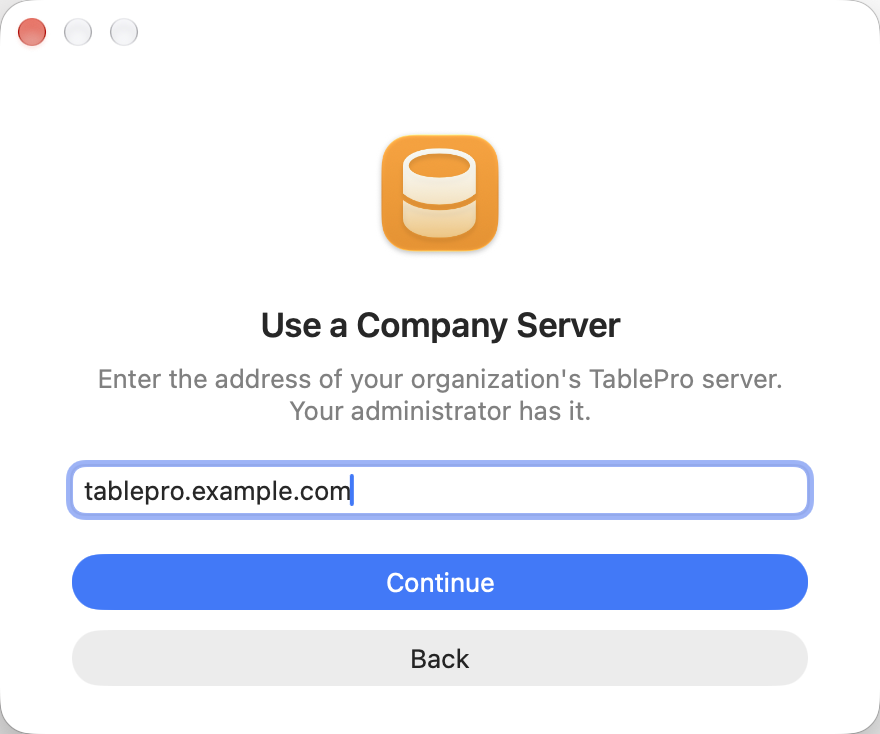
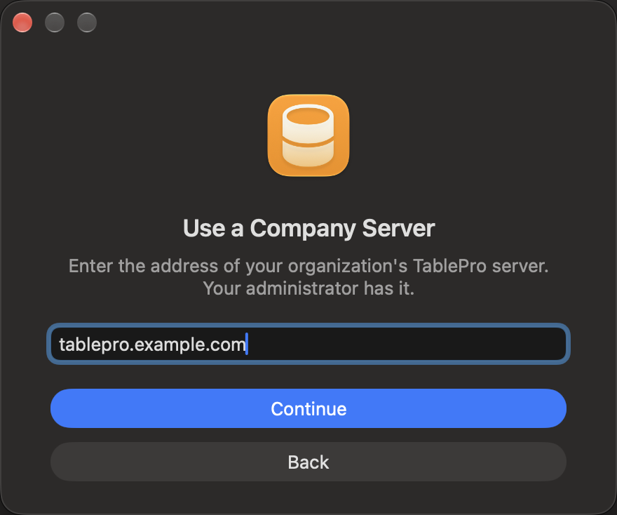

An organization on [Enterprise Self-Hosted](/features/licensing#enterprise-self-hosted) runs its own [TablePro server](/self-hosted). People sign in to it with the company's identity provider, and Team Library and [TablePro Sync](/features/sync) go through it instead of tablepro.app.

## Sign in to a company server

<Steps>
  <Step title="Open the sign-in window">
    Signed out, click **Sign In** on the welcome window, or open **Settings > Account** and click **Use a Company Server…**.
  </Step>
  <Step title="Click Use a Company Server…">
    It sits under **Sign In** in the sign-in window.
  </Step>
  <Step title="Enter the server's address">
    Type the address your administrator gave you, such as `tablepro.example.com`, and click **Continue**. An address without `https://` gets it. The Mac checks that the address answers as a TablePro server with a valid license before it opens the sign-in page.
  </Step>
  <Step title="Sign in with your work account">
    The sign-in sheet opens on your company's sign-in page.
  </Step>
</Steps>

<Frame caption="Use a Company Server in the sign-in window">
  
  
</Frame>

<Check>
**Settings > Account** shows **Server** with the server's host, and the license installed on it with its seats and end date.
</Check>

Signing in to a company server signs the Mac out of the server it used before, and Team Library drops what it read from that server. To go back, click **Use TablePro's Server Instead** in the sign-in window.

### When the address is refused

| Message | What to check |
|---|---|
| Enter the server's https address | The address must be `https://`, with no path |
| This address does not answer as a TablePro server | The address is the server's API address, not its portal. Ask your administrator |
| This server has no TablePro license installed | The administrator installs one with `tablepro-cloud license install` |
| This server's TablePro license is not valid for this server | The license names another address, or was not issued by TablePro |

## What is different on a company server

- **Shared links** are a tablepro.app service. Signed in to a company server, **File > Share Query…**, **Share Result…**, **Manage Shared Links…** and every **Share…** item are hidden. A link someone sends still opens, unless your organization sets `AllowOtherAccountServers` to `false`.
- **Plans and billing** belong to your organization. Gates name the feature and point to your administrator instead of a purchase, and **Settings > Account** has no **Upgrade…**, **Billing…**, **Use License Key…** or offline file.
- **Devices** have no 3-device limit. Every seat includes Pro.
- **TablePro Sync** keeps your own data on your organization's server, as [Personal sync and Team Library](/self-hosted/sync) describes. Your administrator can keep passwords, query history or all of it off the server.
- **After the license expires**, everything keeps working through its grace, which **Settings > Account** shows under **License**. After that, Team Library and TablePro Sync only download: the server refuses your changes, which wait on the Mac and go out once the license is renewed. Signing out and approving or removing devices still work.

## Set the server for every Mac

An administrator sets these keys with a configuration profile for the `com.TablePro` domain, delivered by an MDM such as Jamf or Kandji. They need TablePro 0.89.0 or later; the first build with them is 0.89.0-beta.2. A key counts only when the profile forces it; the same key written with `defaults write` is ignored. A value of another type is ignored, and TablePro logs why. A Boolean that is `true` or left out leaves the person's own setting.

| Key | Type | Effect |
|---|---|---|
| `com.TablePro.policy.AccountServerURL` | String | The company server's address. The Mac signs in to it unless the person picks another, and **Settings > Account** says your organization manages it |
| `com.TablePro.policy.AllowOtherAccountServers` | Boolean | `false`, with `AccountServerURL` set, hides tablepro.app and **Use a Company Server…**, so the Mac signs in only to the managed server. It also keeps the Mac off tablepro.app: a shared link from tablepro.app does not open, and the AI model list stops refreshing, so the list the app shipped with, or the last one it kept, stays in use. On its own it is ignored |
| `com.TablePro.policy.PersonalSyncProvider` | Array of strings | Where the Mac may sync your own data: `off`, `icloud` or `tablepro-sync`, spelled exactly. One entry sets it and locks **Sync this Mac with** under **Settings > Sync**. Several let the person pick among them. An empty array turns sync off and locks it. A required TablePro Sync waits for the person to review the first upload, and a required iCloud on a Mac already on TablePro Sync waits for them to review the move back. A required iCloud on a Mac with sync off starts at once. A release without TablePro Sync leaves `tablepro-sync` out of the list. Team Library is not affected |
| `com.TablePro.policy.ICloudSyncAllowed` | Boolean | `false` turns iCloud sync off and takes **iCloud** out of **Sync this Mac with**. Passwords saved from then on stay on this Mac. Passwords already in iCloud Keychain stay there and still work, and the data already in iCloud stays |
| `com.TablePro.policy.UsageDataAllowed` | Boolean | `false` turns **Settings > General > Privacy > Share usage data** off and locks it |
| `com.TablePro.policy.PluginCatalogAllowed` | Boolean | `false` stops the plugin registry: no plugin is downloaded, installed or updated from it. Plugins already installed keep loading. A connection whose plugin is not installed says your organization manages plugins, so install the plugins people need before you set the key |

<Note>
TablePro reads the profile at launch and again when macOS installs or removes one. When iCloud stops being allowed, sync stops at once and stays off after the profile goes; the person chooses it again in **Settings > Sync**. When the new values no longer allow the server the Mac is signed in to, TablePro stops calling that server until it is relaunched.
</Note>

Software updates have keys of their own: [Managed updates](/security/managed-updates). **Check for Updates…** still reads the update feed when a person picks it.

A sample profile, with your own address and identifiers:

```xml
<?xml version="1.0" encoding="UTF-8"?>
<!DOCTYPE plist PUBLIC "-//Apple//DTD PLIST 1.0//EN" "http://www.apple.com/DTDs/PropertyList-1.0.dtd">
<plist version="1.0">
<dict>
    <key>PayloadType</key>
    <string>Configuration</string>
    <key>PayloadVersion</key>
    <integer>1</integer>
    <key>PayloadIdentifier</key>
    <string>com.example.tablepro</string>
    <key>PayloadUUID</key>
    <string>8D6E0C4E-6F3A-4B0B-9C8E-1D2A3B4C5D6E</string>
    <key>PayloadDisplayName</key>
    <string>TablePro company server</string>
    <key>PayloadContent</key>
    <array>
        <dict>
            <key>PayloadType</key>
            <string>com.apple.ManagedClient.preferences</string>
            <key>PayloadVersion</key>
            <integer>1</integer>
            <key>PayloadIdentifier</key>
            <string>com.example.tablepro.preferences</string>
            <key>PayloadUUID</key>
            <string>2F4B6D8A-1C3E-4A5B-8D7F-9E0A1B2C3D4E</string>
            <key>PayloadContent</key>
            <dict>
                <key>com.TablePro</key>
                <dict>
                    <key>Forced</key>
                    <array>
                        <dict>
                            <key>mcx_preference_settings</key>
                            <dict>
                                <key>com.TablePro.policy.AccountServerURL</key>
                                <string>https://tablepro.example.com</string>
                                <key>com.TablePro.policy.AllowOtherAccountServers</key>
                                <false/>
                            </dict>
                        </dict>
                    </array>
                </dict>
            </dict>
        </dict>
    </array>
</dict>
</plist>
```

A list goes in the profile as an array, inside the same `mcx_preference_settings` dictionary as the other keys: `<key>com.TablePro.policy.PersonalSyncProvider</key><array><string>off</string></array>`.

To check what a Mac received, run `defaults read com.TablePro com.TablePro.policy.AccountServerURL`. **Settings > Account** shows **Managed by your organization** under **Server** once the profile is in force.
