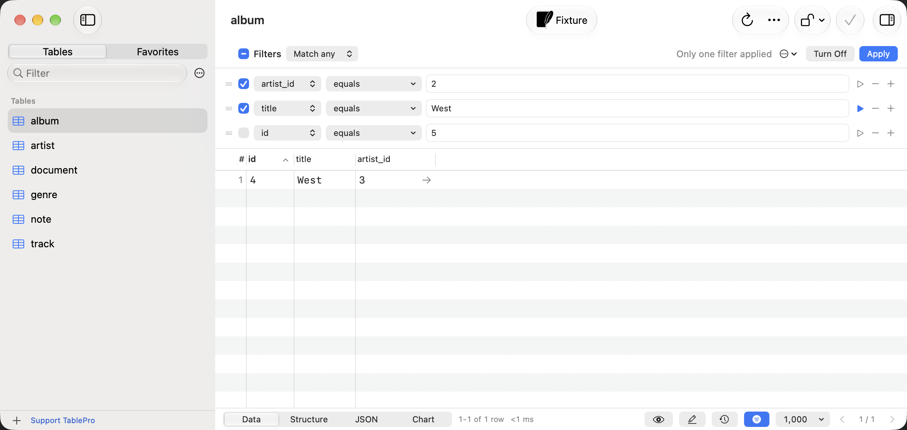
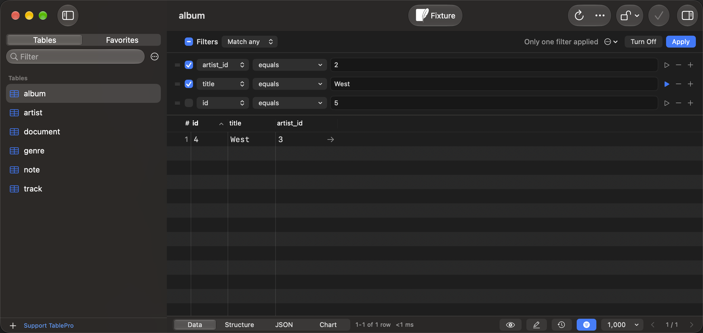

A filter is a WHERE clause, and it runs at the database. That is the difference between filtering and the find bar: matches come from every row in the table, not from the page you are looking at. Open the filter bar with `Cmd+Shift+F`, type a condition into the row that appears, and press `Enter`.

<Frame caption="Three rows under Match any, with the title row applied alone">
  
  
</Frame>

Each row has a drag grip, a checkbox, a column picker, an operator, a value field, a play button, and **−**/**+** buttons. Right-clicking a column header in the grid and choosing **Filter with column** pre-fills a row for that column. A value field suggests column names and keywords as you type; `Enter` runs what you typed, and `Down` then `Enter` takes a suggestion instead.

| Control | What it does |
|---------|--------------|
| Header **Apply**, or `Cmd+Enter` | Runs every checked row |
| `Enter` in a value field | Runs the rows again the way they are applied: a row applied alone stays alone, otherwise every checked row runs |
| Row checkbox | Turns that row off without deleting it. Press **Apply** to re-run |
| Row play button, `Option+Cmd+Enter` in its value field, or right-click > **Apply Only This Filter** | Filters by that row alone, checked or not, without touching any checkbox. Turn the button off, or press **Apply**, to run the checked rows again |
| **Turn Off** | Shows every row again and keeps the filter rows |
| Row grip | Reorders the list. Order never changes the result |
| ⋯ > **Remove All Filters…** | After a confirmation, deletes every saved row for this table and closes the bar |

An edit to a row waits for **Apply** or `Enter`. Until then, turning a page, sorting, refreshing or counting rows reruns the filter that last ran, not the edited rows. The header says **Not applied** while checked rows have not run yet, **Changes not applied** once the rows no longer match what the grid shows, and **Only one filter applied** while a row runs alone.

Filters are saved per connection, database, schema, and table, and survive a relaunch, unchecked rows and rows you never applied included. **Turn Off** keeps the rows and stops filtering, so they come back when you reopen the table. A table with an active filter opens in a new tab rather than replacing the current one. Renaming or dropping a column in the Structure tab updates the filter rows on it.

<Info>
Redis shows a key-pattern search bar (`user:*` and the like) with a key-type picker instead of the filter bar. In a [data file](/features/data-files) window the same filter bar runs over the file itself, with no raw SQL row.
</Info>

## Filter by cell value

Right-click a cell in a table and open **Filter**. The conditions it offers are built from that cell's stored value, not from its **Display As** text:

| Cell | Conditions |
|---|---|
| A value | `status = “paid”`, `status != “paid”`, plus `>` and `<` on a number or date column |
| NULL | **is NULL**, **is not NULL** |
| Empty text | **is empty**, **is not empty** |

<Frame caption="A number cell adds greater than and less than">
   3 and < 3" />
   3 and < 3" />
</Frame>

Choose one and it lands in the filter bar as a checked row and runs. It narrows what the grid already shows: rows that were running stay checked, and every other row is unchecked, including the ones **Turn Off** left behind. Under **Match any**, with two or more rows running, the new condition runs alone. A `!=` condition also leaves out rows where the column is NULL.

There is no **Filter** item on a query result, on Redis, or on a new row or an edited cell. Binary, JSON, XML, spatial, array and large-object columns have none either, and neither does text with a leading or trailing space or over 10,000 characters: type those conditions into the filter bar instead.

## Operators

Eighteen of them, and the menu shows the SQL each one produces.

| Operators | SQL |
|---|---|
| equals, not equals | `=`, `!=` |
| contains, not contains | `LIKE %..%`, `NOT LIKE %..%` |
| starts with, ends with | `LIKE ..%`, `LIKE %..` |
| greater than, greater or equal, less than, less or equal | `>`, `>=`, `<`, `<=` |
| is NULL, is not NULL | `IS NULL`, `IS NOT NULL` |
| is empty, is not empty | On a text column, NULL or `''`. On any other column, the same as is NULL |
| in list, not in list | `IN (..)`, `NOT IN (..)`, from comma-separated values |
| between | `BETWEEN`, with two value fields |
| matches regex | `~`, or the engine's own regex function. Where the engine has none, it falls back to contains |

## Case sensitivity

Contains, not contains, starts with, and ends with ignore case. Equals, not equals, IN, NOT IN, and regex respect it. Open the operator menu and use **Match Case** to flip either one for that row; an `Aa` badge marks a row that is not on its usual setting. Picking another operator returns the row to that operator's usual setting.

<Info>
On MySQL, MariaDB, SQL Server, SQLite, libSQL, and Cloudflare D1 the column's collation decides, and no query can override it, so **Match Case** is dimmed. Their default collations already ignore case. Cassandra and Redis have no case-insensitive matching at all, so it is dimmed there too.
</Info>

## Combining conditions

**Match all** and **Match any** in the header join every row with AND or OR. Cassandra, ScyllaDB and the Firebase Realtime Database have no OR, so their filter bar offers **Match all** only. There is no per-row choice and no grouping, so a mixed expression cannot be built out of rows. Put the parentheses in a raw SQL row instead, which enters the WHERE clause as a single parenthesized condition:

```sql
(status = 'open' AND priority > 3) OR escalated
```

⋯ > **Preview Query** shows the WHERE clause the rows produce, with a copy button.

An applied filter reaches an export only through the grid. **File > Export > Export Results…** writes the rows the grid holds; **Export Tables…** beside it reads the table itself and ignores the filter bar. See [Import & Export](/features/import-export).

## Nested fields

On a document store such as MongoDB, a field holding an object or an array of objects is one column showing its JSON. The column picker also lists the paths inside it, so `customer.country` and `items.sku` filter directly.

<Frame caption="Column picker listing nested field paths under their parent">
  
  
</Frame>

The paths come from a sample of the collection and only the first two levels reach the picker. The button beside it opens a searchable list of every path found, and a path typed there that no sampled document carried is used anyway, which is how to reach a field only some documents have. See [MongoDB](/databases/mongodb) for the fields this leaves out.

### Fields inside an array

A row on a field inside an array gets one more control:

| Setting | What it matches |
|---------|-----------------|
| **any element** | The row is satisfied by any entry in the array. Two rows can be satisfied by two different entries |
| **same element** | Every row set to **same element** for that array must be satisfied by one single entry |

Filtering `items.price` greater than 500 and `items.name` equal to `Laptop` with **any element** returns an order holding an expensive item and, separately, an item called Laptop. With **same element** on both rows it returns only orders holding one item that is both. **any element** is the default.

<Frame caption="Two rows on items set to same element, so one array entry must satisfy both">
  
  
</Frame>

Rows sharing an array and set to **same element** group together, and **Match all** / **Match any** applies inside the group too.

## Raw SQL

A new row starts in raw SQL, unless **Default column** in the settings says otherwise. Type one WHERE condition:

```sql
created_at > NOW() - INTERVAL 7 DAY
```

One condition means no comment, no second statement, and every quote and parenthesis closed. **Apply** refuses anything else with `A raw SQL filter must be one condition: no comment, no second statement, and every quote and parenthesis closed.` and the rows on screen stay as they were.

<Warning>
A condition that passes that check runs as written. Syntax the database does not accept fails the query.
</Warning>

Autocomplete offers the table's columns and SQL keywords, after AND and OR included, on the same rules as the [query editor](/features/autocomplete): a typed character opens it, so does a dot and a `::` cast, and a position where the whole column list would be noise stays shut. Nothing in the list is selected until `Up` or `Down` selects it, so `Return` applies the filter. Once a suggestion is selected, `Return` or `Tab` inserts it. `Escape` dismisses the list without closing the filter bar.

The column picker moves a row between raw SQL and a column, or from one column to another, and the text stays exactly as you typed it. Type `paid` into a new row, then pick `status`, and the row compares `status` with `paid`.

On a database that does not speak SQL the row is labeled **Raw Filter** and takes that database's own syntax: on MongoDB, a filter document such as `{"customer.country": "US"}`. etcd, DynamoDB, Memcached, Weaviate, InfluxDB and Kafka have no raw row, and [Kafka](/databases/kafka#limitations) cannot filter a topic at all.

## Presets and settings

Presets live in the ⋯ menu. **Save as Preset…** stores the current rows with **Match all** or **Match any**, clicking a preset name loads it, and **Delete Preset** removes one.

The settings live in **Settings > Data**, under **Filters**, and ⋯ > **Filter Settings…** opens them. **Default column** sets what a new row starts as: Raw SQL, Primary Key, or Any Column, and **Default operator** is Equal or Contains. **Always show the filter bar** keeps the bar open on a table that has no filter.

**Saved filters** decides what reopening a table does with the rows saved for it.

| Option | Reopening a table |
|---|---|
| **Restore and apply** | Runs the filter the table was last showing, a row applied alone included |
| **Restore without applying** | Brings the rows back in the filter bar over unfiltered results. Press **Apply** to run them |
| **Don't save** | Opens unfiltered. Filters last as long as the tab, and rows already saved are kept rather than deleted |

**Restore and apply** is the default. Pick **Restore without applying** to see a table whole before deciding to filter it.
