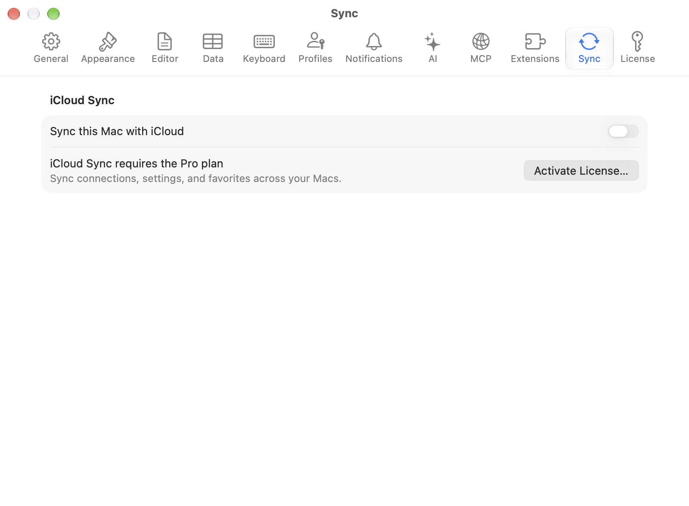
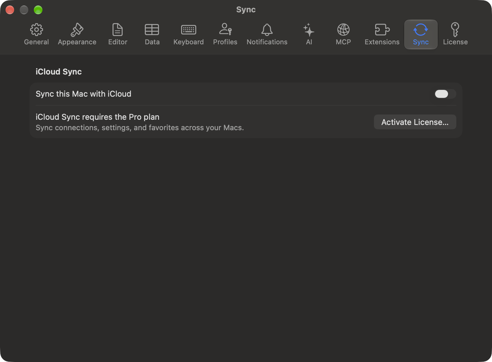

import LocalCredentialConsent from "/snippets/local-credential-consent.mdx";

Sync needs a Pro or Team [license](/features/licensing) and starts off. Press `Cmd+,`, open **Settings > Sync**, turn on **Sync this Mac with iCloud**, pick the categories, and click **Sync Now**. The iPhone and iPad app shares the same CloudKit data but carries connections, groups, tags, and saved queries only.

<Frame caption="iCloud Sync settings">
  
  
</Frame>

## What syncs

Each synced category has its own toggle under **Sync Categories**. Turning one on brings down what other devices added or changed while it was off, but not what they deleted: remove those items on this Mac too.

| Data | Synced | Notes |
|------|--------|-------|
| **Connections** | Yes | Host, port, username, database type, SSH/SSL config, and whether the connection is a favorite |
| **Passwords** | Opt-in | Nested under Connections, and carried by Apple's iCloud Keychain rather than TablePro's own records. Turning it on affects new saves only, so re-save a password to sync it. On iPhone and iPad the same switch is **Settings > iCloud > Sync Passwords** |
| **Groups & Tags** | Yes | Nested group hierarchy and sort order included |
| **SSH Profiles** | Yes | Named [SSH profiles](/connections/ssh-profiles) |
| **Credential Profiles** | Yes | Between Macs only. Named [credential profiles](/connections/credential-profiles): the name, the username, and where the password comes from. Which connections use a profile is kept on each Mac |
| **Table Favorites** | Yes | The names shown in the Favorites tab and pinned in table lists |
| **Table Folders** | Yes | Between Macs only. The sidebar's [folders](/features/connection-window#folders) and the tables and views filed in them |
| **Database Favorites** | Yes | Favorited databases and their Development / Testing / Production tags |
| **Saved Queries** | Yes | Saved SQL and their folders |
| **Settings** | Yes | Between Macs only. General, Editor, Data Grid, History, Tabs, Keyboard, Notifications, and AI settings, the **Light theme** and **Dark theme** choice, [custom themes](/customization/appearance#managing-themes), custom AI slash commands, and saved per-table column widths and order |
| **Appearance mode and fonts** | No | **Appearance** (System, Light, or Dark), Editor Font, and Data Grid Font stay on each Mac |
| **Linked SQL Folders** | No | Folder paths are per-Mac. Link the same Git repo on each Mac after cloning. The cached file index stays local too |
| **Sidebar state** | No | The sidebar's database and schema filters and recent tables lists stay on each Mac |
| **Connection list order** | No | Recent connections and whether that section is shown, the sort order, and the order of favorites stay on each device |

A sync runs at launch, 2 seconds after you change anything synced, and when the network returns after a sync that could not reach iCloud. While TablePro is running, a change made on another device arrives within seconds, in the background too: iCloud sends this Mac a silent notice, and the change downloads at once. Switching back to the app also downloads, at most once every 15 minutes while those notices reach this Mac. When they stop, for example on a network that blocks Apple's push service, a switch downloads at most once a minute again. A switch inside that window waits for it to end.

A custom theme travels as its file. Moving one to the Trash on one Mac moves it to the Trash on the others. A theme file copied into the Themes folder in Finder goes up the next time you edit it in TablePro or turn sync on. A Mac on an earlier version of TablePro switches its **Appearance** to **System** when a theme choice arrives from an updated Mac.

## Sign-ins on another Mac

<LocalCredentialConsent />

Connections that use environment variables also need [approval on each Mac](/features/connection-sharing#environment-variables).

## Keeping a connection off iCloud

A localhost or throwaway database is rarely worth a round trip. Mark it **Local only** under **iCloud Sync** on the connection form's **Options** tab, or right-click it and choose **Exclude from iCloud Sync**. It shows a struck-through cloud icon in the connection list, and the flag survives duplicating and exporting.

Marking a synced connection Local only moves its passwords, passphrases and other secrets to this Mac and removes them from iCloud Keychain. Your other Macs, iPhone and iPad keep the connection but ask for its passwords again. The form says so before you save, and the menu item asks first. A secret this Mac cannot read or save keeps its iCloud Keychain copy. Passwords of a shared SSH or credential profile belong to the profile and stay where it syncs. A connection that was already Local only keeps any older iCloud Keychain copies until you turn Local only off and on again.

What belongs to the connection stays on this Mac with it: its table and database favorites, the saved queries and folders scoped to it, and its column widths, order, and hidden columns. Edits and removals you make to them wait here while the connection is Local only, and the first sync after you turn it off sends them. Deleting a Local only connection removes those items from this Mac and from nowhere else.

## Checking that it worked

**Status** in the **Sync Status** section reads **Up to Date** after a clean run. **Last Synced** is the last run that both sent this Mac's changes and brought the other devices' in, so it stops moving while uploads fail even though downloads keep arriving.

When the same connection changed on two devices, TablePro merges field by field, so a name edited on one Mac and a port edited on the other both survive. When one field changed in both places, the device that syncs last wins.

## Troubleshooting

A condition that a retry cannot clear shows as a notice at the top of **Settings > Sync**, with the action that clears it. Its title also shows as a link on the welcome window that opens the pane, except **iCloud Is Not Ready**, which clears by itself. While it lasts, edits stop going up on every change: they wait on this Mac, and nothing local is deleted.

### iCloud Storage Is Full

Every upload fails, deletions included, until iCloud has room. Changes from your other devices still arrive. Click **Manage Storage…**, or open **System Settings**, click your name, then click **iCloud**, and free up space or add storage. The upload is tried again after 5 minutes, then twice as long each time up to an hour; click **Try Again** in the notice to try at once.

### Not Signed In to iCloud

No Apple Account is signed in to iCloud on this Mac. Click **Open System Settings…** and sign in. Sync starts by itself once you do.

### iCloud Is Not Ready

The account is signed in, but iCloud is not ready for apps yet, which happens briefly after signing in. Sync resumes by itself. If the notice stays, look in **System Settings > Apple Account** for a prompt to confirm your password.

### iCloud Is Restricted

Screen Time or a device management profile does not allow iCloud on this Mac. Sync stays off until whoever manages the Mac lifts the restriction.

### TablePro Data Was Removed from iCloud

TablePro's data is no longer in iCloud, most often because it was deleted under **Manage Storage**. Nothing uploads until you choose: **Upload Again** sends everything on this Mac back up, and **Turn Off iCloud Sync** keeps it on this Mac only. If another device uploads first, this Mac picks that up and syncs normally again.

### Update Required

iCloud no longer accepts this version of TablePro. Click **Check for Updates…** and install the update. With an update already waiting, the button reads **Update Available…** or **Relaunch to Update**.

### Offline

iCloud could not be reached. Changes go up as soon as the network returns, without a click.

### Waiting to Retry

iCloud asked TablePro to slow down. The next attempt waits for the time iCloud named, and at least 30 seconds.

### Some Changes Not Uploaded

iCloud refused the changes counted under **Sync Now** and accepted the rest. The refused ones stay on this Mac and go again on the next sync.

### Other cases

Signing in to a different iCloud account starts sync over for that account: the next sync is a full fetch rather than a delta, and changes waiting on this Mac go to the new account. Expect the first sync to take longer.

When a license expires, sync stops and local data stays where it is. The switch dims, and the row under it offers **Renew License**.

A license that has not reached the license server in 30 days pauses sync the same way. The row under the switch says **Could Not Check This License** and offers **Try Again**; a check that fails again says why under the button.
