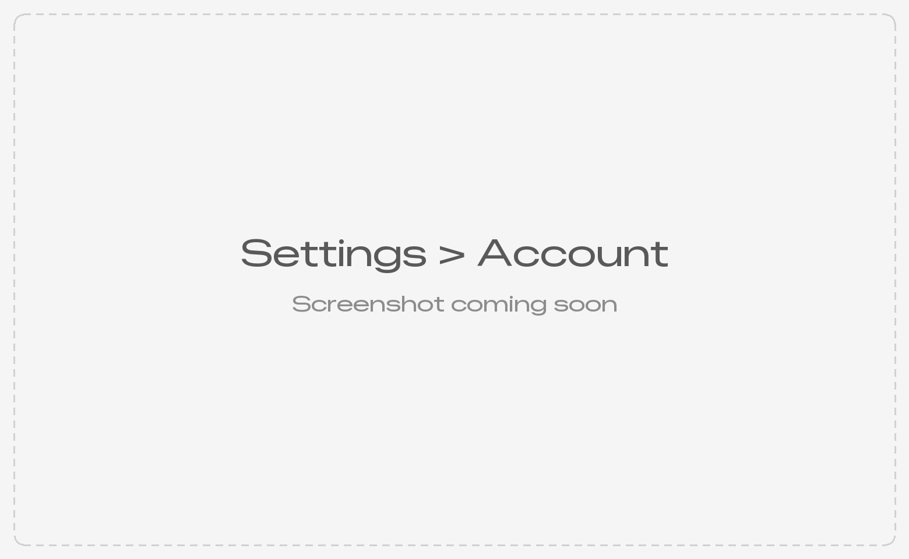
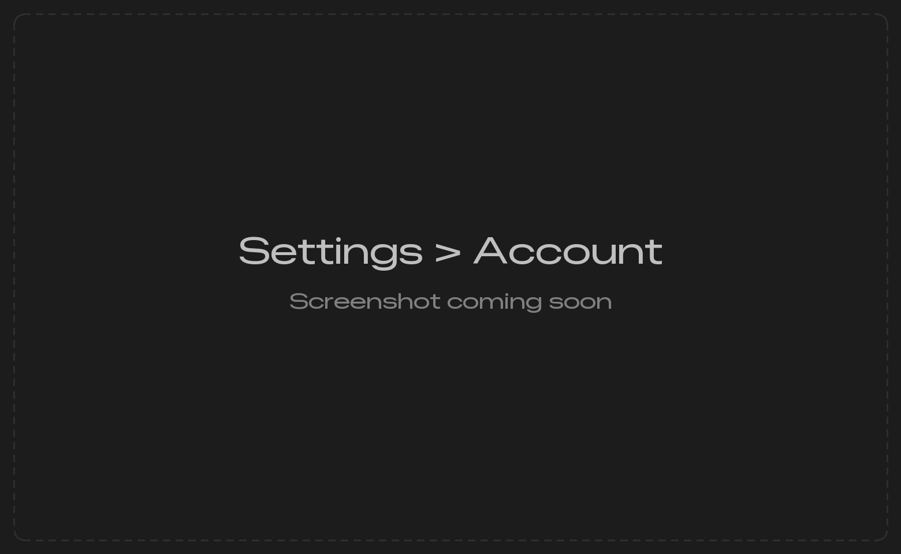

You never have to buy TablePro to keep using it, and nothing counts down. A plan adds the features in the table. You buy one on [tablepro.app](https://tablepro.app/#pricing), and billing lives in your account at [account.tablepro.app](https://account.tablepro.app), not in the app.

## Tiers

There are two paid plans, Pro and Team. Team includes everything in Pro. Starter was the earlier name of Pro, so a Starter license is a Pro license. A seat on a team gives you the team's plan.

| Feature | Required tier | Without the plan |
|---------|---------------|-------------------|
| [iCloud Sync](/features/icloud-sync) | Pro | Dimmed, with a row saying it needs a paid plan |
| [Encrypted connection export](/features/connection-sharing) | Pro | Dimmed, with a row saying it needs a paid plan |
| [Environment variables in connection fields](/features/connection-sharing) | Pro | References stay unresolved |
| [Linked Folders](/features/connection-sharing) | Pro | Dimmed, with a row saying it needs a paid plan |
| [Query Insights](/features/query-insights) | Pro | Overlay saying it needs a paid plan |
| [Result charts](/features/data-grid#chart-mode) | Pro | Overlay saying it needs a paid plan |
| [Compare & Sync](/features/compare-sync) | Pro | Dialog naming the requirement |
| [Data Rewind](/features/change-tracking#restoring-a-save) | Pro | Dialog naming the requirement |
| [Shared links](/features/shared-links#who-can-share) past the Free limits | Pro | Free limits; Pro options carry a **Pro** tag |
| [Team Catalog](/features/connection-sharing) | Team | Menu item hidden |
| [Team Library](/features/team) | Team | Menu item hidden |

The table describes macOS features. The [Linux beta](/linux/install) uses the same plans and accounts; its [account guide](https://github.com/TableProApp/TablePro/blob/main/linux/README.md#tablepro-account) covers device limits and sign-in. The Windows preview signs in to the same accounts: see [TablePro account](/windows/account). The [iPhone and iPad app](/ios) needs no plan.

Signed out, a row, overlay or dialog offers **Sign In** and **Purchase License**. Signed in to an account without the feature, it offers **Upgrade Plan**, which opens the pricing page. A plan you already hold is never offered for sale: when it could not be checked, the gate says what **Settings > Account** says and offers **Try Again**, and past the [device limit](#devices) it offers **Open Account Settings…**. Everything else in the app works without a plan.

## Buy a license

Choose **Help > Support TablePro**, or click **Support TablePro** under the app name on the welcome window or in the sidebar footer of a connection window. The window states how the project is funded and carries two actions: **Buy a License** opens the pricing page and **Sponsor on GitHub** opens [the sponsorship page](https://github.com/sponsors/datlechin), both in your default browser.

<Frame caption="Help > Support TablePro, with no license active">
  
  
</Frame>

Use at work is free too. If TablePro is part of your work, a license is asked for, never required: the AGPL puts no condition on use. Prices live on tablepro.app, and renewals and invoices in your account. Once your plan is active, the window keeps only the sponsorship action and the **Support TablePro** links disappear.

### The ask on the 30th day

On the 30th day you use TablePro without a license, a sheet on the window in use asks whether you would buy one:

| Button | What happens next |
|---|---|
| **Buy a License** | The pricing page opens. The sheet returns in 90 days if there is still no license. |
| **I Use It Personally** | No sheet for a year. |
| **Not Now**, or `Esc` | The sheet returns in 90 days. |

It waits out the first five minutes after launch and any running query, and appears only on a connection, data file, or welcome window. A day counts once TablePro is in use on it, and the count stays on your Mac.

## Sign in

The first launch opens **Sign in to TablePro**, with **Sign In** and **Continue Without Account**. To sign in later:

<Steps>
  <Step title="Open Settings > Account">
    Press `Cmd+,` and choose **Account**. Signed out, the welcome window also shows a **Sign In** link, and every gate carries **Sign In**.
  </Step>
  <Step title="Click Sign In">
    A sign-in sheet opens. Sign in, or create an account, there. Signing in by email, type the 6-digit code from the email into the sheet: the link in the email opens your browser instead.
  </Step>
</Steps>

<Check>
**Account** shows your name and email, with **Manage Account…**, which opens your account in the browser, and **Sign Out**.
</Check>

<Frame caption="Settings > Account on a Pro plan">
  
  
</Frame>

The rest of the pane:

| Section | Shows |
|---|---|
| **Plan** | One row per license: the plan and its cycle, whose it is (Personal, or the team's name), and its status, such as **Renews on**, **Ends on**, **Lifetime** or **Payment problem**. On a plan you pay for, **Billing…** opens its billing in your account. On Free: **You're on Free** with **Upgrade…** |
| **Features** | Every paid feature, marked **Included** or locked |
| **Devices** | The devices signed in to your account. See [Devices](#devices) |
| **Teams** | Each team you belong to, your role, **Seat** or **No seat**, and **Manage…**, which opens the team in your account |
| **Offline** | When the plan was last verified and until when it holds, **Refresh**, the **Machine ID**, **Import Offline File…** and **Use License Key…** |

Notices at the top of **Plan** name what needs doing: a failed payment offers **Update Payment Method…**, and a plan that is canceling says when it ends. Seats, invitations and roles are managed in your account; see [Team Plan](/features/team).

### A license key from an older version

A key saved by an older version of TablePro signs the Mac in on its own, to the account the key belongs to, the first time the new version reaches the server. To use a key by hand, click **Use License Key…** under **Offline**, paste it (`XXXXX-XXXXX-XXXXX-XXXXX-XXXXX`) and click **Use Key**. On a Mac already signed in, the sheet says which account the key replaces. A key is deleted from the Mac once it is used.

## Devices

A plan works on up to 3 devices at a time: Macs, Linux and Windows computers counted together. A Free account has no device limit. **Devices** lists every device signed in to your account, this Mac first and marked **This Mac**, with its system and when it was last seen.

**Remove** beside a device signs TablePro out there at its next check, and its paid features run until its last check expires. This Mac has no **Remove**, and neither does a device whose offline file has not expired; it shows until when instead.

Signing in on a fourth device keeps it on Free and says "Your plan is in use on 3 other devices." Click **Choose a Device…** to list the 3, then **Remove** one, and this Mac takes its place. **Manage Devices…** in the same sheet opens the list in your account. Until you remove one, **Plan** shows **Device limit reached**.

## Validation and offline use

Your plan reaches the Mac as a signed file, valid for up to 14 days and never past the end of the license. The signature is checked on your Mac, with no network, so editing the file changes nothing.

- The plan is refreshed at launch, then 24 hours after a check that worked, or 1 hour after one that failed. **Refresh** under **Offline** checks now. A plan changed in your account shows at the next check.
- Without a network, paid features keep working until the file expires. With 3 days left, **Plan** says **Verify your plan soon**. Once it expires, it says **Your plan could not be verified** and paid features pause until a check succeeds. Both offer **Try Again**.
- A Mac that never reaches the internet uses an offline file. Copy the **Machine ID** under **Offline**, create an offline file for it in your account, then click **Import Offline File…**. A file is valid until the end of the paid period, or for one year on a lifetime license, and its device keeps its slot until it expires.

## What syncs

Nothing about the account syncs. Account tokens stay on the Mac that signed in and are never in iCloud Keychain, so each Mac signs in on its own and counts as its own device.
