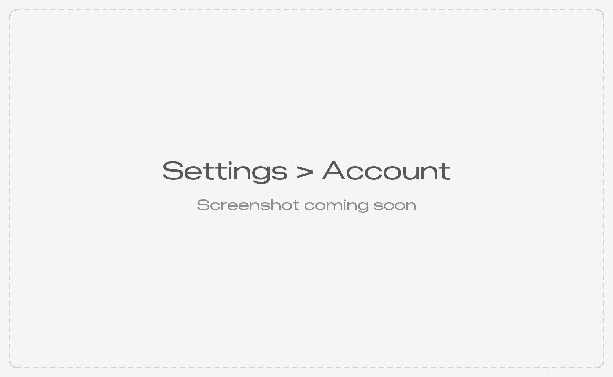
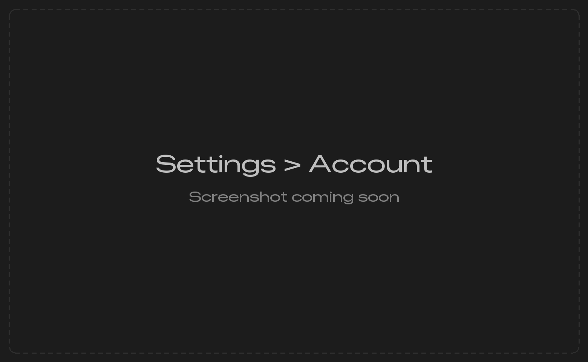

You never have to buy TablePro to keep using it, and nothing counts down. A plan adds the features under [Features by plan](#features-by-plan). You buy one on [tablepro.app](https://tablepro.app/pricing), and billing lives in your account at [account.tablepro.app](https://account.tablepro.app), not in the app.

## Plans

| Plan | Price | Includes |
|---|---|---|
| Free | $0, no account needed | Every feature not listed under [Features by plan](#features-by-plan) |
| Pro | $4.99 a month, $39 a year, or $79 once | The Pro features, for one person on up to 3 [devices](#devices) |
| Team | $12 per seat a month, or $120 per seat a year, from 2 seats | Pro for each member with a seat, plus Team Catalog and Team Library |
| Enterprise Self-Hosted | $120 per seat a year, from 3 seats, or [other terms](#enterprise-self-hosted) | Pro for each seat, and the TablePro sync server on your own infrastructure |

Pro is the plan for one person. Choose Team when two or more people share connections and queries; see [Teams](/features/team).

Prices are in US dollars, and [tablepro.app/pricing](https://tablepro.app/pricing) shows the price for your country. Pro bought once never expires and gets every update. Team has no one-time purchase: a team that bought lifetime seats earlier keeps them and adds seats with a subscription. A subscription keeps the price it was bought at for as long as it renews. Pro and Team have no trial. Starter was the earlier name of Pro, so a Starter license is a Pro license.

If your company needs central control over TablePro, write to [hello@tablepro.app](mailto:hello@tablepro.app) with the subject "TablePro Enterprise".

### Enterprise Self-Hosted

Run the TablePro sync server on your own infrastructure, as an OCI image with PostgreSQL. People sign in through your identity provider with OIDC or SAML 2.0. The preview syncs Team Library, with team roles and an audit log. Syncing query history, settings and connections through the server, with passwords end-to-end encrypted, is coming and is not in the preview. Every seat includes Pro.

It is a preview, on macOS first, and the other apps follow. [Self-hosted server](/self-hosted) covers installing and running it. For a free 30-day evaluation, write to [hello@tablepro.app](mailto:hello@tablepro.app) with the subject "TablePro Enterprise Self-Hosted".

Every option starts at 3 seats.

| Option | Price |
|---|---|
| Monthly | $12 per seat a month. The server has to reach tablepro.app to renew its license |
| One-time | $179 per seat with a year of updates, $143.20 from 5 seats and $125.30 from 10. Updates after that are $45, $36 or $31.50 per seat a year, and optional. The discounts from 25 seats do not apply |
| Updates after a lapse | Pay for the years missed, never more than a new one-time license |
| Paid ahead | 10% off for 2 years, 15% off for 3 years, taken after the seat discount: 50 seats for 3 years are $81.60 per seat a year |
| 25 seats or more | 10% off the whole install, 20% from 50 seats, 30% from 100, yearly, monthly or paid ahead |

A renewal keeps its price for as long as you renew, updates included. Payment is by card. A purchase is refunded in full within 14 days while no license file has been issued for it, and renewals are not refunded. A staging install gets a free license with the same seats. Support is by email, with a reply within 2 business days.

### Students and teachers

Pro is free for a year with a school or university email address. Sign in at [account.tablepro.app](https://account.tablepro.app) with that address. An account whose address qualifies sees a card with **Get Pro free** on **Overview** and **Billing**. Click it and confirm, then enter the 6-digit code sent to that address, or open the link in the same email. From 30 days before the year ends, the card offers **Renew** for as long as the address still qualifies. An account with its own Pro subscription or lifetime license cannot claim it.

### Gift codes

A gift code adds Pro to your account for a number of months, or for good, with nothing to pay or cancel. Open [account.tablepro.app/redeem](https://account.tablepro.app/redeem), enter the code, sign in, and click **Redeem code**. **Have a gift code?** on your account's **Overview** opens the same page. Each account redeems a code once. An account with its own Pro subscription or lifetime license cannot redeem one, and neither can an account whose Pro from another code has not ended.

## Features by plan

Team and Enterprise Self-Hosted include everything in Pro. A seat on a team gives you the team's plan.

| Feature | Required plan | Without the plan |
|---------|---------------|-------------------|
| [iCloud Sync](/features/icloud-sync) | Pro | Dimmed, with a row saying it needs a paid plan |
| [Encrypted connection export](/features/connection-sharing) | Pro | Dimmed, with a row saying it needs a paid plan |
| [Environment variables in connection fields](/features/connection-sharing) | Pro | References stay unresolved |
| [Linked Folders](/features/connection-sharing) | Pro | Dimmed, with a row saying it needs a paid plan |
| [Query Insights](/features/query-insights) | Pro | Overlay saying it needs a paid plan |
| [Result charts](/features/data-grid#chart-mode) | Pro | Overlay saying it needs a paid plan |
| [Compare & Sync](/features/compare-sync) | Pro | Dialog naming the requirement |
| [Data Rewind](/features/change-tracking#restoring-a-save) | Pro | Dialog naming the requirement |
| [Shared links](/features/shared-links#who-can-share) past the Free limits | Pro | Free limits; Pro options carry a **Pro** tag |
| [Team Catalog](/features/connection-sharing) | Team | Menu item hidden |
| [Team Library](/features/team) | Team | Menu item hidden |

The table describes macOS features. The [Linux beta](/linux/install) uses the same plans and accounts; its [account guide](https://github.com/TableProApp/TablePro/blob/main/linux/README.md#tablepro-account) covers device limits and sign-in. The Windows preview signs in to the same accounts: see [TablePro account](/windows/account). The [iPhone and iPad app](/ios) needs no plan.

Signed out, a row, overlay or dialog offers **Sign In** and **Purchase License**. Signed in to an account without the feature, it offers **Upgrade Plan**, which opens the pricing page. A plan you already hold is never offered for sale: when it could not be checked, the gate says what **Settings > Account** says and offers **Try Again**, and past the [device limit](#device-limit) it offers **Open Account Settings…**, which opens **Devices**. Everything else in the app works without a plan.

## Buy a plan

Choose **Help > Support TablePro**, or click **Support TablePro** under the app name on the welcome window or in the sidebar footer of a connection window. The window states how the project is funded and carries two actions: **Buy a License** opens the pricing page and **Sponsor on GitHub** opens [the sponsorship page](https://github.com/sponsors/datlechin), both in your default browser.

<Frame caption="Help > Support TablePro, with no plan on this Mac">
  
  
</Frame>

Use at work is free too. If TablePro is part of your work, a purchase is asked for, never required: the AGPL puts no condition on use. Once your plan is active, the window keeps only the sponsorship action and the **Support TablePro** links disappear.

A plan bought without signing in goes to the TablePro account of the email address you paid with, and that account is created if there is none. Sign in on the Mac with the same address. **Billing** in your account handles renewals and invoices, and refunds a purchase or a renewal in full within 7 days.

### The ask on the 30th day

On the 30th day you use TablePro without a plan, a sheet on the window in use asks whether you would buy one:

| Button | What happens next |
|---|---|
| **Buy a License** | The pricing page opens. The sheet returns in 90 days if there is still no plan on the Mac. |
| **I Use It Personally** | No sheet for a year. |
| **Not Now**, or `Esc` | The sheet returns in 90 days. |

It waits out the first five minutes after launch and any running query, and appears only on a connection, data file, or welcome window. A day counts once TablePro is in use on it, and the count stays on your Mac.

## Sign in

The first launch opens **Sign in to TablePro**, with **Sign In** and **Continue Without Account**. To sign in later:

<Steps>
  <Step title="Open Settings > Account">
    Press `Cmd+,` and choose **Account**. Signed out, the welcome window also shows a **Sign In** link, and every gate carries **Sign In**.
  </Step>
  <Step title="Click Sign In">
    A sign-in sheet opens on account.tablepro.app. Continue with email, a passkey, Apple, GitHub or Google. There is no password, and an email address with no account yet creates one. Signing in by email, type the 6-digit code from the email into the sheet: the link in the email opens your browser instead. The code works once, for 15 minutes.
  </Step>
  <Step title="Confirm this Mac, if asked">
    A sheet already signed in to your account asks before it reuses that sign-in, and names this Mac. Click **Sign in to TablePro for macOS**.
  </Step>
</Steps>

<Check>
**Account** shows your name and email, with **Manage Account…**, which opens your account in the browser, and **Sign Out…**, which asks first.
</Check>

Signing in registers the Mac as one of your [devices](#devices), on every plan, Free included. To sign in to your organization's own server instead, see [Company server](/features/company-server).

<Frame caption="Settings > Account on a Pro plan">
  
  
</Frame>

The rest of the pane is the **Plan** section and rows that each open a page. **Devices** and **Teams** show while you are signed in:

| Part | Shows |
|---|---|
| **Plan** | One row per license: the plan and its cycle, whose it is (Personal, or the team's name), and its status, such as **Renews on**, **Ends on**, **Lifetime** or **Payment problem**. On a plan you pay for, **Billing…** opens its billing in your account. On Free: **You're on Free** with **Upgrade…**. The last row says when the plan was last verified and until when it holds, with **Refresh** |
| **Features** | Every paid feature, marked **Included** or **Not included** |
| **Devices** | The devices signed in to your account, with how many beside the row. See [Devices](#devices) |
| **Teams** | Each team you belong to, your role, **Seat assigned** or **No seat**, and **Manage…**, which opens the team in your account. The row shows how many, or **None** |
| **Offline File and License Key** | The **Machine ID**, **Import Offline File…** and **Use License Key…** |

Notices at the top of **Plan** name what needs doing: a failed payment offers **Update Payment Method…**, and a plan that is canceling says when it ends. A team's billing opens for the team's owner only; any other member is told the owner can fix it. Seats, invitations and roles are managed in your account; see [Teams](/features/team).

### A license key from an older version

A key saved by an older version of TablePro signs the Mac in on its own, to the account the key belongs to, the first time the new version reaches the server. The key is then deleted from the Mac. Until that happens, the Mac is signed out, and the old license grants nothing on its own.

To use a key by hand, click **Use License Key…** on the **Offline File and License Key** page, paste it (`XXXXX-XXXXX-XXXXX-XXXXX-XXXXX`) and click **Use Key**. On a Mac already signed in, the sheet says which account the key replaces. A key the server refused, or one left on a Mac that was already signed in, waits there filled in.

Purchases made since TablePro accounts come without a key: sign in with the email address you bought with.

## Devices

A plan works on up to 3 devices at a time: Macs, Linux and Windows computers counted together. The limit is per account, not per plan, so Pro and a team seat on the same account share those 3. A Free account has no device limit.

**Devices** lists every device signed in to your account, this Mac first and marked **This Mac**, with its system and when it was last seen. **Remove…** beside a device, or on its right-click menu, asks first, then signs TablePro out there at its next check, and its paid features run until its last check expires, 14 days at most. **Devices** in your account does the same. This Mac has no **Remove…**, and neither does a device whose offline file has not expired; it shows until when instead.

A device stays until you remove it, however long it goes without checking in, and signing out does not remove it. The first time a device uses your plan, your account gets a security email.

### Device limit

Signing in on a fourth device keeps it on Free and says "Your plan is in use on 3 other devices." Click **Choose a Device…** to list the 3, then **Remove…** one, and this Mac takes its place. **Manage Devices…** in the same sheet opens the list in your account. Until you remove one, **Plan** shows **Device limit reached**, and **Show Devices** beside it opens the **Devices** page.

Past the limit, TablePro checks every hour and each time you switch back to it, so a device removed in your account frees its slot for this Mac within the hour.

## Validation and offline use

Your plan reaches the Mac as a signed file, valid for up to 14 days and never past the end of the license. The signature is checked on your Mac, with no network, so editing the file changes nothing.

- The plan is refreshed at launch, then 24 hours after a check that worked, or 1 hour after one that failed. **Refresh** under **Plan** checks now. A plan changed in your account, such as a plan bought or a team joined, shows at the next check.
- Without a network, paid features keep working until the file expires. With 3 days left, **Plan** says **Verify your plan soon**. Once it expires, it says **Your plan could not be verified** and paid features pause until a check succeeds. Both offer **Try Again**.

### Offline file

A Mac that never reaches the internet takes the signed file from your account instead.

<Steps>
  <Step title="Copy the machine ID">
    On the offline Mac, open **Settings > Account > Offline File and License Key** and click **Copy** beside **Machine ID**.
  </Step>
  <Step title="Create the file">
    On any computer with a browser, sign in at [account.tablepro.app](https://account.tablepro.app) and open **Devices**. Click **Create offline file…**, choose **Another machine**, paste the ID into **Machine ID**, choose **macOS** under **Platform**, type a **Name**, and click **Create file**. The browser saves the file.
  </Step>
  <Step title="Import it">
    On the offline Mac, click **Import Offline File…** on the same page and choose the file.
  </Step>
</Steps>

<Check>The identity at the top of **Account** reads **From an offline file**, and **Plan** shows **Offline file** with the date it is valid until.</Check>

A file is valid until the end of the paid period, or for one year on a lifetime license. It warns the same way as the signed file: **Your offline file expires soon** with 3 days left, then **Your offline file has expired**. Create a new file and import it. On the welcome window and on a feature gate, that notice offers **Open Account Settings…**, which opens the **Offline File and License Key** page.

<Warning>
An offline file cannot be taken back. The machine holds one of your 3 slots until the file expires, and neither the app nor your account removes it before then. Orders behind a license the file carries can no longer be refunded from your account; support handles those.
</Warning>

## Sign out

**Sign Out…** in **Settings > Account** asks first, then signs this Mac out. Paid features stop on the Mac until you sign in again, Team Library changes not sent yet are discarded, and an imported offline file is removed. The Mac stays in your devices and keeps its slot until you remove it from another device or from your account.

## What syncs

Nothing about the account syncs. Account tokens stay on the Mac that signed in and are never in iCloud Keychain, so each Mac signs in on its own and counts as its own device.

## Versions before TablePro accounts

Mac versions before 0.86.0 take a license key in **Settings > License**, check it with the server every 7 days, and keep paid features for 30 days after the last check that worked. Their Macs count toward the same 3 devices. They can no longer join a team: update TablePro, then accept the invitation from its email.
