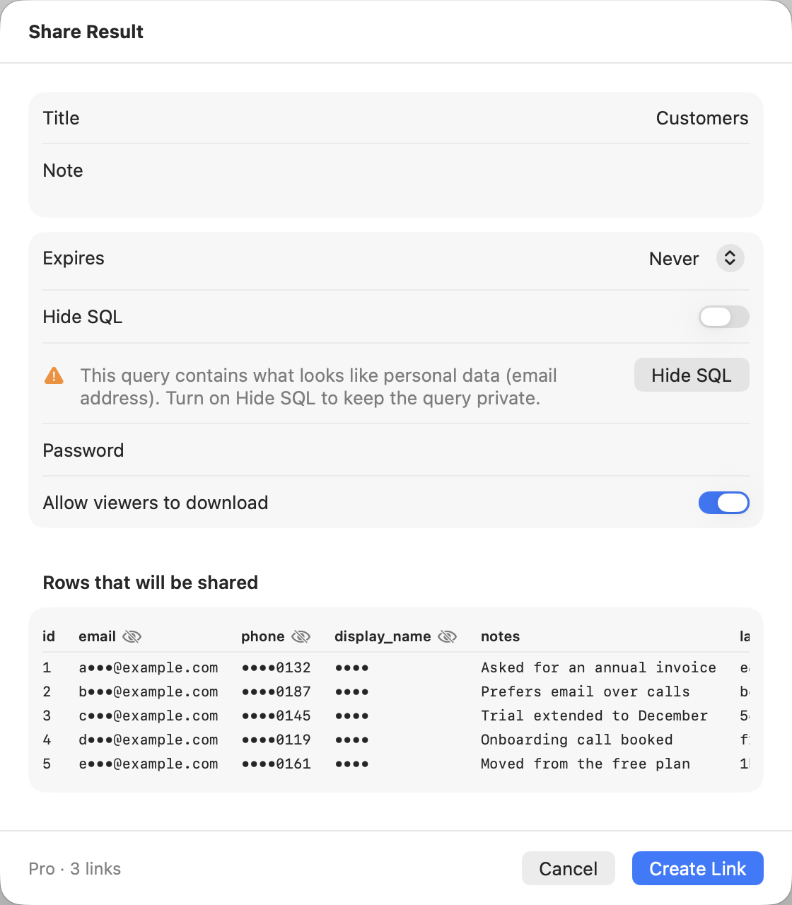
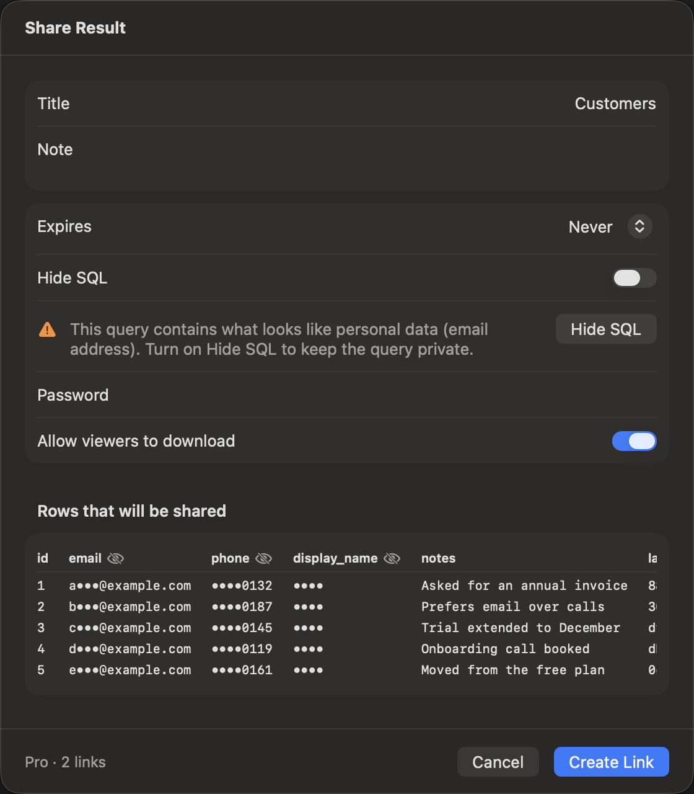
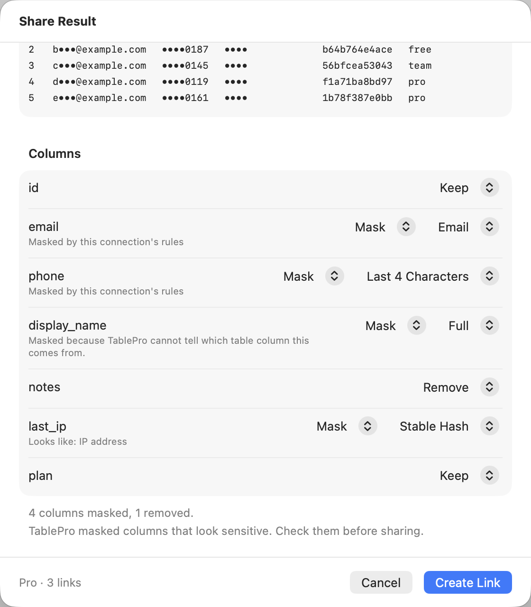
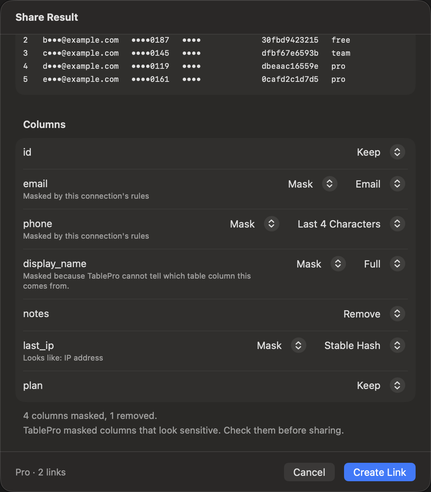

A shared link is a copy taken when you share: the SQL, and for a result the rows as the grid showed them at that moment. Anyone who has the link reads it in a web browser, with no account and no TablePro.

## Who can share

Sharing needs a TablePro account with a verified email address. Sign in under **Settings > Account** on the Mac, **Preferences > Account** on Linux, or [Settings > Account](/windows/account) on Windows.

| | Free | Pro |
|---|---|---|
| Live links | 5 | 1,000 |
| Rows in a shared result | The first 1,000 | The first 10,000 |
| Expires after | 1, 7 or 30 days; 30 by default | 1, 7 or 30 days, or never; never by default |
| Password | No | Yes |
| Turn viewer downloads off | No | Yes |
| Team links | No | With a seat on the team, while the team allows public links |

Pro means a Pro or Team license, a seat on a team included. See [Licensing](/features/licensing).

A link is live until it expires, you revoke it, or TablePro removes it. A link that expired, was revoked or was removed frees its slot. A [suspended](#link-status) link keeps its slot. Team links count against the team's own limit of 1,000, never against yours.

On Free, extend a link to 30 days from now at any time, from [your account](#manage-your-links).

### After Pro ends

Your links keep working. Once, every live personal link that never expires, or expires more than 30 days later, is set to expire 30 days from then. Passwords stay on the links that have them. A new link waits until fewer than 5 are live.

## Share from the Mac

| To share | Do this |
|---|---|
| A result | Right-click the grid and choose **Share Result…**, or choose **File > Share Result…** |
| A query | Right-click in the editor and choose **Share Query…**, or choose **File > Share Query…**. The selection is shared, or the whole editor when nothing is selected |
| A saved query | Right-click it in the [Favorites](/features/favorites#working-with-saved-queries) sidebar and choose **Share…** |

From a table tab, the link holds the table from its first row, with the tab's filter and sort, up to your plan's row limit, whichever page is on screen. With a [value filter](/features/data-grid#filtering) on, it holds the rows the filter shows. From a query tab whose result stopped before its end, the rows past those loaded are read from the server, up to the limit. A table view that cannot be written as SQL shares its rows only, and the sheet says so.

On Linux and Windows the commands sit elsewhere: see [Linux](/linux/sql-editor#share-a-query-or-result) and [Windows](/windows/browsing#share-a-result-or-query).

## The share sheet

<Frame caption="A Pro account sharing a result whose query holds an email address">
  
  
</Frame>

Signed out, the sheet offers **Sign In…** and nothing else. With an email address not yet verified, it offers **Open Account**, where you verify it.

| Field | What it sets |
|---|---|
| **Share as** | Whose link it is: **Personal**, or a team where you hold a seat. Shown only when you hold one |
| **Title** | The page heading. Starts as the tab, saved query or result name |
| **Note** | Optional text under the title |
| **Expires** | When the link stops opening. **Never** needs Pro |
| **Hide SQL** | Results only. The page shows the rows without the query |
| **Password** | Pro. Viewers type it before anything shows |
| **Allow viewers to download** | On by default. Pro can turn it off, which removes the page's export buttons |

The field labels read the same in all three apps, except **Share As** on Linux. Windows words its buttons in sentence case, such as **Sign in...** and **Open in browser**.

On Free, **Never**, **Password** and **Allow viewers to download** are dimmed and carry a **Pro** tag. Click the tag to see the plans in your browser.

Under **Share as**, a team whose public links are off is listed but dimmed, with "Public links are off for this team." Choosing a team makes a [team link](#team-links): the footer and the at-limit list then count that team's links instead of yours.

For a result, **Rows that will be shared** previews the first 5 rows as they will be sent: the columns the grid shows, in its order, with masks applied and removed columns left out. Under it, **Columns** sets what each column sends, as [Sensitive data](#sensitive-data) explains. A result longer than your plan allows is cut, and the sheet says so: "Shares the first 1,000 of 48,210 rows." The page tells viewers the same.

A query that looks like it holds a secret, such as an AWS access key, a private key, a JSON Web Token, an API token or a password in a URL, gets a warning naming it. So does a column set to **Keep** whose name looks like `password`, `token`, `secret`, `api_key` or `ssn`. Warnings never stop the share. With **Hide SQL** on, the query's warnings go away, since the page does not show the query.

The footer counts your links: `Free · 3 of 5 links · first 1,000 rows`, or `Pro · 12 links`.

Click **Create Link**, or **Share** on Windows. The link goes to the clipboard, and the sheet shows it under **Link copied** with **Copy** and **Open in Browser**.

### Large results

A link holds up to 100 columns and about 4.5 MB of values, weighed after masking.

- With more than 100 columns kept or masked, the first 100 go, and the sheet says "Shares the first 100 columns." Remove columns under **Columns** to choose which go.
- Rows that would take the link past 4.5 MB are cut, and the sheet shows the same "Shares the first … of … rows." note as for your plan's limit.
- A single value over 256 KiB, or a first row over 4.5 MB, stops the share with "This result is too large to share." Mask or remove that column. Windows names the column.

### At the link limit

With every slot taken, the sheet lists the live links holding them, oldest first, each with **Revoke**. Revoke one and the form comes back.

### If the link is not created

| Message | What to do |
|---|---|
| This result is too large to share. | A value is over 256 KiB, or the first row over 4.5 MB. Mask or remove that column under **Columns**, or select less in the query, and share again |
| Too many links just now. Try again in a moment. | An account makes up to 60 links an hour and 300 a day. Wait, then click **Create Link** again |
| Sharing is turned off for this account. | TablePro turned sharing off for the account. Contact support |
| You appear to be offline. Try again once you're connected. | Check the network, then click **Create Link** again |

## Sensitive data

Check **Columns** before every result share. Each shared column is set to one of three choices, applied on your computer: masked values are masked before they leave it, and a removed column is never sent.

| Choice | The link holds |
|---|---|
| **Keep** | The values as the grid shows them |
| **Mask** | The values under a mask you pick from [Masks](/features/data-masking#masks): Full, Last 4 Characters, Email, Stable Hash or NULL |
| **Remove** | Nothing from that column |

On the Mac and Windows, **Mask** shows a second menu for the mask. Linux gives each column one menu: **Keep**, **Mask as Full** and each other mask, then **Remove**.

<Frame caption="On the Mac: two rule columns, an untraced column, a removed column and a detected IP address">
  
  
</Frame>

Each column starts from what is known about it:

| Column | Starts as | Can be set to |
|---|---|---|
| On the Mac, masked by the connection's [masking rules](/features/data-masking) | **Mask**, with the rule's mask | The rule's mask, **Full**, **NULL** or **Remove**. Never **Keep** |
| Looks sensitive, by its name or its values | **Mask**, with the suggested mask | Anything, **Keep** included |
| Anything else | **Keep** | Anything |

The line under a masked column's name says why: "Looks like: email address", or on Linux "The name looks like personal data" or "Values look like email addresses". On the Mac, "Masked by this connection's rules" marks a rule. On a Mac connection with rules, a column that reads no table column, such as `count(*)`, says "Masked because TablePro cannot tell which table column this comes from." and cannot be set to **Keep**. [Masking for AI and scripts](/features/data-masking#masking-for-ai-and-scripts) lists what counts.

Under the list, a line counts the result, such as "2 columns masked, 1 removed." After a detection, it adds "TablePro masked columns that look sensitive. Check them before sharing."

### What looks sensitive

A column's name is split into words at `_`, `-`, `.`, spaces, capitals and digits, and a term matches one whole word or several joined: `stripe_api_key` and `apiKey` match `api_key`, and `company` does not match `pan`. When a name matches two terms, the one covering more words wins.

| Looks like | Name terms | Values | Suggested mask |
|---|---|---|---|
| Email address | `email`, `mail` | Half or more are email addresses | Email |
| Phone number | `phone`, `mobile`, `tel`, `telephone`, `fax`, `msisdn` | Half or more are phone numbers | Last 4 Characters |
| Password or secret | `password`, `passwd`, `pwd`, `secret`, `token`, `api_key`, `access_key`, `private_key`, `credential` | One JSON Web Token or API key | Full |
| ID number | `ssn`, `social_security`, `national_id`, `passport`, `tax_id`, `tin` | | Last 4 Characters |
| Card or account number | `credit_card`, `card_number`, `cc_number`, `pan`, `iban`, `account_number`, `routing_number` | One card number that passes the Luhn check, or one valid IBAN | Last 4 Characters |
| Postal address | `address`, `street`, `zip`, `zipcode`, `postcode`, `postal` | | Full |
| Date of birth | `dob`, `birthdate`, `date_of_birth`, `birthday` | | Full |
| IP address | `ip`, `ip_address`, `ipv4`, `ipv6` | Half or more are IP addresses | Stable Hash |
| Person's name | `first_name`, `last_name`, `full_name`, `surname`, `given_name` | | Full |

Values are read from the rows the link holds, and only in text columns: a number, date, boolean or UUID column is judged by its name alone. A column matched by both its name and its values takes the name's mask. On the Mac, a column a rule already masks is not checked.

### Personal data in the SQL

A result whose SQL holds a string literal that looks like an email address, phone number, card number, IBAN, JSON Web Token or API key shows "This query contains what looks like personal data (email address). Turn on Hide SQL to keep the query private." Click its **Hide SQL** button, or turn on **Hide SQL** in the form. The page then shows the rows without the query, though the service still stores it.

### What viewers see

A masked column's header on the page carries a **Masked** badge. Hover over it, or tap or click it, to read "Values in this column were masked before sharing." with the mask's name. A removed column does not appear at all.

## Manage your links

Choose **File > Manage Shared Links…**, or open [account.tablepro.app/shared-links](https://account.tablepro.app/shared-links). **Shared links** in your account lists every personal link with its kind, status, expiry and view count, and a lock on the ones with a password. The line at the top counts them against your plan, such as `Free · 3 of 5 links`.

Each live or expired link has a menu:

- **Copy link** and **Open**, while the link is live.
- **Extend 30 days**, on Free. The new expiry counts from now.
- **Edit…** changes the title, note, expiry, password, downloads, and **Hide SQL** on a result. A password or downloads off still need Pro, and a password a link already has can be removed on Free.
- **Revoke…** stops the link for everyone at once. It cannot be undone.

Editing the title or note of an expired link leaves it expired. Setting a new expiry makes it live again, if a slot is free. A link is deleted 7 days after it expires or is revoked.

### Link status

| Status | Means |
|---|---|
| Live | Opens for anyone with the link |
| Expired | No longer opens. A new expiry in **Edit…** brings it back |
| Revoked | No longer opens, for good |
| Removed | TablePro removed it after a report. The reason shows under the title, and the link cannot be edited or brought back |
| Suspended | Still live, but does not open while sharing is turned off for the account or public links are off for its team. It opens again once that is turned back on |

### Team links

A team link is made by choosing the team under **Share as** in the share sheet. A team's **Shared links** page, under the team in your account, lists its team links. Owners and admins see every team link, edit or revoke any of them, and hold the **Allow public links** switch. Turning it off stops new team links, and the team's existing links stop opening, shown as suspended, until it is on again. Nothing is revoked. A member with a seat sees the team links they shared.

## Open a link

The page shows the title, note, database type, the day the link was shared and the day it expires. Under them:

- The query, with **Copy SQL** and **Open in TablePro**. A result shared with **Hide SQL**, or from a table view with no SQL, has neither.
- The result, with a [**Masked** badge](#what-viewers-see) on each masked column, and **Export CSV** and **Export JSON** unless the owner turned downloads off. The rows stay readable on the page either way.

A result that was cut says "First 1,000 of 48,210 rows", or "First 1,000 rows of a larger result" when its total is not known.

A link with a password asks for it first. After 10 tries in 15 minutes, the page makes you wait before the next. A link that expired, was revoked or removed, or is suspended shows "This shared link is no longer available".

**Report this link**, at the bottom of every page, sends a reason, optional details and an optional email address to TablePro. Reasons are illegal content, malware or phishing, personal or private data, spam, copyright infringement, and something else. Staff review each report and remove links that break the rules.

### Open in TablePro

**Open in TablePro** puts the SQL in a new query tab, on the connection you are looking at, and never runs it. No connection details travel with a link. Opening one needs no account.

- A link with a password asks for it in the app.
- A result shared with **Hide SQL** says "This shared result hides its SQL, so there is nothing to open."
- With no connection open, the Mac opens the welcome window and the tab follows the next connection you open. Linux asks you to choose a connection. Windows shows the SQL with **Copy SQL**, and asks you to connect first.

## What a link sends

Nothing leaves your computer until you click **Create Link**. Then the service at `api.tablepro.app` stores:

- The title, note, database type, and the SQL. A result shared with **Hide SQL** still stores the SQL, and only the page leaves it out.
- For a result, the columns the grid shows and the rows up to your plan's limit. Hidden and removed columns stay behind. Masked columns are sent masked, with the name of their mask, so the original values never reach the service. Binary values are sent as their size, such as `(binary, 120 bytes)`.

Connections, hosts, user names and passwords are never part of a link. The link itself is the only key: anyone who has it can read the page, so treat it like the data it shows. The page asks search engines not to index it, and its browser title never names the link. Network details are in [Privacy](/security/privacy#shared-links).
