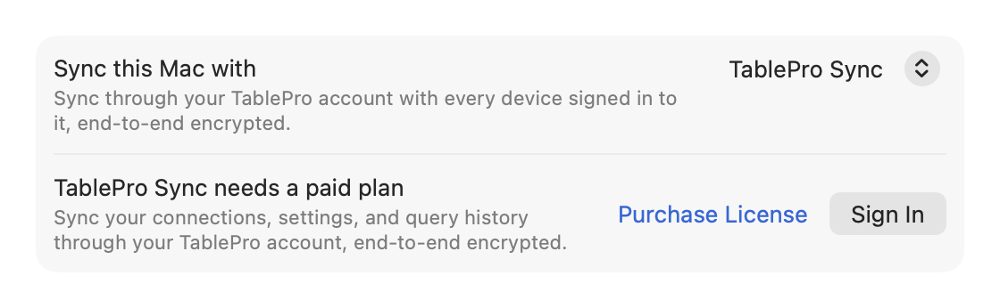
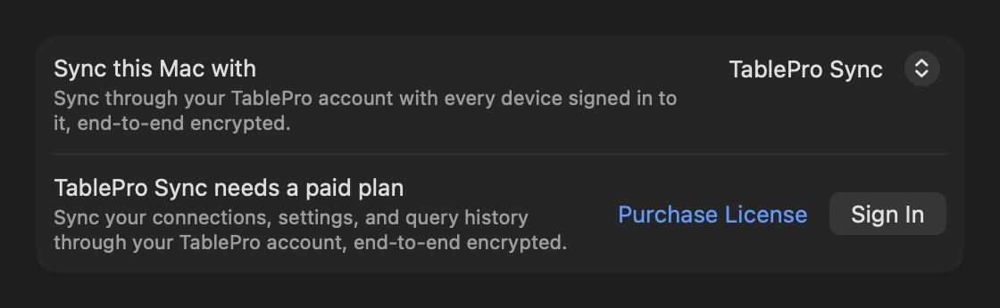
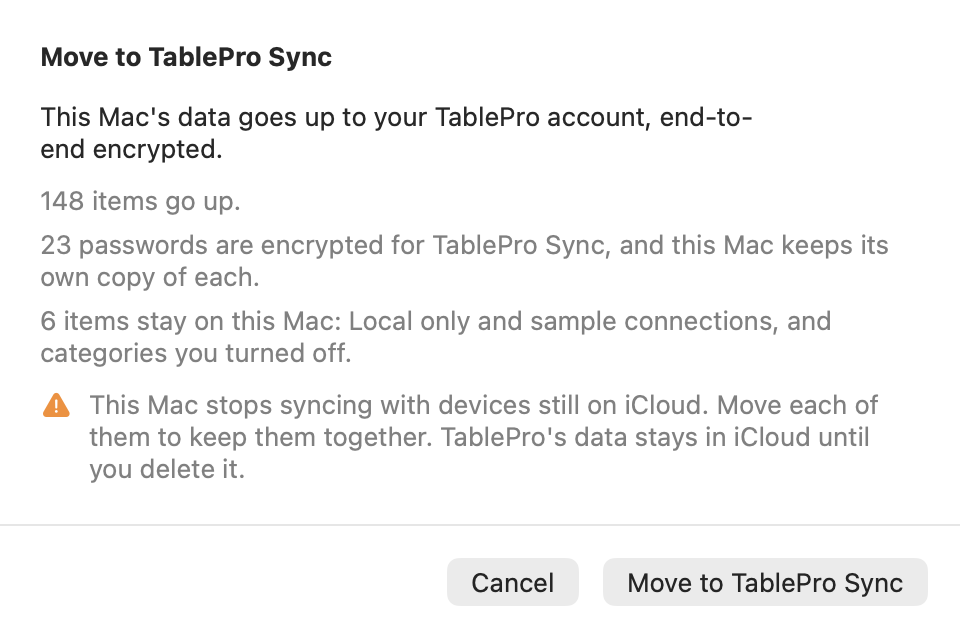
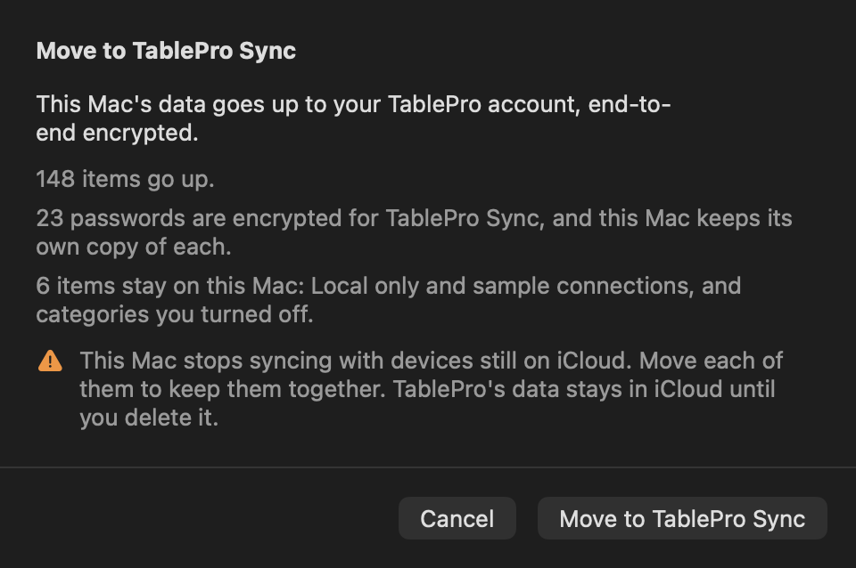
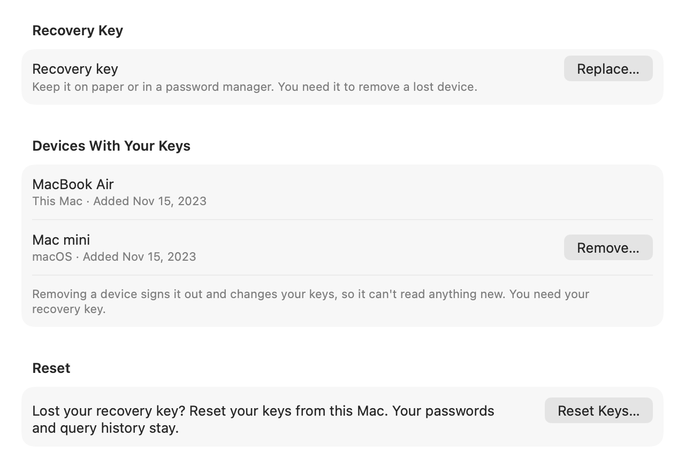
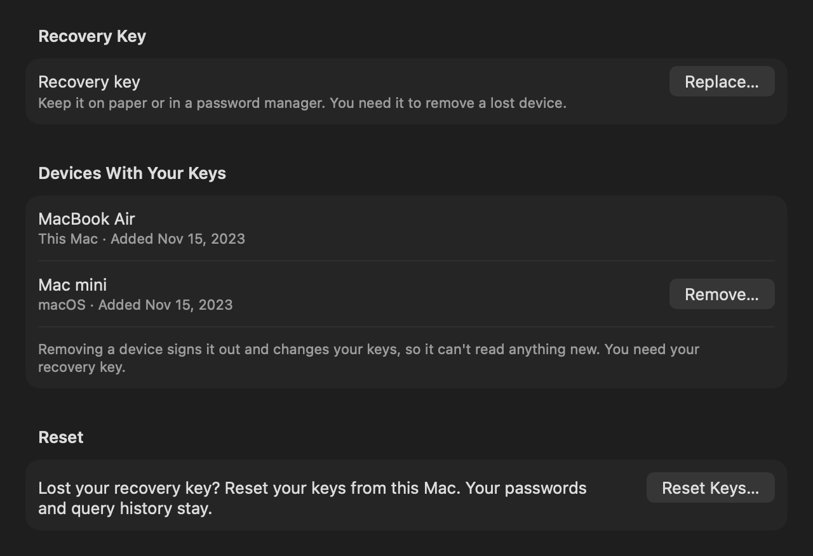

One provider carries everything this Mac syncs. Pick it under **Sync this Mac with**, at the top of **Settings > Sync**.

<Frame caption="TablePro Sync on a Mac that is not signed in yet">
  
  
</Frame>

| Provider | Syncs through | Needs |
|---|---|---|
| **Off** | Nothing. Connections and settings stay on this Mac | Nothing |
| **iCloud** | Your Apple Account, to your other Macs, iPhone and iPad | A paid [plan](/features/licensing). See [iCloud Sync](/features/icloud-sync) |
| **TablePro Sync** | Your TablePro account, on tablepro.app or your [company's server](/features/company-server) | A paid plan or a seat on the company server, and a [recovery key](#set-up-your-recovery-key) |

Sync starts **Off**. Signed in to a company server, pick **TablePro Sync**, which keeps your data on your organization's server. Otherwise **iCloud** is the one your iPhone and iPad share. [Team Library](/features/team#team-library) syncs whichever you pick, **Off** included.

## What TablePro Sync carries

The switches under **What Syncs** apply to either provider. On TablePro Sync they carry connections, groups and tags, saved queries, table and database favorites, table folders and settings. Two more things go with them:

- **Passwords**, while that switch is on: passwords and other connection secrets, end-to-end encrypted with your account's keys. This Mac keeps its own copy of each.
- **Query history**, end-to-end encrypted. It has no switch: on TablePro Sync it syncs unless your server turns it off.

End-to-end encrypted means this Mac seals the value before it leaves, and only your approved devices open it. The rest goes to the server as records it can read.

Connections set to **Local only** stay on this Mac, and so do the sample connections. A company server can keep passwords, query history or all of your own data off the server; the pane then says which, and that part stays on this Mac. See [Personal sync and Team Library](/self-hosted/sync#sync-switches).

## Move between providers

A move to or from TablePro Sync opens a sheet that says what it does before it runs.

| From | To | What happens |
|---|---|---|
| **Off** | **iCloud** | Sync starts |
| **Off** | **TablePro Sync** | **Upload to TablePro Sync** counts the items that go up, the passwords it encrypts and the items that stay on this Mac. Click **Upload** |
| **iCloud** | **TablePro Sync** | **Move to TablePro Sync** counts the same. Click **Move to TablePro Sync**. Devices still on iCloud stop syncing with this Mac until you move each of them too |
| **TablePro Sync** | **iCloud** | **Move Back to iCloud** downloads the latest from TablePro Sync, then syncs with iCloud again. Items deleted on TablePro Sync since this Mac moved are deleted from iCloud too, unless another device changed them there, and the button names how many |
| Either | **Off** | Sync stops. Your data stays on this Mac and with the provider |

<Frame caption="The counts come from this Mac's own data">
  
  
</Frame>

A Mac with no keys yet sets them up before anything goes up: the sheet asks for **Set Up Recovery Key…** on your account's first device, or **Approve This Mac…** when another device already has them, then runs the move.

TablePro's data stays in iCloud after the move. **Delete iCloud Data…**, in the **iCloud data** row of the same pane, removes it. Devices still syncing with iCloud stop until one of them uploads again; what this Mac and TablePro Sync hold stays.

### Signed in to another account

When this Mac syncs with an account other than before, such as another Apple Account, TablePro account or server, nothing personal goes up until you choose. **Signed In to Another Account** offers **Move My Data**, which brings this Mac's data into the account it now syncs with, and **Start Empty**, which takes what that account already holds. It also counts the changes the earlier account never received.

### Chosen by your organization

A configuration profile can set the provider and lock the menu, which then reads **Managed by your organization**. A required TablePro Sync waits for you: **Your Organization Uses TablePro Sync** opens the upload sheet with **Review Upload…**. A required iCloud on a Mac already on TablePro Sync shows **Your Organization Uses iCloud**, and **Review Move Back…** opens the move back. See [Company server](/features/company-server#set-the-server-for-every-mac).

### When the plan or license ends

**Uploads Paused** means your plan no longer includes TablePro Sync, or your company server's license has ended. This Mac still downloads changes and keeps its own until the plan or license is renewed. In a company server's grace period, **Your Server's License Has Expired** gives the date TablePro Sync stops taking changes.

## End-to-end encryption

TablePro Sync seals passwords and query history with keys that belong to your account. Every approved device holds them, and a recovery key that only you keep stands in for a device when none is at hand. They live under **Settings > Account > End-to-End Encryption**, shown while you are signed in.

<Frame caption="A Mac with the keys, and one other device that holds them">
  
  
</Frame>

### Set up your recovery key

Your account's first device makes the keys, from the move sheet or from **Set Up…** on this page.

<Steps>
  <Step title="Save the key">
    **Set Up a Recovery Key** shows 14 groups of letters and digits. Click **Copy** or **Print…**, keep it in a password manager or on paper, and click **Continue**. TablePro shows it only this once and cannot recover it.
  </Step>
  <Step title="Type two groups back">
    **Confirm Your Recovery Key** asks for two of the groups. **Show Key Again** goes back to it until you finish.
  </Step>
  <Step title="Click Set Up">
    **Recovery Key Set Up** confirms it, and TablePro Sync seals your secrets on this Mac from then on.
  </Step>
</Steps>

<Warning>
Anyone who has your recovery key and signs in to your TablePro account can read what TablePro Sync keeps for you. Keep it as you would that account's password.
</Warning>

You need the recovery key to remove a lost device, and to approve a Mac when no other device is at hand. **Replace…** gives you a new one in exchange for the current one, and lets the devices you compared words with keep your keys; the others ask for approval again.

### Approve another device

A device that signs in to an account with keys gets nothing personal until a device that has them, or your recovery key, approves it. Approve only a device you are signing in to right now.

<Steps>
  <Step title="Ask from the new Mac">
    On the new Mac, open **Settings > Account > End-to-End Encryption** and click **Ask Another Device…**.
  </Step>
  <Step title="Approve it on a device with the keys">
    The request shows under **Waiting for Approval**. Click **Approve…**, check the device's name and platform, and click **Approve**.
  </Step>
  <Step title="Compare the words">
    Both devices show five words. When they match in the same order, click **The Words Match** on each. If they differ, click **They Don't Match**: nothing is approved, and someone else may be asking for your keys.
  </Step>
</Steps>

<Check>
The new Mac says **This Mac Is Approved**, and TablePro Sync starts there.
</Check>

A request lasts 10 minutes. With no other device at hand, click **Use Recovery Key…** on the new Mac instead. It then holds new keys, and your other devices ask it for approval.

### Remove a device

Remove a device you lost or gave away from any other device that has your keys.

<Steps>
  <Step title="Click Remove…">
    Under **Devices With Your Keys**, click **Remove…** beside it, then **Remove**.
  </Step>
  <Step title="Confirm it's you">
    The browser opens to confirm it's you with your account's passkey, or on tablepro.app with an emailed code. On a company server without a passkey, you add one first, after your organization's sign-in.
  </Step>
  <Step title="Enter your recovery key">
    TablePro changes your keys with it.
  </Step>
  <Step title="Review, then click Change Keys">
    Choose which of your devices keep the keys, and turn off any teammate you did not mean to confirm while the removed device had them. Teammates you turn off are left out of the new team keys, and **Remove Their Seats First** offers **Manage…** for each team to take their seats too.
  </Step>
</Steps>

The removed device is signed out and reads nothing new. Your other devices pick up the new keys at their next sync. A device whose removal stopped before the keys changed shows **Removed, keys not changed yet** with **Finish…**.

### Lost the recovery key

**Reset Keys…**, under **Reset** on a Mac that still has your keys, gives you a new recovery key. The reset waits 7 days, and any of your devices, or the old key if you find it, can cancel it. After the wait, **Finish Reset…** on this Mac completes it, and your other devices sign out and join again from this Mac. Passwords and query history stay. Teammates see that your keys changed, and an owner or admin of each team confirms you again before you get its passwords.

With no device that has the keys and no recovery key, **Reset and Start Empty…** on a Mac waiting for approval starts over. It needs your passkey and waits 7 days too. Then TablePro Sync deletes everything you synced to it for good, passwords and query history included. Team libraries stay.

### Sign out

**Sign Out** under **Settings > Account** erases this Mac's keys. After you sign in again, it waits for approval from another device or your recovery key, like a new Mac. If they cannot be erased, TablePro asks whether to sign out anyway, and they then stay on this Mac until another account signs in here.
