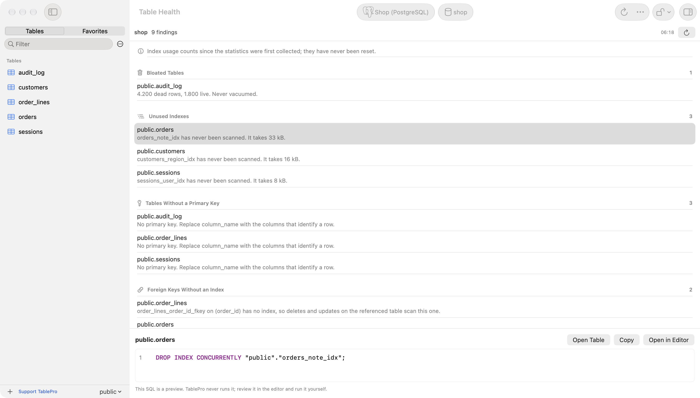
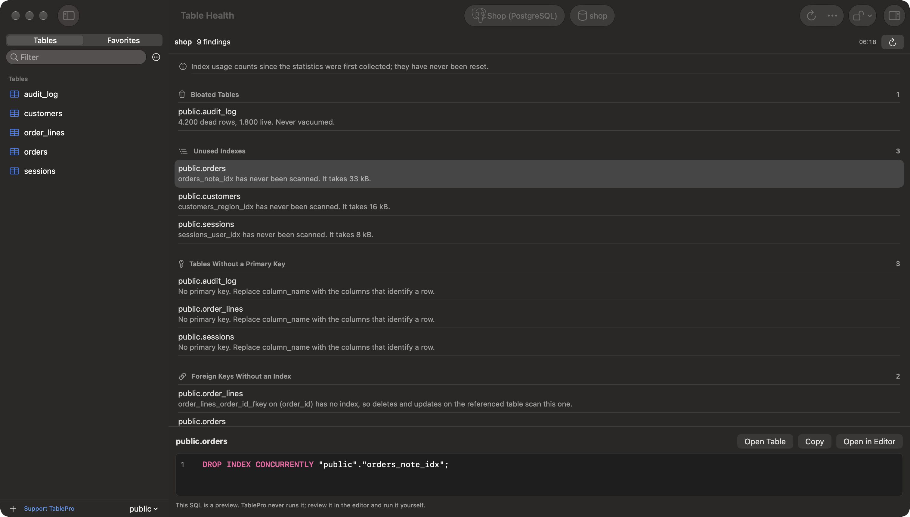

Open it from **Database > Table Health**. The report reads the catalogs and statistics of the database selected in the sidebar and changes nothing. Press `Cmd+R` (**Database > Refresh**) or click the refresh button to read them again.

<Frame caption="Table Health listing findings by check, with the fix for the selected one below">
  
  
</Frame>

## What each engine checks

| Check | PostgreSQL | MySQL and MariaDB |
|---|---|---|
| Bloated tables | At least 1,000 dead rows and at least a fifth of the live rows, from `pg_stat_user_tables`, with the last vacuum | Not checked |
| Unused indexes | Never scanned, from `pg_stat_user_indexes` | No reads recorded, from `performance_schema` |
| Redundant indexes | Not checked | An index whose columns lead another index of the same type. Full-text indexes are not compared, since two can use different parsers |
| Tables without a primary key | Yes | Yes |
| Foreign keys without an index | No index starts with the key's columns | Not checked: InnoDB indexes a foreign key's columns itself |

The report covers the database selected in the sidebar, in every schema on PostgreSQL. The toolbar names it. The menu item is dimmed for other engines.

A unique index, a primary key and an index behind a constraint never count as unused: they enforce something even when no query reads them. Neither does an index that starts with a foreign key's columns: the key's checks need it, and on MySQL and MariaDB they read it without counting a read. On MySQL and MariaDB a full-text index is not listed as unused either, since its searches are not counted. A partitioned table is listed once, not once per partition.

## Read the statistics window

An index looks unused when nothing scanned it since the counters started. The note at the top of the list says when that was:

- **PostgreSQL**: when the database's statistics were last reset, or that they never were.
- **MySQL and MariaDB**: when the server started, since `performance_schema` counts from there. An index on a table with no recorded reads or writes since then is not listed.

When the server records nothing to read, the check says why instead of listing every index:

- **PostgreSQL**: `track_counts` is off. The bloat check is skipped too.
- **MySQL and MariaDB**: `performance_schema` is off, the `wait/io/table/sql/handler` instrument or the `global_instrumentation` consumer is disabled, or no table in the database has a recorded read since the server started. MariaDB ships with `performance_schema` off; set `performance_schema=ON` and restart to turn it on.

Check an index against a period of normal traffic before dropping it. One a monthly report reads looks unused for the other 29 days.

## Act on a finding

Select a finding to preview the SQL that fixes it:

| Finding | Preview |
|---|---|
| Bloated table | `VACUUM (ANALYZE)` |
| Unused or redundant index | `DROP INDEX CONCURRENTLY` on PostgreSQL, `ALTER TABLE orders DROP INDEX orders_note_idx` on MySQL |
| Table without a primary key | `ALTER TABLE logs ADD PRIMARY KEY (column_name)`. Replace `column_name` with the columns that identify a row |
| Foreign key without an index | `CREATE INDEX CONCURRENTLY` on the key's columns, or `CREATE INDEX` on a partitioned table, which cannot build one concurrently |

TablePro never runs the preview. **Open in Editor** puts it in a new query tab for you to review and run. **Copy** puts it on the clipboard. **Open Table**, or a double-click on the finding, opens the table. The same actions are in the finding's context menu.

`VACUUM`, `CREATE INDEX CONCURRENTLY` and `DROP INDEX CONCURRENTLY` cannot run inside a transaction, so run them with auto-commit on.

## When a check fails

A check the account cannot read shows the server's error in its own section, and the other checks still run. On MySQL and MariaDB, the unused index check needs `SELECT` on `performance_schema`. A connection with no database selected asks for one.
