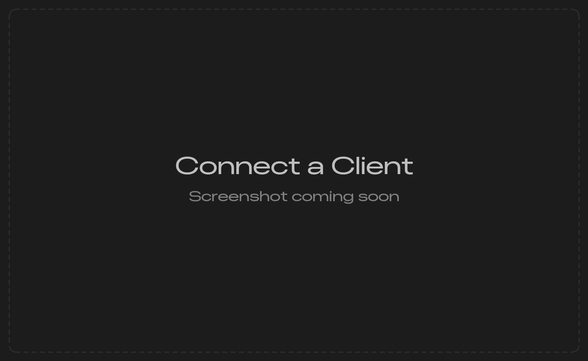

Most clients take one click. Open **Settings > MCP**, click **Connect a Client…**, and click **Install** on the client's row.

<Frame caption="Clients found on this Mac come first">
  
  
</Frame>

On macOS, every entry TablePro writes starts the bundled bridge, `tablepro-mcp`, from inside the app. The bridge launches TablePro when nothing is running, finds the private socket and carries the token, so the client's file holds no token and no port.

<Note>
TablePro for Linux has no bridge. Its clients get an address and a token instead: see [TablePro for Linux](#tablepro-for-linux).
</Note>

## Set up a client

<Steps>
  <Step title="Turn on the server">
    Turn on **Enable MCP Server** in **Settings > MCP**. While it is off, the sheet says so and clients you add cannot connect yet.
  </Step>
  <Step title="Open the client list">
    Click **Connect a Client…**. Clients found on this Mac are under **On This Mac**, the rest under **Other Clients**. The same button is on the toolbar of **Connected Clients** in the MCP Activity window.
  </Step>
  <Step title="Install">
    Click **Install** on the client's row. **Install…**, with an ellipsis, opens the client to confirm the new server there; the row reads **Finish in** and the client's name until you do.
  </Step>
  <Step title="Load it in the client">
    Select the row to see whether the client picks up the change at once or needs a new session, a reload or a restart.
  </Step>
</Steps>

<Check>
The row reads **Connected** once the client calls the server.
</Check>

A client under **Other Clients** offers **Copy** only, since there is nothing on this Mac to install into. Select any row for its settings file, **Show in Finder**, and the command or configuration to paste by hand.

## How each client is set up

A row uses the first method that works on this Mac: the client's install link, its own command, or an edit of its settings file. **Copy** is always there as well.

| Client | Install | Settings file | Takes effect |
|---|---|---|---|
| Claude Desktop | Edits the file | `~/Library/Application Support/Claude/claude_desktop_config.json` | Quit and reopen |
| Claude Code | Runs `claude mcp add --scope user` | `~/.claude.json`, read only | New session |
| ChatGPT | Runs `codex mcp add`, else edits the file | `~/.codex/config.toml` | Quit and reopen |
| Codex CLI | Runs `codex mcp add`, else edits the file | `~/.codex/config.toml` | New session |
| ChatGPT Classic | Cannot connect | None | None |
| Cursor | Opens Cursor to confirm, else edits the file | `~/.cursor/mcp.json` | At once |
| Visual Studio Code | Opens VS Code to confirm, else edits the file | `~/Library/Application Support/Code/User/mcp.json` | At once |
| Visual Studio Code - Insiders | Opens VS Code - Insiders to confirm, else edits the file | `~/Library/Application Support/Code - Insiders/User/mcp.json` | At once |
| Devin Desktop | Edits the file | `~/.config/devin/mcp_config.json` | Reload |
| Zed | Edits the file | `~/.config/zed/settings.json` | At once |
| Gemini CLI | Runs `gemini mcp add --scope user`, else edits the file | `~/.gemini/settings.json` | New session |
| GitHub Copilot CLI | Edits the file | `~/.copilot/mcp-config.json` | New session |
| opencode | Runs `opencode mcp add --global` | `~/.config/opencode/opencode.json`, read only | New session |
| Cline | Edits the file | `~/.cline/data/settings/cline_mcp_settings.json` | At once |
| Goose | Opens Goose to confirm | `~/.config/goose/config.yaml`, not read | Quit and reopen |
| LM Studio | Opens LM Studio to confirm, else edits the file | `~/.lmstudio/mcp.json` | At once |
| Kiro | Edits the file | `~/.kiro/settings/mcp.json` | At once |
| Warp | Edits the file | `~/.warp/.mcp.json` | At once |
| Junie | Edits the file | `~/.junie/mcp/mcp.json` | New session |
| JetBrains AI Assistant | Copy only | None | Quit and reopen |
| Raycast | Opens Raycast to confirm | None | At once |

A read-only file is one the client's own command manages: TablePro reads it for the status and never writes it. A client with no settings file TablePro reads never shows **Set up**; it reads **Connected** once it calls the server.

`CLAUDE_CONFIG_DIR`, `CODEX_HOME`, `COPILOT_HOME`, `CLINE_DIR` and `XDG_CONFIG_HOME` move these files only when they are in TablePro's own environment. An app opened from the Dock or Finder does not get them from your shell profile, so a client whose folder you moved that way needs **Copy**.

### ChatGPT and Codex CLI

Both read `~/.codex/config.toml`, so installing one sets up both, and both rows read **Connected** when either one connects. ChatGPT Classic reaches MCP servers only from OpenAI's cloud, never from your Mac. Its row gives that reason and has no button; set up ChatGPT instead.

## What the status means

| Status | Meaning | Button |
|---|---|---|
| **Not found** | The client is not on this Mac | **Copy** |
| No status | The client is on this Mac without TablePro | **Install** |
| **Set up** | The entry starts this copy of TablePro | None |
| **Connected** | The client called the server in the last five minutes. A client that connects while the list is open reads **Connected just now** for a minute | None |
| **Turned off** | The entry is there, but turned off in the client's own MCP settings | None. Turn it on in the client |
| **Set up with a token** | The entry reaches the HTTP server with a token from **Settings > MCP > Authentication** | None. TablePro keeps it, with the token's limits. To use the bridge instead, remove it, then install |
| **TablePro moved** | The entry starts a `tablepro-mcp` that is no longer there | **Update** |
| **Uses another copy** | The entry starts a different copy of TablePro, such as a beta in another folder | **Update** |
| **One project only** | Claude Code has TablePro in one project's settings only | **Install** adds it for every project |
| **Old setup in a project** | Claude Code has TablePro for every project, but one project has its own entry for a copy that is gone or different, and that one wins there | None. Remove TablePro from that project's settings |
| **Can't read settings** | The settings file is not valid, or names a key twice | **Copy** |

**Update** edits the settings file where TablePro may write it, and otherwise runs the client's command; it never uses the install link. In the file it rewrites only the keys TablePro sets, so a value you added to the entry, such as an `env` entry, stays. A client's command replaces the whole entry.

## What TablePro writes

Install, Update and Remove change one thing in the client's settings file: the `tablepro` entry, or for Codex and ChatGPT the `[mcp_servers.tablepro]` table. Other servers, comments, key order and indentation stay as they were.

- Before TablePro replaces a file, the file as it was goes beside it as `<file>.tablepro-backup`, such as `~/.cursor/mcp.json.tablepro-backup`. The next write replaces it. To undo a change, rename the backup over the file.
- A settings file that does not exist yet is created with mode `0600`, and the folders above it as needed.
- A settings file that is a symbolic link is written through, at the file it points to.
- A file TablePro cannot parse, one that names a key twice, and a Codex file that defines `tablepro` other than as a `[mcp_servers.tablepro]` table are not touched. The row says why, and **Copy** still works.

## Remove TablePro from a client

Select the client's row and click **Remove…**, or press `Delete`, then confirm. Claude Code, Codex CLI, ChatGPT and Gemini CLI are removed through their own command where TablePro finds it. The rest lose the `tablepro` entry from their settings file, with the backup kept.

Goose, opencode, Raycast and JetBrains AI Assistant have no **Remove**. Remove TablePro in the client itself.

## Set up a client by hand

Right-click a row and choose **Copy Command** or **Copy Configuration**. Both carry this copy's bridge path, and the command quotes it where it has a space.

A client that is not in the list takes the bridge as a command:

```json
{
  "mcpServers": {
    "tablepro": {
      "command": "/Applications/TablePro.app/Contents/MacOS/tablepro-mcp"
    }
  }
}
```

For an install outside `/Applications`, use your own bundle's path.

For Claude Code, from Terminal:

```bash
claude mcp add --scope user tablepro -- /Applications/TablePro.app/Contents/MacOS/tablepro-mcp
```

`--scope user` adds the server to every project. Without it, Claude Code adds it to the current project only, and the row reads **One project only**. The double dash separates Claude Code's flags from the command it runs. Verify with `claude mcp list`.

## What the config leaves out

TablePro does not have to be open first, but **Enable MCP Server** has to be on. Finding no trusted handshake, the bridge runs `open -g tablepro://integrations/start-mcp` and polls for one every 200ms for up to 10 seconds. With the toggle off, or a server that fails to start, TablePro writes down its refusal and the bridge exits with the matching error at once. A TablePro started that way stays out of the Dock, the app switcher and the menu bar until it has a window to show; open the app yourself and it behaves normally for the rest of that run.

The token is not yours to manage either. Each server start mints one named `__stdio_bridge__`, writes it into the handshake file, and rotates it 15 minutes before its one-hour expiry. It is **Read & Write**, so an agent on the bridge can read and write but cannot call `confirm_destructive_operation`.

The bridge reads the socket path from the [handshake file](/developers/mcp-protocol#local-socket-and-handshake). It checks the socket before sending a token, then checks the server instance before forwarding client requests. The HTTP port is only for clients using the HTTP transport.

Two installs share that one handshake file, so the bridge reaches whichever TablePro is running rather than the bundle whose path you configured. Quit the one you do not want.

<Note>
For a narrower scope than `readWrite`, or a connection allowlist, use the [HTTP transport](#http-transport) with a token you mint yourself.
</Note>

## TablePro for Linux

The server runs only while TablePro is open, and answers HTTP on `127.0.0.1`. Each client entry holds the address and an `Authorization` header with the access token, so it works without a bridge.

<Steps>
  <Step title="Turn on the server">
    Turn on **Preferences > MCP > Enable MCP Server**.
  </Step>
  <Step title="Install">
    Under **Clients**, click **Install** on the client's row. Click the row itself for its status, its configuration file, the setup to paste by hand, and **Remove…**.
  </Step>
  <Step title="Load it in the client">
    The message after Install says whether to restart the client, start a new session or reload. Another message says when a client connects.
  </Step>
</Steps>

The list holds the macOS clients except ChatGPT Classic and Raycast, with the ones set up or found on this computer first.

- **Install** writes the entry into the client's file as described in [What TablePro writes](#what-tablepro-writes). The file holds the token, so TablePro leaves it readable only by you.
- Claude Code is installed through `claude mcp add --scope user --transport http`, which TablePro runs without a shell. The Flatpak never runs a client's command: there the row offers **Copy**, and you run the command in a terminal.
- Goose, opencode and JetBrains AI Assistant offer **Copy** only.
- Claude Desktop starts MCP servers only as local commands, so it cannot reach this server. Its row reads **Cannot connect to an address**.
- The setup shown on a client's page masks the token. **Copy** includes it.
- The server answers only programs running as your user. Any other connection gets `403` with "TablePro serves only programs of the user it runs as", whatever token it sends.

| Status | Meaning |
|---|---|
| **Not set up** | The client's file has no TablePro entry |
| **Set up** | The entry has this address and the current token |
| **Set up with an old access token** | The token was regenerated since. **Update** writes the new one |
| **Set up for another address** | The entry points at another address, such as an old port. **Update** fixes it |
| **Set up for another server** | The entry starts a program instead of using this address. **Update** replaces it |
| **Set up for one project only** | Claude Code has TablePro in one project only. **Install** adds it for every project |
| **Set up by hand in the client** | TablePro cannot read where this client keeps its servers |
| **Its configuration file cannot be read** | The file is not valid or not text. **Copy** the setup instead |

**Regenerate Access Token…** works with the server on or off. Rows set up with the old token say so, and offer **Update**, while the server runs. The [Linux command](/linux/command-line#check-status) reads the new token itself.

To set up a client by hand, use **Copy Address** and **Copy Authorization Header** under **Client Setup**. For Claude Code:

```bash
claude mcp add --scope user --transport http tablepro http://127.0.0.1:23508/mcp \
  --header "Authorization: Bearer tp_your_token_here"
```

`claude mcp list` should show it as connected.

### Linux tools

Start with `list_connections` and pass an id from its result as `connection_id`. Call `connect` for
a closed connection; a `connecting` result means the user may need to answer a prompt in the app.
Call it again to check for `open`.

Arguments marked `?` are optional. Unknown arguments are rejected.

| Tool | Arguments | Result |
|---|---|---|
| `list_connections` | None | Saved connections visible to clients, their open state, external access and Safe Mode |
| `connect` | `connection_id` | Opens the connection in a window; returns `connecting` or `open` |
| `list_databases` | `connection_id` | Databases and which one is current; unsupported on engines with no database listing |
| `list_schemas` | `connection_id`, `database?` | Schemas, with default and system flags |
| `list_tables` | `connection_id`, `database?`, `schema?` | Tables and views |
| `describe_table` | `connection_id`, `table`, `database?`, `schema?` | Columns, indexes, foreign keys and a row count where available |
| `get_table_ddl` | `connection_id`, `table`, `database?`, `schema?` | Statements that create the table |
| `browse_table` | `connection_id`, `table`, `schema?`, `filters?`, `logic?`, `sort?`, `limit?` | Filtered and sorted rows |
| `count_rows` | `connection_id`, `table`, `schema?`, `filters?`, `logic?` | Exact count of matching rows |
| `execute_query` | `connection_id`, `query`, `database?`, `read_only?`, `max_rows?`, `timeout_seconds?` | One statement's results, or one SQL Server batch's results |
| `export_data` | `connection_id`, `format`, `tables`, `database?`, `schema?`, `max_rows?` | CSV, JSON or SQL `INSERT` text for each table, with row counts and truncation flags |

`database` defaults to the connection's own database. An override must already be open beside it
through **Open Database…**. `schema` defaults to the connection's default schema. Pass table and
column names without SQL quotes. `execute_query` takes no `schema`; qualify names in the SQL.

`read_only` defaults to `false`. Set it to `true` to refuse anything but a read before asking for
write approval. Query size, row and timeout limits are the same as the
[Linux command](/linux/command-line#run-a-query); its [query rules](/linux/command-line#what-a-query-may-do)
also apply. `browse_table.limit` and `export_data.max_rows` use the query row limits.
`export_data` takes the [export formats and table limit](/linux/command-line#export) and returns text
in the response, without writing a file.

A filter has `column`, `operator`, and either `value` or `values`. Operators are `eq`, `not_eq`, `lt`,
`lt_eq`, `gt`, `gt_eq`, `contains`, `starts_with`, `ends_with`, `like`, `not_like`, `ilike`, `is_null`,
`is_not_null`, `in`, `not_in` and `between`. Use `values` for lists and the two bounds of `between`;
null checks need neither. `logic` is `and` by default, or `or`. Each sort entry has `column` and an
optional `direction`: `ascending` by default, or `descending`.

## HTTP transport

Use HTTP when the client cannot start a local process. Click **Generate Token** in **Settings > MCP > Authentication**. The sheet that shows the new token has a **Client** menu: pick the client for its command or configuration with the address filled in, or **Other Client** for the address and header alone. The token is masked on screen, and the copy button includes it.

For a client that is not in the menu:

```json
{
  "mcpServers": {
    "tablepro": {
      "url": "http://127.0.0.1:23508/mcp",
      "headers": {
        "Authorization": "Bearer tp_your_token_here"
      }
    }
  }
}
```

Replace `23508` with the port shown in **Settings > MCP**. When the configured port was taken and the server bound another, the sheet warns that the address changes when TablePro restarts. Other clients use the same `url` plus `headers` shape, sometimes under `type: streamable-http`. Check the client's docs.

Three things change on this route. The server binds `127.0.0.1` over plain HTTP with no remote mode and no TLS, so a client on another machine needs an SSH port forward. `GET /mcp` answers `405`, so a client that opens a `GET` stream for notifications fails; notifications ride the response stream of the request they belong to. And `2025-11-25` and `2025-06-18` still work through the old `initialize` handshake and `Mcp-Session-Id`, while `2025-03-26` is refused.

Writing a client against `2026-07-28` directly means sending the required `_meta` and headers on every request. See [MCP Protocol](/developers/mcp-protocol).

## Check it worked

Ask the client to list TablePro tools, or call `list_connections`.

<Check>
The tool list contains `list_connections`, `list_tables`, `describe_table` and `execute_query`, and `list_connections` returns your saved connections.
</Check>

Clients see the full [tool catalog](/developers/mcp-tools), the [resources](/developers/mcp-resources) and the [prompts](/developers/mcp-prompts), and the server's instructions tell the model to start from `list_connections` and call `describe_table` before writing SQL. A connection's **External Clients** level and the token's scope still apply on top of that.

## When it does not work

The bridge writes its failure to stderr and as a JSON-RPC error, so the message in the client names the layer that refused. A failed **Install**, **Update** or **Remove** shows its message under the client's name in **Connect a Client**.

### The TablePro MCP server is turned off

**Enable MCP Server** is off in **Settings > MCP**. Turn it on, then relaunch the client.

### The TablePro MCP server is turned on but failed to start

**Settings > MCP** shows why under **Status**. Fix that, click **Try Again**, then relaunch the client.

### TablePro is not running

The bridge could not launch the app, or got no trusted handshake within 10 seconds. Open TablePro and check that **Settings > MCP** shows the server running; if it does, toggle **Enable MCP Server** off and on, then relaunch the client.

### The local MCP endpoint did not prove it belongs to TablePro

The handshake file points at a process the bridge will not trust, usually one left behind by a TablePro that is gone. Quit TablePro, delete `~/Library/Application Support/TablePro/mcp-handshake.json`, and reopen the app, which rewrites it.

### This TablePro build does not speak 2026-07-28

The bridge is newer than the app it found. Update TablePro.

### This connection is read only for external clients

**External Clients** on that connection is **Read Only** and the statement writes. Change it under **Access** on the connection form's **Options** tab, or run the query in the app's editor.

### Forbidden (`-33007`)

**External Clients** is **Blocked**, the connection's AI policy is **Never**, or the token's allowlist excludes it. Any of the three also hides the connection from `list_connections`, except that a launcher token granted [`connections:display`](/developers/mcp-tools#listing-for-display) still lists a connection whose AI policy is **Never**.

### Unauthenticated (`-33009`)

The bridge token is stale. The bridge re-reads the handshake and retries once on its own, so this reaches you only when TablePro is not running.

### Rate limited (`-33010`)

Five failed auth attempts inside 60 seconds triggered a 5-minute lockout for every client on this Mac. A request that sends no token is not a failed attempt. Wait it out, or restart TablePro. The other [rate limits](/developers/tokens#rate-limits) return the same code.

### The … command stopped with exit code …

The client's own command refused the change. Its output is under the message. Fix what it names, or copy the command and run it in Terminal.

### … could not be read as valid settings, so TablePro left it unchanged

The client's settings file is not valid JSON, JSON with comments, or TOML. Open it with **Show in Finder** and fix it, or paste the setup from **Copy Configuration** by hand.

### … names the same key twice, so TablePro left it unchanged

Two members of one object on the way to TablePro's entry share a name. Delete the duplicate, then click **Install** again.

### TablePro serves only programs of the user it runs as

TablePro for Linux answered `403`: the client runs as another user, or the server could not tell which user it runs as. Run the client as the user who runs TablePro.

### TablePro is running from a disk image or a temporary location

**Install** and **Update** are dimmed, because a client set up for that copy breaks once the disk image is ejected. Move TablePro to the Applications folder, open it from there, and install again.
