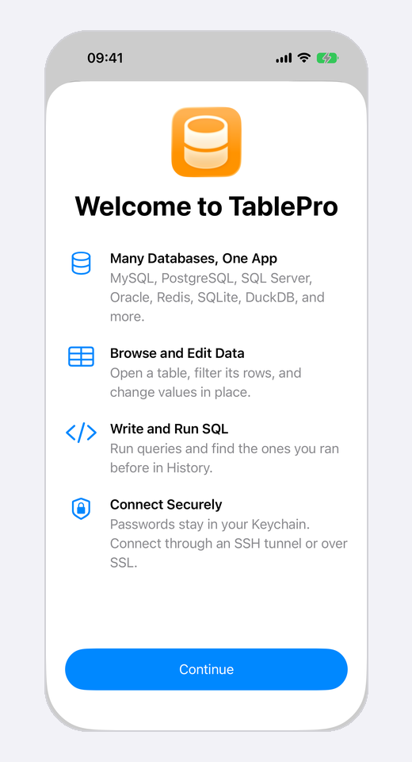
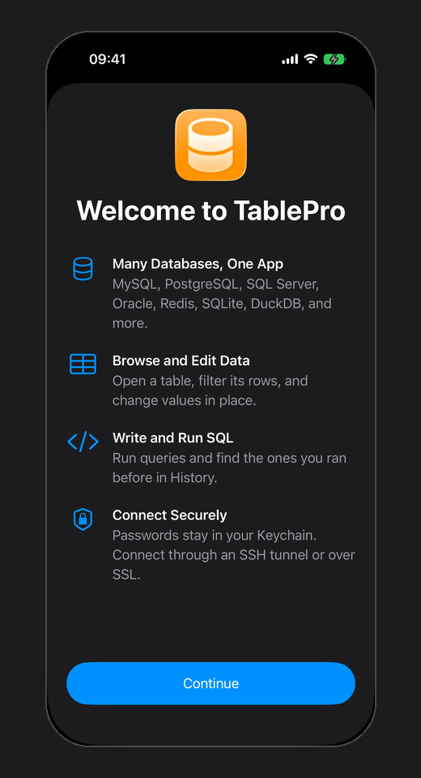
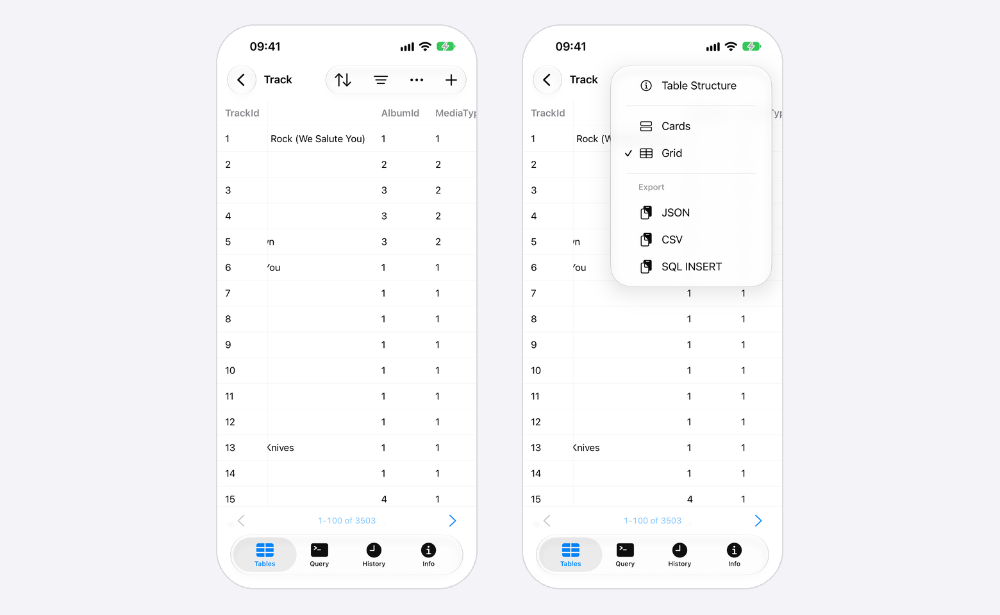
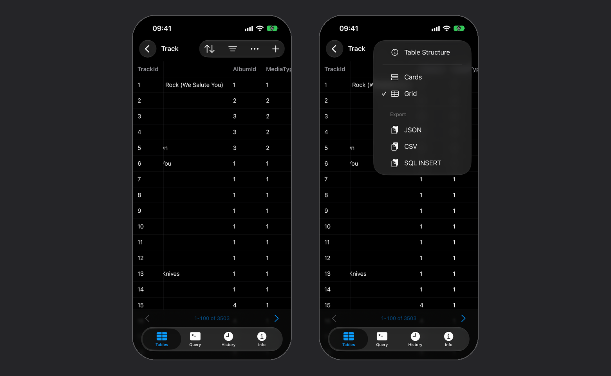
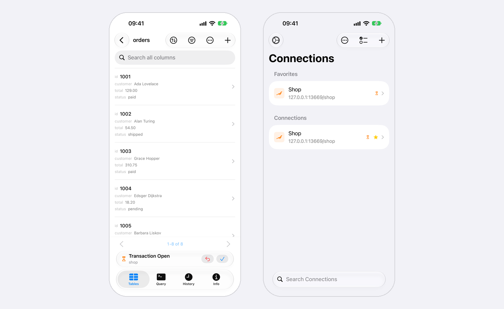
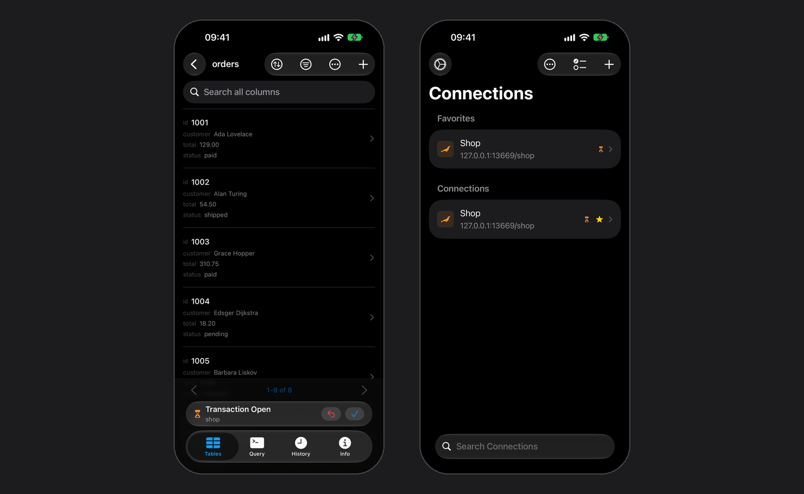

You need iOS 18 or later. Builds ship on their own schedule, so a feature in a Mac release note may not be on your phone yet. Your version and build are under **Settings > About**. Connections and saved queries from a Mac come over iCloud; the rest of your Mac setup stays on the Mac.

<Frame caption="The connection list and Settings on iPhone">
  
  
</Frame>

## First launch

A welcome sheet lists what the app does. **Continue** leads to at most two questions, each asked once:

| Question | Shown when | If you swipe the sheet away |
| --- | --- | --- |
| **Sync with iCloud** | The device is signed in to iCloud | Sync stays off |
| **Share Usage Data?** | Until you answer it | Nothing is sent |

Both answers can change later, under **Settings > iCloud** and **Settings > Privacy**. After an update, a **What's New** sheet lists what changed, once per version.

<Frame caption="Swipe the sheet down to skip both questions">
  
  
</Frame>

## Supported databases

Every driver is compiled in, so there is no plugin system and nothing to install. The type picker offers these thirteen:

| Type | Notes |
| --- | --- |
| **MySQL** / **MariaDB** | Port 3306 by default |
| **TiDB** | Port 4000 by default. Sequences are not listed as tables |
| **OceanBase** | Port 2881 by default. Sign in as `user@tenant` |
| **PostgreSQL** | Port 5432 by default |
| **SQL Server** | TDS, including Microsoft Entra ID sign-in on a connection synced from the Mac |
| **Oracle** | Service name or SID |
| **ClickHouse** | Port 8123 by default, the HTTP interface |
| **Cloudflare D1** | No host or port: an **Account ID** and an **API Token**, then pick the database from the account |
| **MongoDB** | Port 27017 by default. **Hosts** takes every server of a replica set |
| **Redis** | Port 6379 by default |
| **SQLite** | Copies the file you pick into the app |
| **DuckDB** | A file on the device, or in-memory |

<Info>
Redshift is not in the picker, but the driver is present: a Redshift connection created on the Mac connects once it syncs over.
</Info>

Cassandra, BigQuery, Spanner, Snowflake and the rest have no iOS driver. Their connections still sync and sit in the list dimmed, marked **Opens on Mac only**. A tap says why and connects nothing. Rename, move, edit or delete one as usual; the fields you leave alone sync back to the Mac intact. Importing a `.tablepro` file marks these rows the same way.

<Frame caption="Tap a Mac-only connection to see why it stays closed">
  
  
</Frame>

## The connection list

Favorites come first, then **Recent** with the five connections opened last, then your groups, nested the way the Mac nests them. The **More** menu holds **Sort By** (**Manual**, **Name**, **Database Type**, **Last Connected**), **New Group**, **Manage Tags**, **Open Sample Database**, and import and export. Type a tag's name in the search field to filter by it; with two tags or more chosen, **Match All Tags** appears in the **More** menu.

| To | Do this |
| --- | --- |
| Favorite a connection | Swipe right on it, or touch and hold and choose **Add to Favorites** |
| Rename | Touch and hold, choose **Rename**, type the name, and tap **Done** |
| Move into a group | Touch and hold and choose **Move to Group**, or drag the row onto a group |
| Reorder | Tap **Edit** and drag the handles, with **Sort By** on **Manual** |
| Change several at once | Tap **Edit**, select the rows, and tap **Move**, **Favorite** or **Delete** |
| Delete | Swipe left, or touch and hold and choose **Delete** |
| Edit or delete a group | Swipe right on the group to edit its name, icon and color, swipe left to delete it |
| Change a connection's icon | Open the connection's form, tap **Icon** under **Organization**, and pick a symbol, or **Default** for the database logo |
| Delete a tag | Open **More > Manage Tags**, then swipe left on the tag, or touch and hold it and choose **Delete Tag**. Built-in tags cannot be deleted |
| Sync now | Pull down on the list, with iCloud Sync on |

**Duplicate** copies the saved password, SSH secrets, client certificates and file access along with the settings. Recent and the sort order stay on the device.

A connection, group or tag form with unsaved changes stays open when swiped down, and **Cancel** asks before it discards them.

## The sample database

**Open Sample Database** sits on the empty list and in the **More** menu. It opens Chinook, a SQLite database of a music store, at its **Track** table, with no server to set up. The sample stays on this device: it never syncs, exports or hands off to another device. To throw away your edits, touch and hold **Chinook (Sample)** and choose **Reset Database**.

## What syncs over

The same CloudKit container as the Mac. iCloud Sync is off on both until you turn it on: here during first launch or under **Settings > iCloud**. While it is off nothing leaves the device, and edits made in the meantime go up when you turn it back on, provided the device is still signed in to the same Apple Account. Sign in to a different Apple Account and sync starts over for that account: its connections come down, edits not yet sent go up to it, deletions not yet sent are dropped, and the other connections already on the device stay and go up the next time you edit them. Four kinds of data cross: connections (host, port, SSH tunnel and SSL settings, color, icon, safe mode level, favorite), groups with their nesting and icons, tags, and [saved queries](#saved-queries) with their folders. Saved queries have no switch of their own here and sync whenever iCloud Sync is on. SSH profiles, table favorites, and app settings are skipped, and query history on the phone is only what you ran on the phone.

Four things a connection depends on are per device and never sync:

| Per device | What you see | What to do |
| --- | --- | --- |
| CA and client certificates | The SSL section reads **Not set** | Import them here. One PKCS#12 file covers the client certificate and its key |
| An SSH key file | It arrived as a path on the Mac, so the tunnel cannot find it | Pick the key on this device, or paste it into **Private Key** |
| A jump host's key file | The hop under **Jump Hosts** reads **No key on this device** | Open the hop and pick or paste its key, or turn on **Same Key as SSH Server** |
| SQLite and DuckDB files | Opening one says the file isn't available on this device | Edit the connection and pick the file here |

Passwords, a Cloudflare D1 API token included, are a separate opt-in, off by default, at **Settings > iCloud > Sync Passwords**. They ride iCloud Keychain and only new saves are affected, so re-save a password on the Mac to push it across. A private key saved on this device, a jump host's included, follows the same setting: with **Sync Passwords** on, iCloud Keychain copies the key to your other iPhones and iPads, which use it, and to your Mac, which does not. Coming back to the app syncs too, at most once a minute. Pull down on the connection list to sync now; a background refresh runs about every 30 minutes.

When a sync cannot finish, the connection list and **Settings > iCloud** name the reason, and changes made meanwhile wait on the device. For **iCloud Storage Is Full**, open the Settings app, tap your name, then tap **iCloud**, and free up space or add storage. The upload is tried again after 5 minutes, then twice as long each time up to an hour; pull down on the list to try at once. For **TablePro Data Was Removed from iCloud**, choose **Upload Again** to send everything on the device back up, or **Turn Off iCloud Sync** to keep it here only.

A change that syncs in while a connection is open leaves the screen where it is. A change to how it connects, such as a new host, port, username, database, SSH tunnel or SSL mode, reconnects it once no row or form on it has unsaved changes. Saving a new password, SSH password, key passphrase, private key or certificate for an open connection reconnects it the same way. A connection deleted on another device shows **Connection Deleted** before returning to the list.

<Warning>
Picking a SQLite file copies it into the app, and edits go to that copy, so the original never changes and the two drift apart. DuckDB writes back to the file you picked.
</Warning>

A database created with **Create New Database**, or copied in by picking it, stays with its connection through an app update and a restore from backup. A file that is gone is reported as unavailable, and so is a file connection synced from another iPhone or iPad; the connection never opens an empty database, or a file of the same name on this device, in its place.

## IAM sign-in

Short-lived tokens replace the password for [AWS IAM](/connections/aws-iam) on Amazon RDS and Aurora (MySQL, MariaDB, PostgreSQL) and ElastiCache (Redis), and for [Google Cloud IAM](/connections/cloud-sql-proxy#iam-sign-in-without-the-proxy) on Cloud SQL (MySQL, PostgreSQL). Pick the method under **Authentication** in the connection's form, and the **Password** field goes away. Each connect signs a fresh token and never saves it.

The methods match the Mac's, but two of them read files that only the Mac has:

| Method | What this device needs |
| --- | --- |
| **AWS IAM (Access Key)** | The access key in the form. With **Sync Passwords** on, a key saved on the Mac comes over |
| **AWS IAM (Profile)** | A key under **Access Key for This Device**, since the profile is read from files on the Mac |
| **AWS IAM (SSO)** | **Start URL** and **SSO Region** under **IAM Identity Center**, then **Sign In with IAM Identity Center** and an **Account** and **Role** |
| **Google Cloud IAM (Service Account)** | The JSON key: tap **Service Account Key** to paste it or choose the file. A key pasted on the Mac comes over with **Sync Passwords**; a key file on the Mac does not |
| **Google Cloud IAM (Application Default)** | A service account key under **Key for This Device**, since the `gcloud` credentials are files on the Mac |

A key for this device and the IAM Identity Center settings stay on this device. They never sync, whatever **Sync Passwords** says, and the connection on the Mac does not change. Opening a connection that still needs one says which, with **Edit Connection** to add it.

<Frame caption="A Profile connection signs in once this device has its own access key">
  
  
</Frame>

**Sign In with IAM Identity Center** shows a code and opens the browser; confirm the code there. The sign-in renews itself with its refresh token until the IAM Identity Center session ends; after that, opening the connection offers to sign in again.

A token needs an encrypted connection. A MySQL, MariaDB or PostgreSQL connection with **SSL Mode** on **Disabled** or **Preferred** connects with **Required**, and a server that offers no TLS is refused before the token is sent. A Redis connection with SSL off fails until you turn SSL on.

## What works

An open connection fills the screen and carries four sections: **Tables**, **Query**, **History**, **Info**. They sit in a tab bar on iPhone and in a sidebar on iPad.

On iPad, and on iPhone Duo's inner display, the table list and the open table sit side by side. At phone width the list fills the screen and a table opens over it.

On iPhone Duo the system draws the toolbar and the tab bar down the side of the display. The outer display is 466 by 678 points, shorter than any other iPhone, so rows keep the height those bars would have taken across the top and bottom. `Cmd+1` through `Cmd+4` switch between them on a keyboard, a toolbar menu switches database and schema when the engine has more than one, and **Connections** returns to the list.

### Browsing

Rows show as cards or as a grid. Pick **Cards** or **Grid** in a table's **More** menu, or in the **More** menu of **Query** once it has results, and the choice applies everywhere. iPhone starts with cards and iPad with the grid. A card previews four of its fields, and eight where the display is wide enough. The grid shows one row per line under a fixed header, and the row's key column stays at the leading edge while the other columns scroll sideways. Touch and hold a row in either layout to share, copy, or delete it.

<Frame caption="The key column stays put while the other columns scroll">
  
  
</Frame>

Search the table list by name. A PostgreSQL materialized view sits under **Views** and opens read only. Page a table at 50, 100, 200, or 500 rows, jump to a page number, sort by a column, search text columns, and stack filters with AND or OR. On PostgreSQL, ClickHouse, SQL Server and Oracle, pages follow the primary key, after your sort when you pick one, so paging never repeats or skips a row. The search field types quotes and dashes as you key them, so `O'Brien` finds `O'Brien` with Smart Punctuation on.

To follow a foreign key, tap the link under its value on a row, or long-press a row in the list and pick the key. A sheet previews the row it points at, titled with the table and, when it differs from the one open, the schema. A value in the preview that is itself a foreign key opens the next row in the same sheet, and **Back** returns one step. **Open Table** opens that table filtered to the key, and when one row matches it lands on that row, ready to edit. **Back** then returns to the filtered list and to the row you started from. While that row has an edit open, **Open Table** is dimmed.

<Frame caption="One more tap from the preview to the row in its table">
  
  
</Frame>

**Table Structure** lists columns, indexes, and foreign keys, read only. An index shows its key columns and expressions in key order, then any `INCLUDE` columns and a partial index's `WHERE` clause. On Redshift the index list holds the DISTKEY and SORTKEY columns.

On MongoDB a collection opens as a table: its top-level fields are the columns, `_id` first, and a nested document or array reads as one line of JSON. Search matches text fields, and from MongoDB 4.2 a number, a date or an ObjectId by its text too. The filters offer every operator except the LIKE patterns, and **Table Structure** lists the fields found in a sample of documents and the indexes.

On Redis the list holds the current database's keys. A key opens by type: a string's value, a hash's fields, a list's elements by index, a set's members, a sorted set's members and scores, a stream's entries. There is no search, sort, filter or **Table Structure** for a key.

### Editing

Tap a row to open it full screen, page between rows, edit values, toggle one to `NULL`, and save. An emptied date, number, boolean or JSON field saves `NULL`, and in a NOT NULL column it keeps its value; an emptied text field saves an empty string. While you edit, **Cancel** takes the place of the back button and asks before it throws away a changed value, and so does **Connections** in another tab. Inserting and deleting rows, and truncating or dropping a table, are here too; a PostgreSQL foreign table offers neither Truncate nor Drop. Editing needs a primary key, and a row whose key holds binary data opens read only.

A ClickHouse key is not unique, so a ClickHouse row is matched on every value it holds: a save is an `ALTER TABLE … UPDATE` and a delete an `ALTER TABLE … DELETE`, and a row holding a value over 4 KB or binary data opens read only, with no **Load full value**. Each one waits until the server has applied it. When another row holds the same value in every column, the save or delete is refused with **Identical Rows**, since it would change both.

A MongoDB document is found by its `_id`: a save sets the fields you changed, a delete removes that document, and a nested value edits as JSON. A save or delete is refused when the `_id` text reads as two of the types the collection holds, such as an ObjectId and a string, since the row could be either.

A new row starts with every column on **DEFAULT**, which leaves that column out of the `INSERT` so the database fills it in. The badge beside a field switches it between **DEFAULT**, **NULL** and a typed value, and **NULL** is offered on nullable columns only. Generated columns are never written, and an auto-increment key stays on **DEFAULT** until you type one.

A save, insert, delete, truncate or drop runs inside a read-write transaction, except on ClickHouse and MongoDB, which have none. MySQL, MariaDB, TiDB, PostgreSQL, Redshift, Oracle and SQLite report what their session is already holding, and a write there runs inside that rather than under a transaction of its own, so the rows wait for whoever opened it. A server that starts its sessions read-only is a different problem: see [Server read-only is not Safe Mode](/features/safe-mode#server-read-only-is-not-safe-mode). SQL typed into the Query section is yours and goes out as written.

### JSON values

A `json` or `jsonb` field opens indented on the row screen. Tap **View as JSON** to read all of it: **Text** shows the value indented, and **Tree** folds each object and array. Touch and hold a tree row for **Copy Value**, **Copy Key** and **Copy Key Path**, which copies a path such as `$.user.emails[0]`. A text column holding a JSON object or array offers **View as JSON** too.

<Frame caption="Tree mode starts with the first level open">
  
  
</Frame>

To change a JSON field, tap **Edit**, then **Edit JSON**. Smart quotes, dashes and autocorrect stay off, and the value saves exactly as typed; **Format** reindents it only when tapped. While the text is not valid JSON, the line under it names the spot, as in `Line 18, column 1: Unexpected character.`, and **Done** stays dimmed. Tap that line to move the cursor there.

A table value over 4 KB arrives cut. Tap **Load full value** first; until then it is plain text with no **View as JSON**. A **Query** result keeps long values whole while they fit in the memory the device has free; past that they arrive cut, the result says so, and the row marks them **Shown in part**. A value too long to show on the row opens in full with **View Full Value**.

### Querying

Suggestions fill the bar above the keyboard as you type, in front of the fixed keys. After `FROM`, `JOIN`, `INTO` or `UPDATE` they are tables and views; after `SELECT`, `WHERE`, `ON` or `SET`, the columns of the tables the statement names, and the engine's own functions; elsewhere, keywords. An alias and a dot, as in `i.`, give that table's columns, and a schema and a dot, as in `sales.`, give that schema's tables (a database on MySQL and MariaDB). Comparing an enum column, as in `status = `, offers its values. Tap one to replace the word you are typing, quoted when the engine needs it. A table's columns load the first time it needs them and again after each run, over a second connection where the engine allows one, so typing leaves what `SELECT ROW_COUNT()` or `SHOW WARNINGS` reports for your last statement alone. On iPad with a hardware keyboard, `Tab` inserts the first suggestion and `Escape` hides the bar until you type or move the cursor.

<Frame caption="Tables after FROM, columns after an alias">
  
  
</Frame>

**Run** sends the statement the cursor is in, and a faint band behind the text marks it before you tap. Select text first to send the selection instead; a selection hides the band. With the cursor past the last statement or inside a comment, **Run** sends nothing, keeps the last result, and shows "The cursor is not in a statement." Past 10,000 characters the editor drops its colors and the band, and **Run** still finds the statement.

Touch and hold **Run** for **Run All Statements**, which sends every statement in the editor in order. It is in the **More** menu too. On a hardware keyboard, `Cmd+Enter` runs the statement or the selection, `Cmd+Shift+Enter` runs every statement, and `Cmd+.` stops. On iPad the menu bar's **Query** menu lists **Run Statement**, **Run All Statements**, **Stop** and **Clear Query**, and its **View** menu switches sections with `Cmd+1` through `Cmd+4`.

On MySQL, MariaDB, TiDB, OceanBase and SQL Server, a `USE` you run moves the table list and the database menu to that database, and a dropped connection reconnects there; while a window has unsaved changes on the connection, the `USE` is undone and a message says why. Until a run with a `USE` ends and the menu has followed it, **Run** waits in every window. **Tables** names the database the menu shows in every statement it sends, as `[database].[schema].[table]` on SQL Server, so a save, insert, delete, truncate or drop reaches the table on screen wherever the session sits. On PostgreSQL, a `SET search_path` you run, or a **Roll Back** that undoes one, moves the schema menu to the schema the session uses.

Tap a query in **History** or **Saved Queries**, or a table under **SELECT * FROM ...** in the **More** menu, to add it to the editor. It fills an empty editor; otherwise it goes after your text as a statement of its own, with the cursor in it, and **Undo** takes it back. A statement that creates, alters or drops a table refreshes the table list in every window open on the connection. **History** keeps the last 200 runs on the device, fewer once their text passes 2 MB, and drops the oldest first, so a script it shows is always whole.

<Frame caption="The band marks the statement Run sends">
  
  
</Frame>

Safe Mode reads only the text that runs, so a `SELECT` before an `UPDATE` runs without the **Confirm Writes** question. Each statement commits as it runs unless your script opened a transaction. The result area shows the last statement's rows, or how many rows the run changed. The first statement that fails ends the run: the error names its position, as in `Statement 2/3 failed`, and, where the connection reports its transaction state, whether the statements before it stay applied or wait in your open transaction.

On SQL Server, lines with no semicolon between them are one statement up to the next line holding only `GO`, so **Run** sends that batch. In a selection or **Run All Statements**, each `GO` line ends a batch, each batch goes to the server whole, and `GO 5` runs its batch five times.

On MongoDB the editor takes the shell JavaScript the Mac takes. A statement ends where the program's top level does, so a loop or a function body runs whole, and Safe Mode counts a statement as a read only when every call in it reads and its arguments are plain data: see [MongoDB](/databases/mongodb#writing-queries). `use analytics` moves the table list and the database menu along with it once the statement returns, a stopped one included. While a window, this one included, has unsaved changes on the connection, the `use` is undone instead. Browsing and row edits always run in the database the menu names.

On Redis a command ends at a semicolon or at a line break outside quotes, so each line is its own command and a quoted value may run across lines. A command with an unclosed quote fails without running. Quotes and escapes read as they do on the Mac: see [Redis CLI](/databases/redis#redis-cli).

**Stop** cancels the running statement and starts no other. On MySQL and Redis the statement keeps running on the server until it finishes. Results copy or export as JSON, CSV, or SQL `INSERT`, which Redis and MongoDB leave out. In JSON, a numeric column gives numbers and a boolean column `true` or `false`; every other typed column gives strings, so a `VARCHAR` holding `1e10` or `true` stays text. A column with no type, such as `count(*)` on SQLite, gives a number or a boolean when its value reads as one. A value shown in part, or a binary value, stops the copy or export with **Cannot Export**: leave that column out of the `SELECT`. A result too large for the memory left stops it with a message to return fewer rows. Copying rows from a table reads values over 4 KB in full first.

A running query appears in a Live Activity on the lock screen and Dynamic Island, with the elapsed time and the row count so far. **Settings > Live Activities > Hide Query** replaces the SQL text there with "Running query". The card clears when the query ends. Quitting the app mid-query leaves it behind, marked interrupted, until the next launch clears it.

### Saved queries

Open the **More** menu (•••) beside **Run** and choose **Saved Queries**. The list holds this connection's queries and the global ones, in their folders, and search matches names, keywords and SQL. Tap a query to add its SQL to the editor the way a **History** entry goes in: it fills an empty editor, otherwise it follows your text and **Undo** takes it back. Nothing runs until you tap **Run**.

**Save Query…** in the same menu keeps the editor's text, with the first line of the SQL filled in as its name. Turn on **Global** to list the query on every connection. Keywords and the size limit follow the [Mac's rules](/features/favorites#keywords), and a keyword expands in the Mac's editor only.

<Frame caption="A globe marks a global query">
  
  
</Frame>

| To | Do this |
| --- | --- |
| Rename, move or delete a query | Touch and hold it and choose **Rename**, **Move to Folder…** or **Delete** |
| Change its name, folder, keyword or scope | Swipe right on it, or touch and hold it and choose **Edit…** |
| Add a folder | Tap **New Folder** at the top of the list, or touch and hold a folder and choose **New Subfolder** |
| Rename a folder, make it global, or delete it | Touch and hold the folder. Deleting one moves what it held up a level |

To change a saved query's SQL, edit it on the Mac. Version history and linked SQL folders are Mac only.

### Open transactions

After `BEGIN` in **Query**, a bar sits at the bottom of every section until the transaction ends, by its buttons or by a typed `COMMIT` or `ROLLBACK`. A typed `ROLLBACK` reloads open tables and closes row screens the way **Roll Back** does. On a MySQL or MariaDB server with autocommit off, opening a table is enough to start one. The bar names the database, or the connection on an engine with one database, and the connection list marks the row with an hourglass. Where their titles do not fit, **Roll Back** and **Commit** show as an arrow and a checkmark.

<Frame caption="The mark stays on the list after you leave the connection">
  
  
</Frame>

**Roll Back** asks first at every [safe mode](/features/safe-mode) level. **Commit** follows the level:

| Safe Mode | Commit |
| --- | --- |
| **Off** | Commits at once |
| **Confirm Writes** | Asks first |
| **Read-Only** | Hidden |

**Transaction Failed** means a PostgreSQL statement inside it failed, and the server keeps none of it. Only **Roll Back** is offered, and a typed `COMMIT` rolls it back as well.

The bar shows on PostgreSQL, Redshift, MySQL, MariaDB, TiDB, SQLite, Oracle, DuckDB and SQL Server. OceanBase does not report its session state, so an open transaction there shows nothing.

A connection that drops with a transaction open reconnects and says the server rolled the transaction back. One that drops during **Commit** never got the answer: check which changes were saved before running them again. Switching database on PostgreSQL or Redshift, saving a connection edit that reconnects, or deleting the connection asks first while a transaction is open, since each rolls it back. On MySQL, MariaDB, TiDB, OceanBase and Oracle, **Truncate** and **Drop** commit an open transaction, and their confirmation says so. Two iPad windows on one connection follow each other's database switch.

### When the connection drops

Returning to the app, reopening a connection that is still open, or a tunnel that dies checks the session, and one that stopped answering is dialed again once. While that runs, **Reconnecting** and a spinner sit in the toolbar and the screen stays as it was. A database or schema switch shows **Switching to \<name\>…** in the same place; the content takes no taps until it lands, and the tabs and **Connections** stay usable.

When the redial fails, **Connection lost** takes the screen with the error and **Reconnect**. A row with unsaved edits keeps its screen instead, and **Reconnect** sits in the toolbar. A connect that fails shows its error the same way, with **Edit Connection** beside **Reconnect** when the fix is in the form.

The **Status** row in **Info** uses the same words: **Connected**, **Not Connected**, **Connecting**, **Reconnecting**, **Connection lost** or **Couldn't connect**.

## What is missing

- **Schema changes.** Truncating and dropping a table is the whole list; creating or altering tables, columns, indexes, triggers, and views is Mac only, and so is creating or dropping a Cloudflare D1 database.
- **Changing Redis data.** Keys open read only; change them in **Query**.
- **Whole MongoDB documents.** **Edit Document…**, **Insert Document…** and renaming or removing a field are Mac only; edit field by field here, or use **Query**.
- **Socket connections.** A MySQL or MariaDB connection that uses a socket on the Mac opens there only. The connection list shows **Mac socket** and the path, marked **Opens on Mac only**, and a tap says why. Importing a `.tablepro` file marks such a row the same way. Its socket path syncs here and back intact.
- **AI.** No chat, no inline suggestions, no MCP server.

## Security

Turn on Face ID, Touch ID, or Optic ID under **Settings > Security**. A cold launch always asks, and the connection from your last session waits behind that question: no connecting screen, no host key prompt, nothing dialed until you authenticate. After that **Auto-Lock** relocks immediately or after 1, 5, 15, or 60 minutes idle, starting at 5. The lock covers open sheets and connections, and the app switcher shows a locked card instead of your data; a connection open underneath stays connected. Turning the lock off asks you to authenticate first.

Each connection carries its own [safe mode](/features/safe-mode) level, synced from the Mac. Set it with **Safe Mode** under **Organization** in the connection's form. iOS has three: **Off**, **Confirm Writes**, and **Read-Only**, which refuses writes outright. A read can still call a function that writes, such as `SELECT purge_orders()`. At Read-Only on PostgreSQL, MySQL 5.6.5 and later, and MariaDB 10.0 and later, **Query** runs each statement in the server's read-only transaction and then rolls it back. The server refuses a write the function makes in that transaction. On PostgreSQL, a setting it changes, as with `set_config`, is undone. What a function does outside the transaction still happens: `dblink_exec` writes over a connection of its own, and `pg_terminate_backend` and `GET_LOCK` act on the server. Some sessions cannot take the read-only transaction: OceanBase, Oracle, MySQL before 5.6.5, MariaDB before 10.0, and a session with a transaction or a `LOCK TABLES` open. A MySQL or MariaDB session with autocommit off has a transaction open after any statement. There, Read-Only refuses a query that calls a function outside TablePro's list of built-ins; switch to **Confirm Writes** to run it. **Default Safe Mode** under **Settings > New Connections** sets the level a new connection starts at.

SSH tunnels authenticate with a password, a private key or **Keyboard Interactive**. A tunnel set to **SSH Agent** on the Mac signs in here with a private key on this device and stays **SSH Agent** on the Mac. When the server asks for more, after the password or key or through keyboard-interactive, a password prompt gets the SSH password and a code prompt gets the code from **Two-Factor Authentication**. Any other question, or a code in **Prompt at Connect** mode, appears on the connection's screen for you to answer. **Auto Generate** takes the Base32 secret from your authenticator setup with its algorithm, digits and period, and shares them with the Mac; a tunnel that follows a Mac SSH profile uses the profile's. A private key on a security key does not work here, and the **SSH Sign-In Unavailable** alert says so. An unknown host key, the SSH server's or a jump host's, prompts with its fingerprint first, on the connection's own screen. The question waits there until you answer it, and leaving the screen ends that attempt. A key pasted under **Paste Key**, or picked as a text file, is kept in the Keychain beside the connection's passwords, never in the saved connection list. A key file that is not text is copied into the app and read from there. Setting **Auth Method** to **Password**, choosing **Import File**, or turning **SSH Tunnel** off deletes the saved key when you tap **Save**. A tunnel the Mac forwards to a unix socket on the server forwards to the same socket here. Turning the tunnel off keeps its other settings, here and on the Mac, for when you turn it back on. A tunnel that drops while the connection is open reconnects it, as returning to the app does; see [When the connection drops](#when-the-connection-drops).

### Jump hosts

A tunnel that reaches its SSH server through bastions lists them under **Jump Hosts** in the connection's form, in the order they are dialed. Tap **Add Jump Host** to add one, touch and hold a hop to drag it to a new place, and swipe left to delete it. Each hop takes a host, a port, 22 when left empty, and a username, and signs in with a private key, never a password.

Hops synced from the Mac arrive with key paths that name files on the Mac, so each reads **No key on this device** until it gets one here. Open the hop and pick or paste its key, or turn on **Same Key as SSH Server** to reuse the server's key from this device. A hop's key file has to be text. The Mac keeps its own key paths for the same hops. A hop with no key or no username is named before anything is dialed.

<Frame caption="Hops synced from the Mac, before they have keys on this iPhone">
  
  
</Frame>

### Route from Mac

A tunnel whose SSH host is an alias in the Mac's `~/.ssh/config`, or that the Mac reaches through `ProxyJump`, opens here through the hosts the Mac dialed. They arrive once the Mac has connected, under **Route from Mac** in the connection's form: each jump host, then the SSH server, with the port and username the Mac used. Only hosts, ports and usernames cross; the config file, keys and key paths stay on the Mac. A hop only the Mac's config names reads **No key on this device** until you open it and pick or paste its key, as for any jump host. Changing the SSH server or jump hosts, here or on the Mac, sets the route aside until the Mac connects again, and a copy made here with **Duplicate** gets its own once the Mac connects to it.

### SSH profiles

A connection that uses an [SSH profile](/connections/ssh-profiles) on the Mac arrives with the profile's server, sign-in method and jump hosts, read only in the form: change them in the profile on the Mac. It signs in with the profile's password once the Mac syncs passwords to iCloud Keychain; until then the password field works as it does for any tunnel. A key passphrase saved here wins over the profile's, since it goes with the key on this device. Turning **SSH Tunnel** off unlinks the profile from that connection on every device.

## Privacy

Nothing is sent until you choose **Share Usage Data** on first launch, or turn on **Share Usage Data** under **Settings > Privacy**. While it is on, the app sends events to PostHog, the product analytics service, at `https://eu.i.posthog.com` in the EU:

| Event | Sent | Properties |
| --- | --- | --- |
| `app_opened` | Once per local day, ten seconds after the app comes to the front | `database_types` and `connection_count` of the connections open at that moment |
| `connection_attempted`, `connection_succeeded`, `first_query_executed` | Once per install | `database_type`, such as `PostgreSQL` or `SQL Server` |

Events carry a random ID that the library makes on the device, and PostHog builds no profile from it. The library, posthog-ios, adds the device model, screen size, language, time zone, whether the device is on Wi-Fi or cellular, the app's version, build and bundle ID, the iOS version, whether the build came from TestFlight, the library's version, and a random session ID. PostHog sees the IP address of each request and derives an approximate location from it, such as the country and city. While the switch is on, the library also fetches its settings from `eu-assets.i.posthog.com`.

No hostname, username, password, query, or row. With the switch off the app sends PostHog nothing, and a launch with it off never starts the library.

Earlier versions sent one report a day to TablePro's server instead. If you had chosen **Share Usage Data**, it stays on after the update and sends to PostHog, and a device that already reported its first connection and query does not send them again. If you declined, it stays off, and if you never answered, the question comes up on the next launch.

**Settings > About** holds the version, **What's New**, the privacy policy, and **Acknowledgements** for the open source libraries the app ships.

## Shortcuts and widgets

Three App Intents put the app in Shortcuts, the Share Sheet, and Siri: **Open Connection**, **Add Row to Table**, **Add Rows to Table**. See [Shortcuts](/integrations/shortcuts) for pickers, data formats, and limits.

A **Quick Connect** home screen widget opens a saved connection directly and leaves out the ones that open on the Mac only. Handoff carries an open connection between devices. A `tablepro://connect/<uuid>` link opens a connection and `tablepro://connect/<uuid>/table/<name>` opens a table; the Mac's other links do less or nothing here, as [URL scheme](/developers/url-scheme#on-iphone-and-ipad) lists. A `.tablepro` file from Files or AirDrop imports its connections and saved queries.
