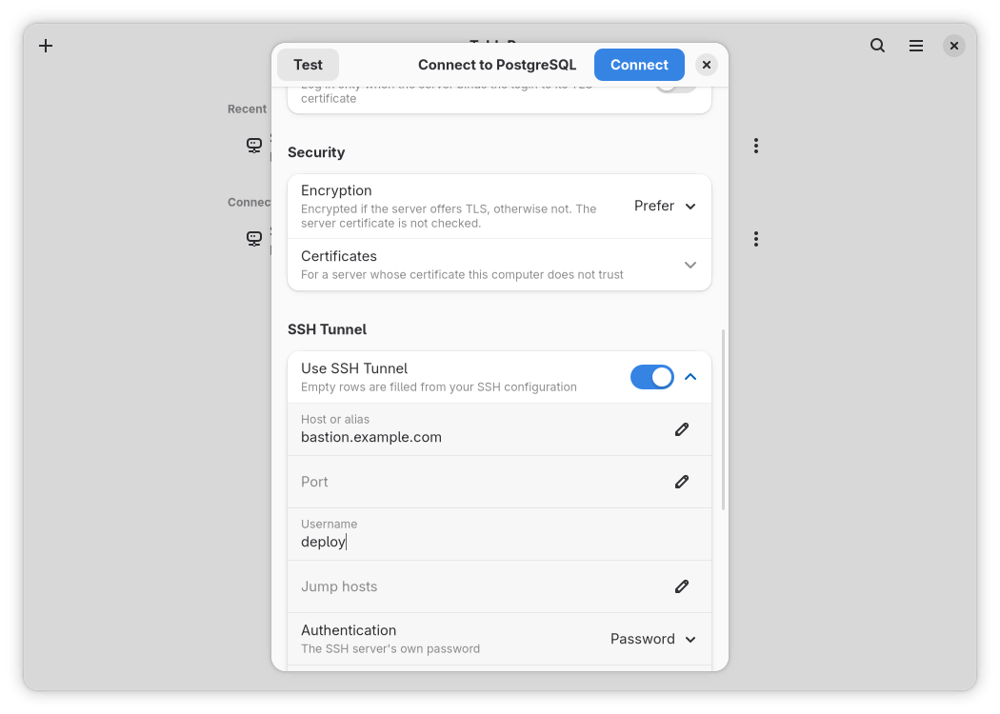

A window holds several connection sessions and their tabs. The selected tab decides the active connection for window actions, banners and the assistant. Check its connection and database labels before running a query or changing data.

Opening a connection that is already open brings its window and session forward. **New Window** (`Ctrl+Shift+N`) starts another with the connection list. **Open Database…** on a connection's sidebar row opens another database as a session in the same window.

<Frame caption="Configure a PostgreSQL SSH tunnel before testing the connection">
  
</Frame>

## Engines

Every driver is compiled into the app. Pick the one in **Driver**:

| Engine | Driver | Default port |
|---|---|---|
| PostgreSQL | **PostgreSQL** | 5432 |
| MySQL and MariaDB | **MySQL** | 3306 |
| SQL Server | **SQL Server** | 1433 |
| ClickHouse | **ClickHouse** | 8123 |
| Cassandra and ScyllaDB | **Cassandra / ScyllaDB** | 9042 |
| Redis | **Redis** | 6379 |
| MongoDB | **MongoDB** | 27017 |
| SQLite | **SQLite** | No port: a file |
| DuckDB | **DuckDB** | No port: a file |

The server releases each engine is tested against, and the ones it does not support, are in the app's [supported servers](https://github.com/TableProApp/TablePro/blob/main/linux/README.md#supported-servers) table.

Redshift, CockroachDB, TiDB, OceanBase and Databend are untested on Linux. Support through the PostgreSQL or MySQL drivers on Mac does not establish Linux compatibility.

## Limits

- Binary, array, spatial, composite and variant cells are read-only. Inspect or copy them in the grid; use a query to change them.
- Duration values, such as MySQL TIME values longer than a day, need text entry. For times of day and timestamps, use the clock in Row Details or enter text. Include an offset for types that store one.
- Redis Cluster and Sentinel are unsupported. Connect to a standalone Redis server instead.

## Add a connection

<Steps>
  <Step title="Open the connect dialog">
    Click **Add Connection** in an empty connection list, or choose **New Connection…** from the main menu.
  </Step>
  <Step title="Name the server">
    Pick the **Driver**, then fill **Host** and **Database**. **Port** starts on the engine's default.
  </Step>
  <Step title="Sign in">
    Fill **Username** and **Password**. With **Remember Password** on, the password goes to [secret storage](/linux/troubleshooting#passwords); with it off, every connect asks for it.
  </Step>
  <Step title="Test, then connect">
    **Test** connects once to check the settings, then disconnects. **Connect** saves the connection and adds its session to the window.
  </Step>
</Steps>

For a MongoDB replica set or cluster behind a `mongodb+srv://` address, turn on **DNS Seed List**. **Authentication Database (optional)** names the database that holds the user.

## Options

| Row | Sets |
|---|---|
| **Safe Mode** | What is asked before a write. See the next table |
| **External Clients** | What MCP clients may do on the connection: **Blocked**, **Read Only** (the default) or **Read & Write** |
| **AI Assistant** | Whether the assistant may send anything from the connection: **Ask Each Time** (the default), **Allow** or **Never** |
| **Custom Query Timeout** | An editor timeout for this connection in place of the one in Preferences. 0 turns it off |

Safe Mode is also in the main menu while connected, and a change there is saved to the connection.

| Safe Mode | Does |
|---|---|
| **Off**, the default | Asks only before DROP, TRUNCATE, and DELETE or UPDATE without WHERE |
| **Confirm Writes** | Asks before every statement that changes the database, showing the SQL and the connection |
| **Read-Only** | Opens the connection read-only, and refuses every editor statement that does not read |

Pick **Read-Only** for a production server you only read. Moving to or from it reconnects that connection's sessions.

## TLS

**Encryption** under **Security** picks the mode:

| Mode | Connection |
|---|---|
| **Disable** | Plain, no TLS |
| **Prefer** | PostgreSQL, MySQL and MariaDB only. Encrypted if the server offers TLS; otherwise unencrypted. The server certificate is not checked |
| **Require** | Encrypted. The server certificate is not checked |
| **Verify full** | Encrypted. The certificate must be valid for the server name |
| **Strict** | SQL Server only. TLS before the login, as TDS 8.0 needs. SQL Server 2022 or later on Windows, 2025 or later on Linux |

Choose **Verify full** to check the server certificate. For a server signed by your own certificate authority, choose its PEM file in **CA certificate** rather than dropping to **Require**.

New connections start with these defaults:

| Engine | Default encryption | Changes with connection options |
|---|---|---|
| PostgreSQL, MySQL, MariaDB | **Prefer** | None |
| SQL Server | **Verify full** | None |
| ClickHouse | **Disable** | **Verify full** on ports 443 and 8443 |
| MongoDB | **Disable** | **Verify full** with **DNS Seed List** on |
| Cassandra, ScyllaDB, Redis | **Disable** | None |

- **Client certificate** and **Client key** log in with a certificate, on every network engine but SQL Server.
- **TLS server name** checks the certificate against another name than the host. MySQL and MongoDB take it only through an SSH tunnel.
- A failed handshake says what went wrong. An unknown issuer takes you to **CA certificate**, a name mismatch to **TLS server name**.

## SSH tunnels

Turn on **Use SSH Tunnel** and fill **Host or alias**. Native packages run the system `ssh` client, so empty rows come from `~/.ssh/config`, and `known_hosts` and your SSH agent apply as they do in a terminal. For the bundle, check [Flatpak connections](#flatpak-connections).

| Authentication | Uses |
|---|---|
| **SSH agent** | Keys from the SSH agent and your SSH configuration |
| **Private key** | A key file, unlocked with **Passphrase** if it has one |
| **Password** | The SSH server's own password |
| **Keyboard-interactive** | The SSH server's own questions, such as a one-time code |

Use **SSH agent** by default. Choose **Private key** for a specific key file, or **Password** or **Keyboard-interactive** when the server requires it.

**Jump hosts** takes what `ssh -J` takes: `user@host:port`, several separated by commas.

An unknown or changed host key shows its SHA256 fingerprint before anything connects, even where `ssh_config` says `StrictHostKeyChecking accept-new` or `no`. [Troubleshooting](/linux/troubleshooting#ssh-tunnels) covers a changed or revoked key.

## SQLite and DuckDB files

With **SQLite** or **DuckDB** picked, **Database file** replaces the server rows. **Choose…** opens an existing file, and **New Database…** creates the file when you connect.

A file also opens straight from Files, through **Open With** on a SQLite database, or from a terminal:

```bash
tablepro app.sqlite3 sales.duckdb
```

The file's own header picks the engine, whatever its name. Each file opens as a session. A file on a network or FUSE filesystem asks whether to open it read-only first, because neither engine's locking holds there.

## SQL Server with Kerberos

Set **Method** to **Windows (Kerberos)**. There is no username or password: the driver uses the ticket `klist` shows, so get one first.

```bash
kinit you@EXAMPLE.COM
```

The driver asks for `MSSQLSvc/<host>:<port>` from the host and port you typed. Native packages use the default realm of the host's `/etc/krb5.conf`. Type the host name the SPN is registered for, not an IP address or a CNAME. A server in another realm works only when your KDC answers with a referral, as Active Directory does inside a forest.

## Flatpak connections

The bundle runs inside a sandbox. Check these differences before copying a native connection setup:

- Secrets use the Secret portal and an encrypted file inside the sandbox. Follow [keyring recovery](/linux/troubleshooting#passwords) if a password, MCP token or AI key cannot be stored.
- Kerberos uses the host's KCM ticket cache. The sandbox selects `/app/etc/krb5.conf`, with DNS realm and KDC lookup, instead of the host's `/etc/krb5.conf`. Obtain a ticket in KCM on the host; a file-backed ticket cache is not enough.
- SSH reads `~/.ssh/config`, keys and `known_hosts`, but not the host's `/etc/ssh` configuration. `ProxyCommand` and `Match exec` cannot run host-only helpers. Use a setup supported inside the sandbox or install a native package.
- File-backed FIDO keys cannot sign inside the sandbox. Load the key into the host SSH agent and choose **SSH agent**.
- A CA installed only on the host is absent from the runtime's trust store. Select its PEM file in **CA certificate** and keep **Verify full**.
