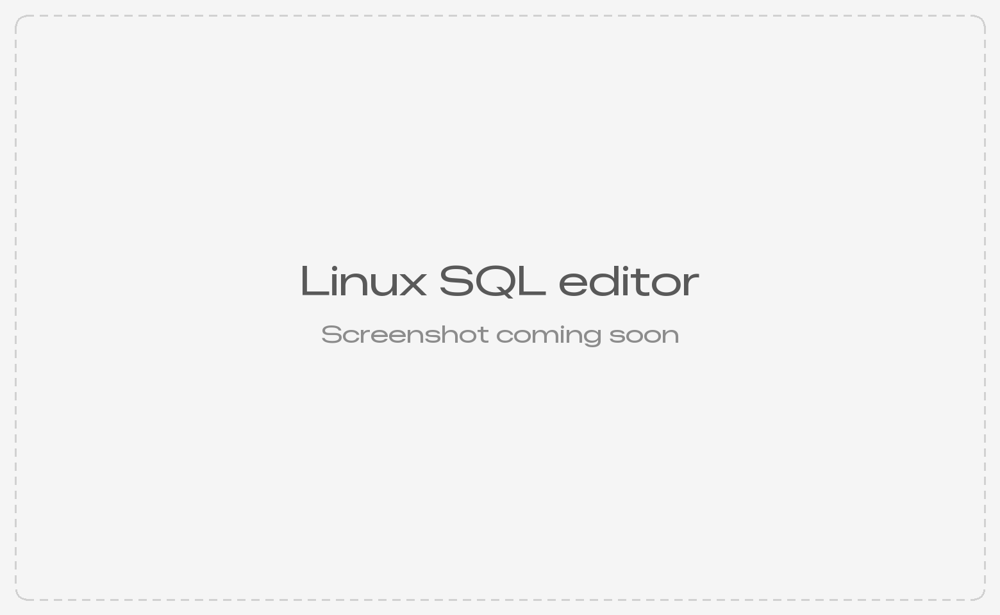
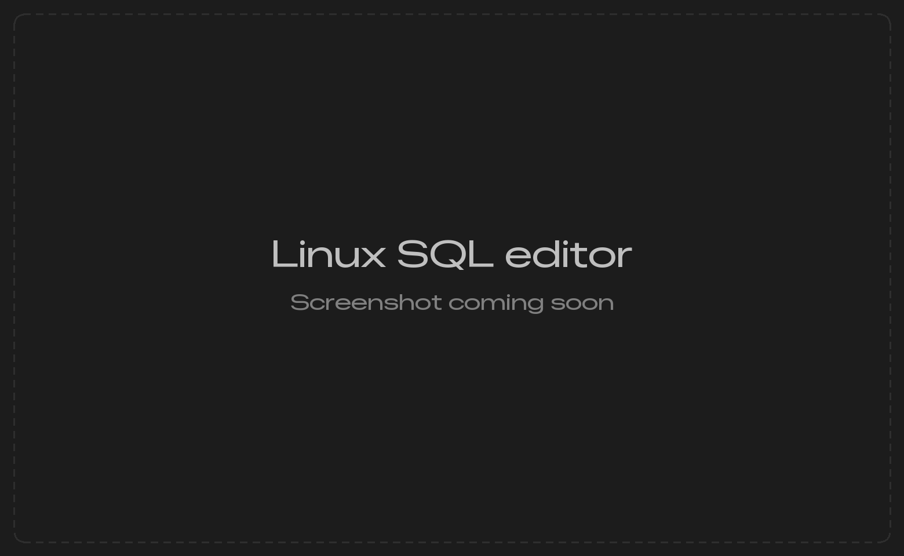

`Ctrl+T` opens an editor tab on the window's connection. In a window with no tab open, **Open SQL Editor** does the same.

<Frame caption="Each result set of a run is its own entry in the results list">
  
  
</Frame>

## Run

| Keys | Runs |
|---|---|
| `Ctrl+Enter` | The selection, or the whole text as a script |
| `Ctrl+Shift+Enter` | The statement at the cursor |
| `Escape`, or **Stop** | Stops the running query on the server |

A script is split the way its engine reads it, `DELIMITER` on MySQL and `GO` on SQL Server included, and sent one statement at a time, or one batch at a time on SQL Server. A failed statement stops the script, except on SQL Server, where the next batch runs.

Stopping cancels the statement on the server. Cassandra and ScyllaDB have no cancel, so the app stops waiting and the server runs the statement to its own timeout.

The editor gives up on a query after 60 seconds. Change that under **Preferences > Editor > Query timeout (seconds)**, or per connection with **Custom Query Timeout** in its [Options](/linux/connect#options). 0 turns the timeout off.

## Results

Each result set, row count, notice and error of a run is its own entry in the results list. A result keeps 10,000 rows and a run 100,000; past that a banner offers **Export All…**, which runs the statement again on a separate read-only connection and writes every row to a file. After a failed statement, **Go to Error** puts the cursor where the server places the error.

A statement that opens a transaction leaves **Commit** and **Roll Back** in the results pane until you pick one. Closing the window asks first while the transaction is open.

## Completion and snippets

Completion offers tables, views, columns, schemas, functions and keywords, and resolves aliases. Type a snippet's trigger, pick it in the list, then press `Tab` to move between its stops and `Shift+Tab` to go back.

| Trigger | Writes |
|---|---|
| `sel` | `SELECT … FROM … WHERE` |
| `ins` | `INSERT INTO … VALUES` |
| `upd` | `UPDATE … SET … WHERE`, and `ALTER TABLE … UPDATE … WHERE` on ClickHouse |
| `del` | `DELETE FROM … WHERE` |
| `selj` | `SELECT … JOIN … ON`, except on Cassandra and ScyllaDB |
| `ctab` | `CREATE TABLE` with an `id` key column |
| `cidx` | `CREATE INDEX` |

Your own snippets are `.snippets` files in GtkSourceView's snippet format, in the folder **Preferences > Editor > Snippets folder** shows. **Open Folder** creates it. A file added or changed takes effect without a restart, and a snippet with the same trigger replaces the built-in one. The format and the per-engine `languages` values are in the app's [README](https://github.com/TableProApp/TablePro/blob/main/linux/README.md#snippets).

## Files and drafts

`Ctrl+O` opens a `.sql` file into the tab, and so does dropping one on the editor. `Ctrl+S` saves back to it and `Ctrl+Shift+S` saves to another file.

The text of every editor tab is kept as you type. A connection's tabs, editor tabs with their text and table tabs with their page and sort, reopen when the connection opens.

## Multiple cursors

| Keys | Does |
|---|---|
| `Ctrl+D` | Selects the word at the cursor, then adds a cursor at its next match |
| `Ctrl+Shift+L` | Adds a cursor at every match of the selection or the word |
| `Shift+Alt+Up`, `Shift+Alt+Down` | Adds a cursor on the line above or under the cursor, in the same column |
| `Ctrl+click` | Adds a cursor, or removes the one you click |
| `Escape` | Returns to one cursor, keeping its selection |

Typing, deleting, pasting and moving work at every cursor, and one `Ctrl+Z` takes the edit back at all of them. A click, a find, **Format** or `Page Up` returns to one cursor.

## Vim mode

Turn on **Preferences > Editor > Vim Keybindings**. The line under the text shows the mode and the command you are typing, and the editor's own `Ctrl` shortcuts keep working in every mode. Every other key goes to Vim, `Escape` too, so use **Stop** to stop a running query.

| Command | Does |
|---|---|
| `:w` | Saves the tab's file, asking for one when the tab has none |
| `:e` | Reads the tab's file again, asking first when that loses changes |
| `:q` | Closes the tab, asking first about unsaved changes or an open transaction |
| `:wq`, `:x` | Saves, then closes the tab |

## Redis and MongoDB

On a Redis connection the editor takes Redis commands, one per line, and shows each reply as `redis-cli` does. On MongoDB it takes mongosh statements such as `db.orders.find()`, `aggregate`, `runCommand`, `use` and `show`, and shows one document per row.

## History and saved queries

`Ctrl+Shift+H` opens **Query History**: every run from the editor, with full-text search, filters by connection, time and status, and export as SQL or CSV. A run that can carry a password is left out.

**Save Query…** in the editor's menu keeps the text against the connection. **Saved Queries** in the main menu lists them, the window's connection first.
