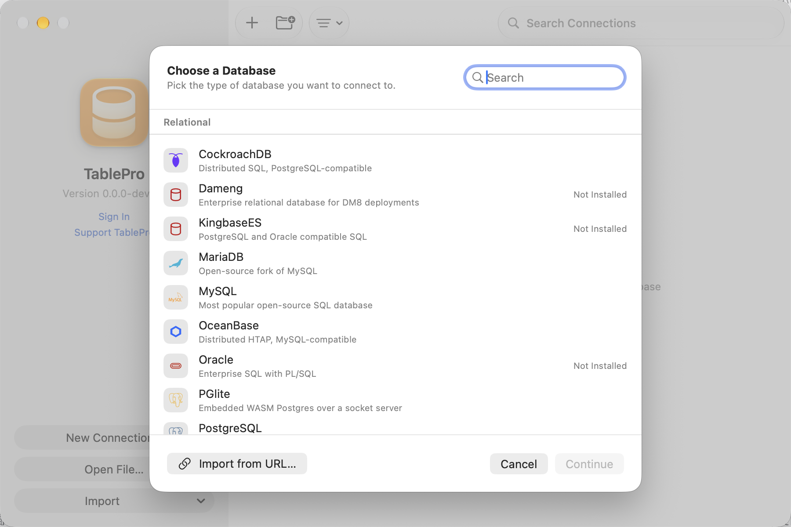
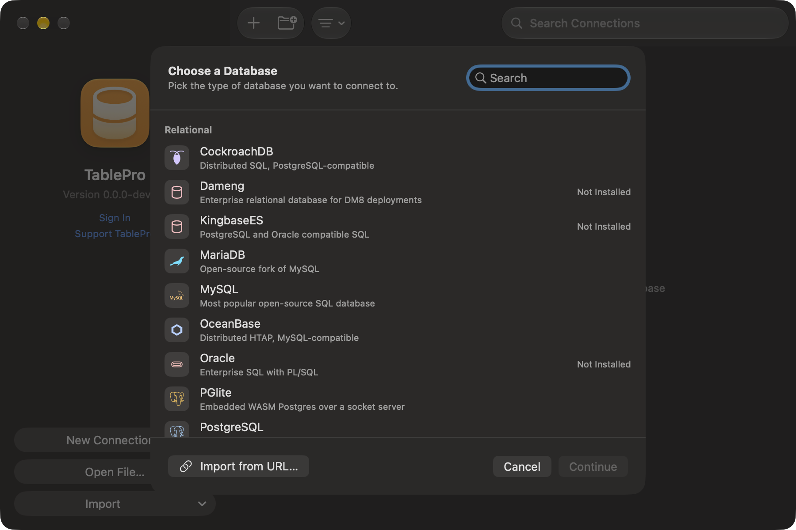
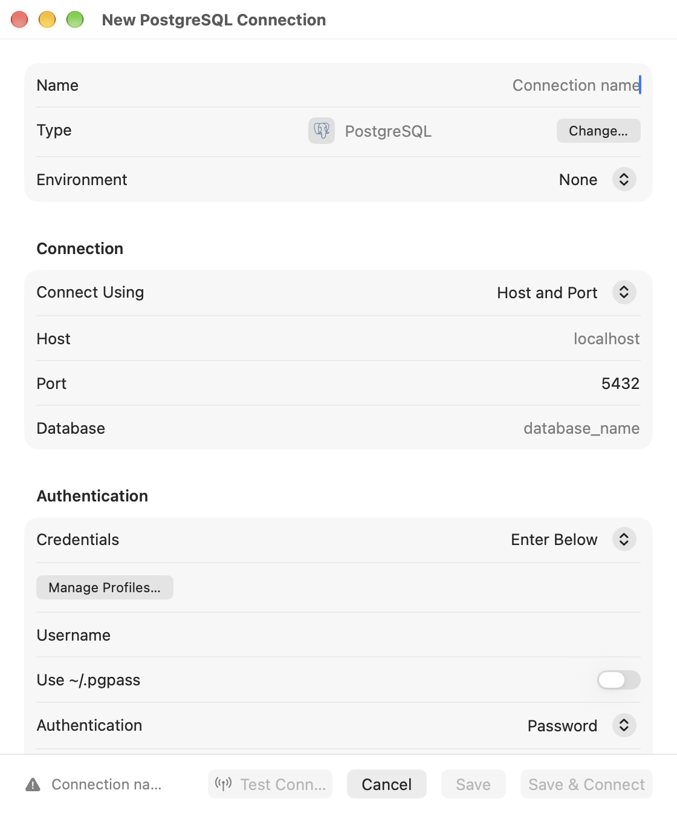
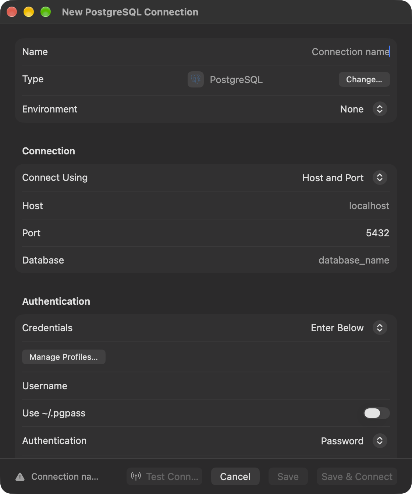
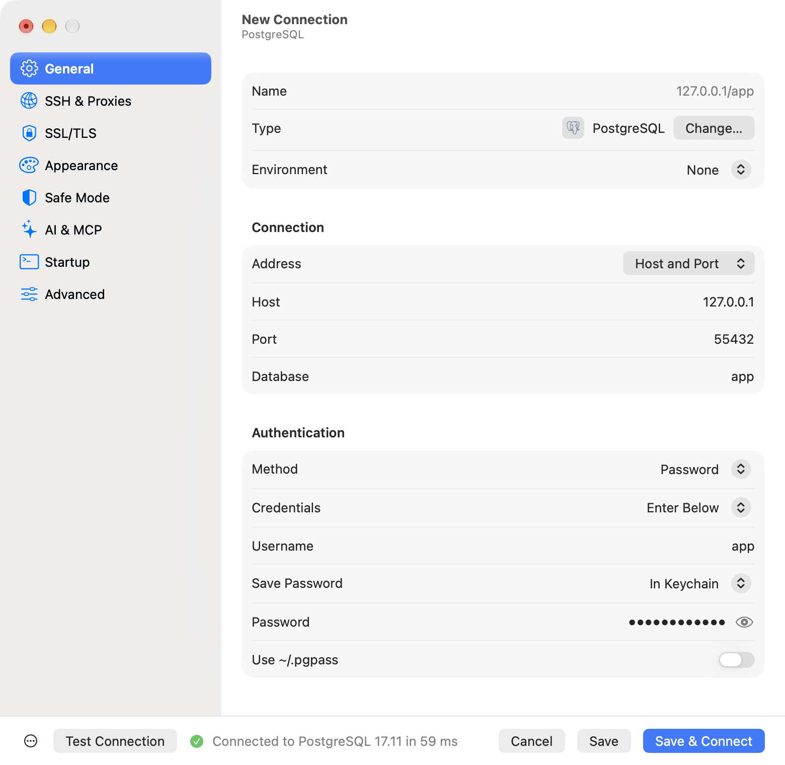
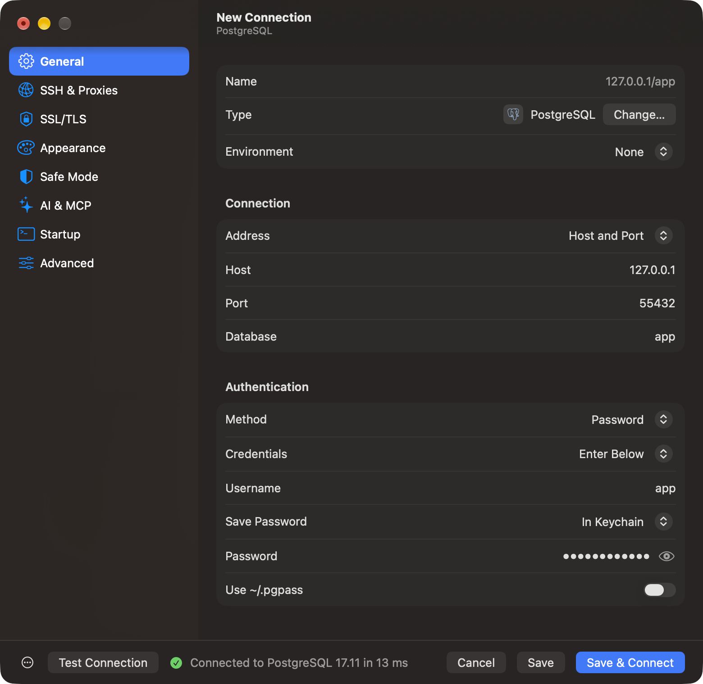

import PlatformGuides from "/snippets/platform-guides.mdx";

With no connections saved, the welcome window offers **Open Sample Database**, a bundled Chinook SQLite file that needs no server and drops you at step 4. Reset it any time from **Help > Reset Sample Database…**.

<Steps>
  <Step title="Install TablePro">
    `brew install --cask tablepro`, or the DMG from GitHub Releases. See [Installation](/installation). The first launch on a Mac with no saved connections opens the [setup guide](#the-setup-guide); click **Skip** to go straight to the welcome window.
  </Step>

  <Step title="Create a connection">
    Click **New Connection…** in the welcome window, pick a type in the **Choose a Database** sheet, then click **Continue**. A type badged **Not Installed** downloads its driver before the editor opens, with no restart.

    <Frame caption="Pick a database type">
      
      
    </Frame>

    <Tip>
    Already have a connection URL, another client's connections, or a repository with a `.env`? The **Import** menu under **New Connection…** takes all three. See [Switching to TablePro](/switching).
    </Tip>
  </Step>

  <Step title="Fill in the form, test it, save it">
    The editor opens on **General** with the cursor in **Host**. Leave it empty for `localhost`; the port starts at the engine's default. Name and Username are optional: an empty name takes the suggestion shown in the field, and an empty username the database's own default. SQLite asks for a `.sqlite` or `.db` file instead of a host, with no credentials.

    <Frame caption="PostgreSQL connection form">
      
      
    </Frame>

    Click **Test Connection** on the bar along the bottom. A line such as **Connected to PostgreSQL 16.4 in 42 ms** appears beside it. Now click **Save & Connect**.

    <Frame caption="Test Connection succeeded">
      
      
    </Frame>

    <Check>
    The window switches to the main layout: databases and tables in the sidebar, the open tab in the middle, the inspector on the right.
    </Check>

    A failed attempt paints the window with the driver's own message and a **Try Again** button instead. [Troubleshooting](/troubleshooting) sorts refused from timed out.
  </Step>

  <Step title="Run a query">
    Click a table in the sidebar to browse it. For SQL, press `Cmd+T` for a query tab, type, and press `Cmd+Enter` to run the statement under the cursor.

    <Frame caption="A table tab showing the data grid">
      
      
    </Frame>

    ```sql
    SELECT * FROM users LIMIT 10;
    ```
  </Step>
</Steps>

## The setup guide

It opens at launch while no connection is saved, until you finish, skip or close it once on this Mac. **Help > Setup Guide** opens it again whatever the list holds. Every step has **Skip**.

| Step | What you do there |
|---|---|
| **Get Started** | Under **Start Fresh**, pick a new connection or **Sample Database**. Under **Bring Your Connections**, pick **Import from Other App…** to go on to the import step, or another import, which closes the guide and opens it |
| **Import from Other Apps** | Select the apps to import from. Each one is read and reviewed in turn, before anything is saved. [Switching to TablePro](/switching) covers what comes across |
| **First Connection** | Choose what opens when you finish: a new connection, the sample database, or what you imported |
| **Appearance and Keys** | Set the appearance, the editor's **Key bindings**, and **Shortcuts**, which takes the [keys of the app you used before](/features/keyboard-shortcuts#shortcuts-from-another-app). Changes apply at once |

When the guide finds another database app's files at launch, it opens on **Import from Other Apps**. A new connection or the sample goes straight to **Appearance and Keys**.

**Done** on the last step, or **Skip** on any step, ends the guide and opens what you picked: a new connection or the sample database. With neither picked, one imported connection opens, and several are selected in the welcome window. Connections imported from a file are only selected, never opened. Closing the window ends the guide and opens nothing.

## What's next

[Managing connections](/connections), [SSH tunneling](/connections/ssh-tunneling), [keyboard shortcuts](/features/keyboard-shortcuts), and [AI features](/features/ai-assistant). Anything that goes wrong is worth an [issue](https://github.com/TableProApp/TablePro/issues).

<PlatformGuides />
