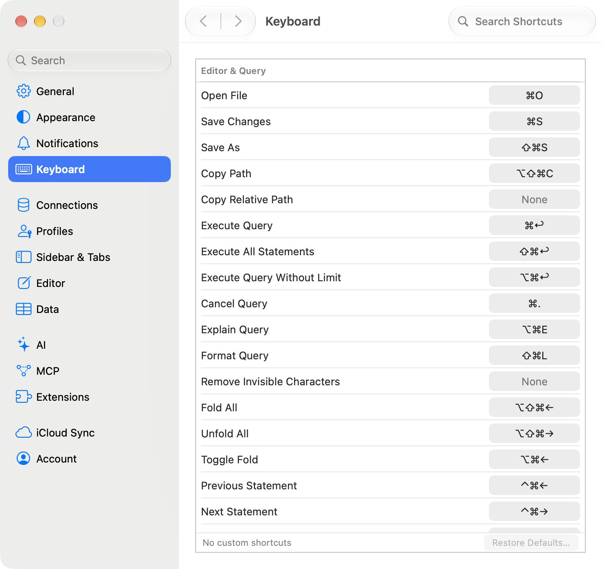
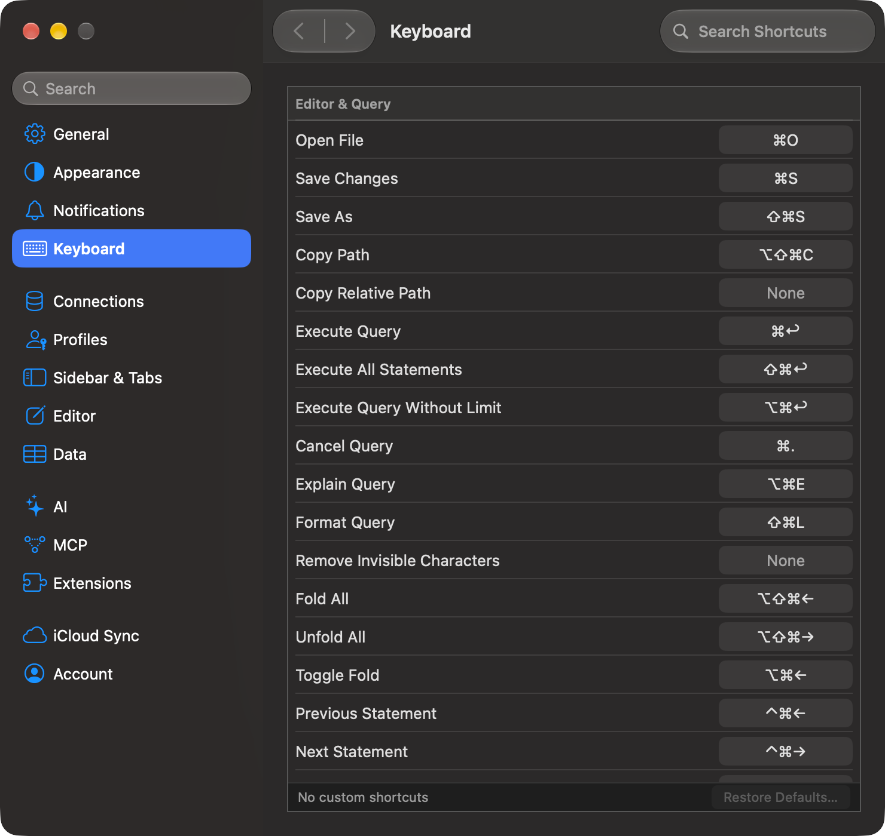

import DriverCounts from "/snippets/driver-counts.mdx";

Most of a migration is one dialog. **File > Import > Import from Other App…** reads the connections and saved queries your current client already has, groups and folders included, and the source app does not need to be running.

This page covers the rest: what does not come across, and what to do about it.

## Import your connections

<Steps>
  <Step title="Open the importer">
    **File > Import > Import from Other App…**. On a Mac with no connections yet, the [setup guide](/quickstart#the-setup-guide) offers the same import at first launch and takes several apps in one pass, one after another.
  </Step>
  <Step title="Pick your current client">
    TablePlus, Sequel Ace, DBeaver, DataGrip and Beekeeper Studio are read in place. Navicat is the exception: export first with **File > Export Connections** in Navicat, with **Export Password** turned on, then point TablePro at the `.ncx` file. **Include saved queries** starts selected when the app has some. **Include passwords** starts off for apps that keep them in the Keychain; see [About passwords](#about-passwords).
  </Step>
  <Step title="Review and import">
    Deselect any connection or saved query you do not want, resolve duplicates, click **Import**. A connection to an engine TablePro does not support arrives unchecked, with the reason beside it. Where each app's saved queries land is in [Connection Sharing](/features/connection-sharing#import-from-other-apps). When the import ends, a single imported connection opens, and several are selected in the welcome window. Connections from a file, such as a Navicat `.ncx` export or a TablePro connections file, are only selected: a file can come from someone else, so TablePro never connects to them on its own.
  </Step>
  <Step title="Open one before you delete the old app">
    Connect to a connection that had a password. That is the only check that proves the credential came across, and deleting the source app is the one step you cannot undo.
  </Step>
</Steps>

<Frame caption="Pick the client you're coming from">
  
  
</Frame>

<Frame caption="Review before anything is saved">
  
  
</Frame>

SSH tunnel and SSL settings come across with the connection. Which engines each source carries, and the quirks of each one, are in [Connection Sharing](/features/connection-sharing).

## About passwords

| Where your old client keeps them | **Include passwords** starts | What the import does |
|---|---|---|
| Its own encrypted store: DBeaver, Beekeeper Studio, Navicat | On | Decrypts it and runs start to finish with nothing to click |
| The macOS Keychain: TablePlus, Sequel Ace, DataGrip | Off | Says how many Keychain items it reads before it starts, then macOS asks permission once per item. Choose **Always Allow** rather than **Allow** and the run stops asking |

A password the Keychain refuses to store does not stop the import. Its connection arrives without it, the result reads **Import Incomplete** and counts the passwords not kept, and the imported connections are selected rather than opened.

A DataGrip project protected by a master password cannot be read at all. Import those connections and set their passwords in TablePro.

TablePlus's password dropdown comes across too. **Ask everytime** arrives as **Ask Every Time** in **Save Password**, and nothing is read from the Keychain for that connection. **Command Line** arrives the same way, since the command itself does not travel: type the password each connect, or set a [password source](/features/connection-sharing#password-sources) on the connection. The SSH pane has the same dropdown and TablePro has no prompt behind it, so a tunnel set to **Ask everytime** or **No password** imports blank. Fill it in before you connect.

## What does not come across

| Not imported | What to do |
|--------------|------------|
| Snippets, and saved queries from Navicat, whose export file has none | Re-save the ones you actually use as [Favorites](/features/favorites) with `Cmd+D`. To keep a whole folder of `.sql` files in sync instead, including one tracked in git, link it as a [linked SQL folder](/features/favorites#linked-sql-folders) |
| Query history | Starts fresh. TablePro records history per connection from the first query you run, searchable with `Cmd+Y` |
| Column widths, sort order and per-table filters | Rebuilt as you browse. TablePro saves these per table on its own |
| Connections to an engine TablePro does not support, such as Vertica or Greenplum | Check the row anyway to keep its host, user and password, then edit the connection and choose a database type. Greenplum speaks the PostgreSQL protocol, so PostgreSQL is the one to try |
| Keyboard shortcuts | See the next section |

## Getting your shortcuts back

Choose your old app under **Use Shortcuts From** in **Settings > Keyboard** (`Cmd+,`), or under **Shortcuts** in the setup guide's last step. TablePlus, Sequel Ace, DBeaver, DataGrip, Beekeeper Studio, Navicat and DBX each have a preset, and [Shortcuts from another app](/features/keyboard-shortcuts#shortcuts-from-another-app) lists what one changes and what it leaves alone.

A preset covers running queries, tabs, find, save and a few more. For any other key, record the chord you are used to on its row in **Settings > Keyboard**; a chord another command holds asks before it moves.

<Frame caption="Settings > Keyboard, where every rebindable shortcut lives">
  
  
</Frame>

Set these up on your first day:

| Job | TablePro |
|-----|----------|
| Run the statement under the cursor | `Cmd+Enter` |
| Run every statement | `Cmd+Shift+Enter` |
| Jump to any table, database or saved query by name | `Cmd+Shift+O` |
| Switch database | `Cmd+K` |
| Query history | `Cmd+Y` |
| Cancel the selected tab's query | `Cmd+.` |
| Format the query | `Cmd+Shift+L` |
| Explain the query | `Cmd+Option+E` |
| Save the query as a favorite | `Cmd+D` |

A few cannot be reassigned, so learn them rather than fight them: editor built-ins such as `Cmd+/` for comment, `Cmd+[` and `Cmd+]` for indent, tab selection `Cmd+1` through `Cmd+9`, and zoom `Cmd+=` and `Cmd+-`. The recorder tells you when you hit one.

Coming from TablePlus, where `Cmd+F` opens the row filter? Rebind **Toggle Filters** to `Cmd+F` in **Settings > Keyboard** and choose **Reassign** when it asks. Find gives up `Cmd+F` while the filter bar holds it, and takes it back if you move the filter bar off again.

If you use Vim bindings, choose [Vim](/features/vim-mode) under **Settings > Editor > Key bindings** and most of this section stops mattering.

The full list is in [Keyboard Shortcuts](/features/keyboard-shortcuts).

## Coming from a client TablePro cannot import

Two other routes exist.

**A connection URL.** **File > Import > Import from URL…** takes a `postgres://`, `mysql://` or similar URL and fills in the form. Fastest path when you only have a handful of connections.

<Frame caption="Import from URL">
  
  
</Frame>

**A project folder.** [Open Project Folder](/features/project-folder-import) reads the database settings out of a project's config files, so a repository with a `.env`, `docker-compose.yml` or framework config becomes a connection without you typing a host.

## If your database is not supported yet

<DriverCounts />

A database missing from the connection form may still be a registry driver: the type chooser lists every one, badged **Not Installed** until you pick it.

If it is genuinely not there, open a request on [GitHub](https://github.com/TableProApp/TablePro/issues). Driver coverage is tracked in the open, and the [supported database list](/connections) is the current answer.
