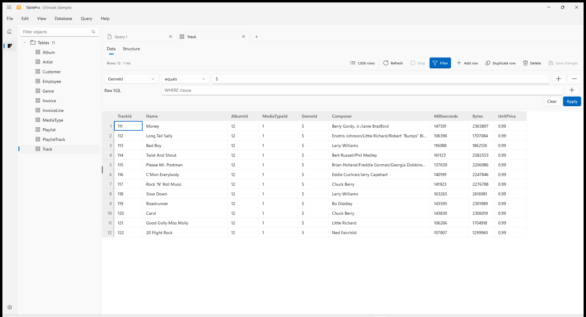
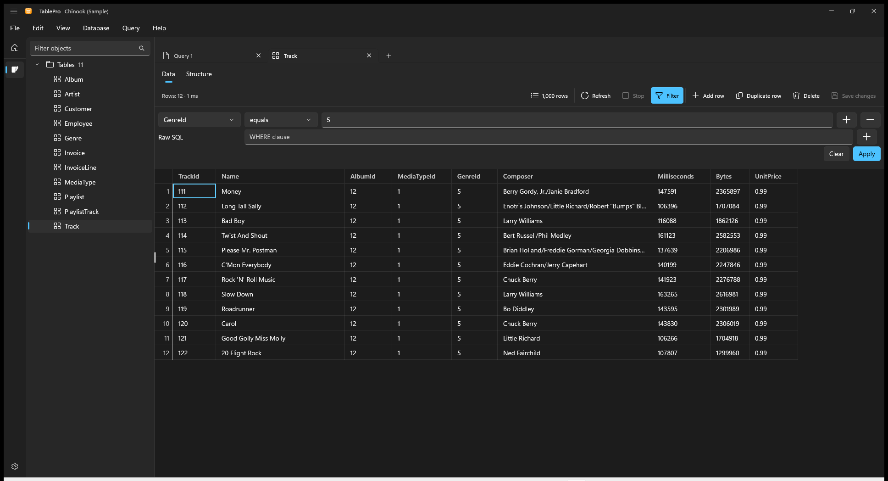
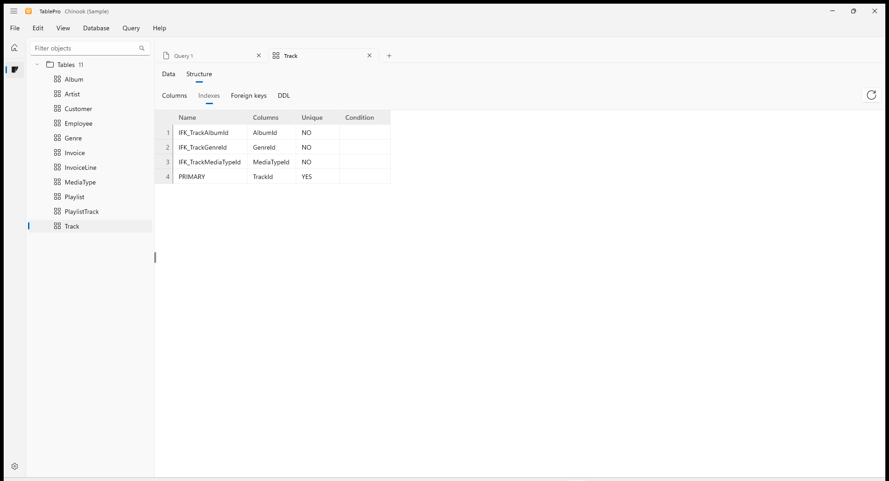
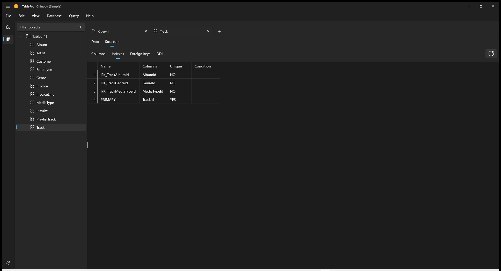
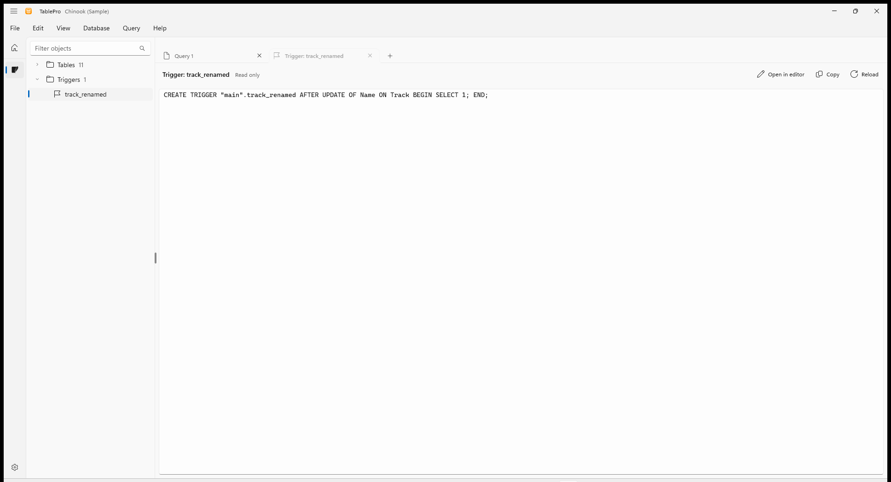
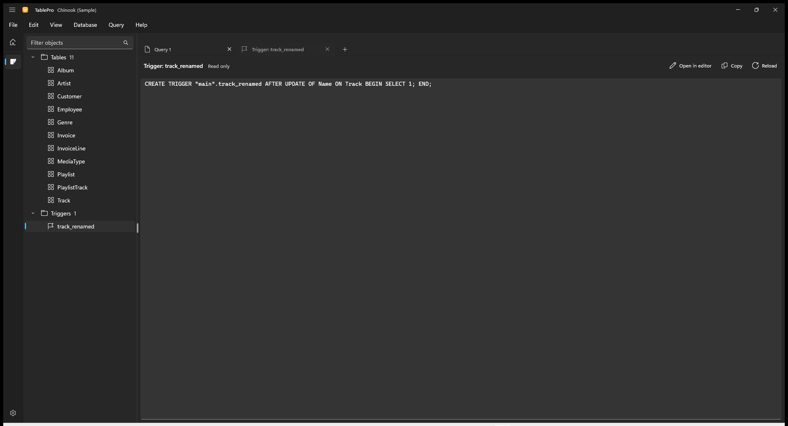
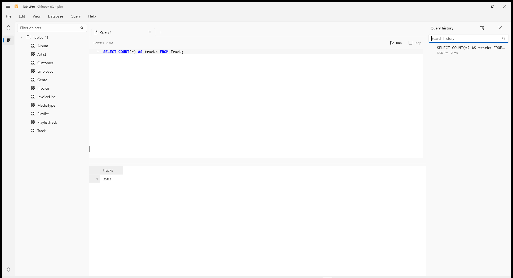
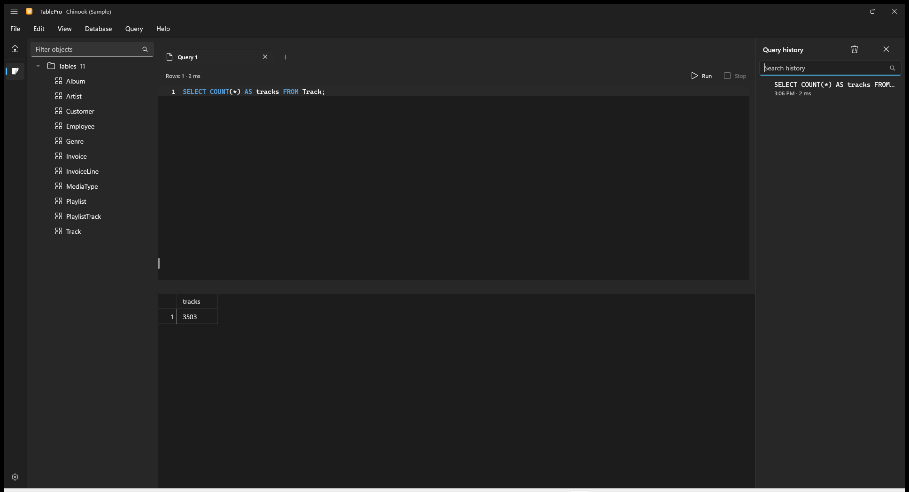

Every object in the tree opens in a tab. Tables and views open as rows, and functions, procedures, triggers and sequences open as their source, read only.

## The object tree

Objects sit in a folder per kind, with their count. Schemas show only when there is more than one besides the system ones. A folder lists its first 500 objects; **Show all** opens the rest in a list. Type in **Filter objects** (`Ctrl+P`) to find any object across schemas, names that start with the text first. `Ctrl+B` hides or shows the tree, and `F5` reads it again.

Click a table or view to open its rows, or bring its open tab forward. Right-click it for **Open in new tab**, **Show structure**, **Show DDL**, **Copy name** and **Import CSV...**, and, where the engine has them and the connection is not read only, **Truncate...** and **Drop...**.

A schema's menu has **New schema...** and **Drop schema**, or **New database...** and **Drop database** where the server's databases are its schemas. **New database...** and **New schema...** are in the **Database** menu too. Each shows its statements under Safe Mode and runs once you confirm. The engine's own databases and schemas, and the one you are in, are never offered for a drop.

## Filter rows

Click **Filter** in a table tab, or press `Ctrl+Shift+F`, to show the filter bar above the rows.

<Steps>
  <Step title="Pick a column and an operator">
    The operators match the column's type: text offers **contains** and **starts with**, numbers and dates offer **greater than** and **between**, and every column offers **is NULL**.
  </Step>
  <Step title="Type the value">
    **between** takes two values. **in list** takes values separated by commas: `3, 7, 12`.
  </Step>
  <Step title="Apply">
    Click **Apply** or press `Enter` in a value box. The tab reads the first page again and counts the rows the filter picks.
  </Step>
</Steps>

<Frame caption="GenreId equals 5 picks 12 of the Track table's rows">
  
  
</Frame>

Add a rule with **+**. With two or more rules, choose **Match all** or **Match any**. **Raw SQL** takes one condition as you would write it after `WHERE`, such as `length(name) > 6`. **Clear** reads the whole table again.

- A rule missing its value is pointed out before anything runs.
- A filter the database refuses keeps the filter you had, and the results say why. Refresh reads the rows again.
- Changing the filter while edits are pending asks before it discards them.
- Each table keeps the filter it was last read with, per connection, database and schema. Opening the table again applies it; **Clear** forgets it.

To filter by a value in the grid, right-click the cell and open **Filter**. It offers equal and not equal to the value, greater and less than where the column orders, and **is NULL** or **is not NULL** on a NULL cell, each where the engine has the operator. Under **Match all**, the rule joins the ones you have and applies at once. Under **Match any** with two or more rules, it replaces them all, raw SQL included, so check the filter bar before you export or share the rows. A query result has no **Filter**.

## Read a table's structure

Switch a table tab from **Data** to **Structure**.

<Frame caption="Indexes of the Track table">
  
  
</Frame>

| Section | Shows |
|---|---|
| Columns | Name, type, nullable, default, primary key, auto increment, comment |
| Indexes | Name, columns in order with `DESC` where descending, unique, condition of a partial index |
| Foreign keys | Columns, the table and columns they reference, on delete and on update actions |
| DDL | The `CREATE TABLE` statement, with **Copy** |

The DDL section is empty for a view, whose columns come from its query. Right-click a table in the tree and choose **Show structure** to open it on Structure directly.

## Open functions, procedures, triggers and sequences

Click one in the tree to open its source in a read-only tab. **Reload** reads it again from the database, and **Copy** copies it.

<Frame caption="A trigger's source opens read only">
  
  
</Frame>

**Open in editor** puts the text in a new query tab, where you change it and run it. On MySQL, that tab runs in the database the object belongs to. When running the text would not recreate the object as it is, the button is replaced by a note saying so.

Which objects show their source depends on the database:

| Database | Shows the source of |
|---|---|
| PostgreSQL, SQL Server | Functions, procedures, triggers, sequences |
| MySQL, MariaDB | Functions, procedures, triggers, and MariaDB sequences |
| SQLite | Triggers |
| ClickHouse | Functions |

## Keep fewer results from a script

A script whose statements return rows lists each result in the picker above the grid. To keep only the newest, set **Settings > Queries > Results kept per run**.

| Setting | Default | Choices |
|---|---|---|
| Results kept per run | No limit | No limit, 10, 20, 50, 100, 200, 500, 1,000 |

Earlier results are dropped as the script runs, and the status line says how many: `Rows: 1 · 12 ms · 990 earlier results were dropped.` A statement that returns no rows never counts toward the limit. A change applies from the next run.

## Share a result or query

Sharing needs a signed-in [TablePro account](/windows/account); signed out, the share dialog offers **Sign in...**.

| To share | Do this |
|---|---|
| The result a query tab shows | Right-click the results grid and choose **Share result...**, or choose **Share result...** in the **File** menu |
| A table's rows, with its filter and sort | Right-click the table's grid and choose **Share...**, or choose **Share result...** in the **File** menu |
| The selection, or the whole query when nothing is selected | Right-click in the editor and choose **Share query...**, or choose **Share query...** in the **File** menu |

A result can be shared once its run has finished. A table shares from its first row, whichever page is on screen, and **Share...** is dimmed while edits are pending. When TablePro cannot write the table's query for its database, the link holds the rows without SQL and opens nothing in TablePro.

In the dialog, **Share as** picks **Personal** or a team where you hold a seat, and **Share** creates the link and copies it, with **Open in browser** beside it. For a result, **Columns** sets each column to **Keep**, **Mask** with a mask, or **Remove**, and columns that look sensitive start masked. **Manage shared links...** in the **File** menu opens your links in the browser. The dialog's fields, the Free and Pro limits, and what a link sends are in [Shared Links](/features/shared-links#the-share-sheet), and the column choices in [Sensitive data](/features/shared-links#sensitive-data).

Opening a `tablepro://share` link puts its SQL in a new query tab without running it. With no connection open, a dialog shows the SQL with **Copy SQL** instead.

## Find a past query

Choose **Show query history** in the **View** menu to open the history beside the tabs. Every query you run in a query tab is kept with its time, duration and outcome, newest first. Type in the search box to find one by any words it contains.

<Frame caption="The query history beside the tabs">
  
  
</Frame>

- Double-click a query, or select it and press `Enter`, to open it in a new query tab.
- Right-click a query to copy, save, pin or delete it. A pinned run comes first and is never removed by the history limits in Settings.
- **Clear history** removes the history of every connection, after asking.

A statement that can hold a password, such as one that creates a user, is never kept. Sorting a result and committing or rolling back a transaction are not kept either.

## Keyboard shortcuts

| Action | Shortcut |
|---|---|
| Show or hide the filter bar | `Ctrl+Shift+F` |
| Apply the filter | `Enter` in a value box |
| Filter objects in the tree | `Ctrl+P` |
