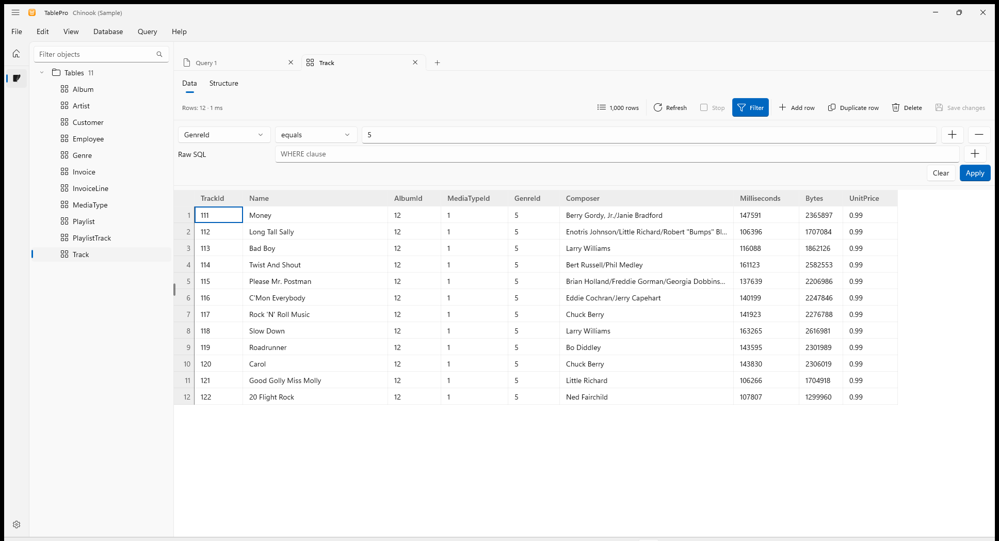
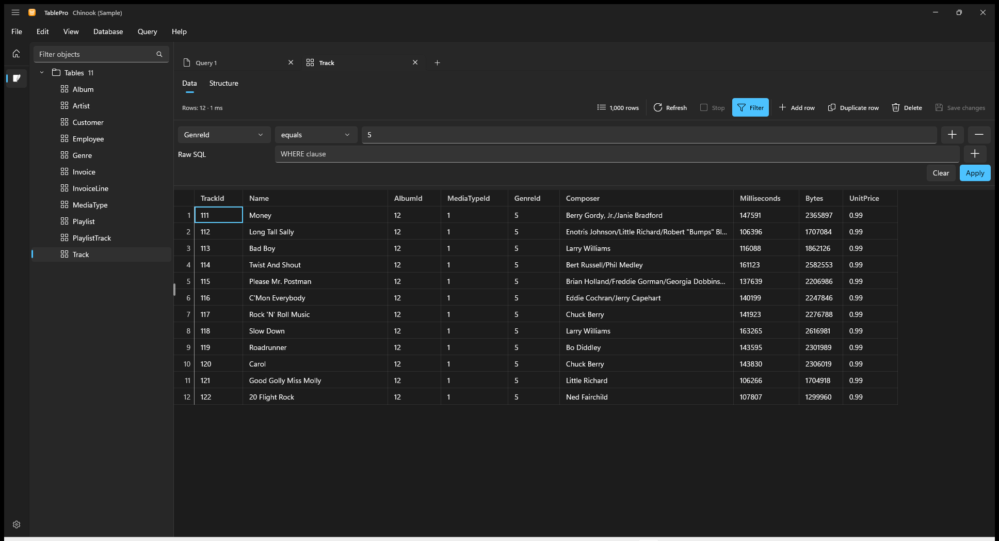
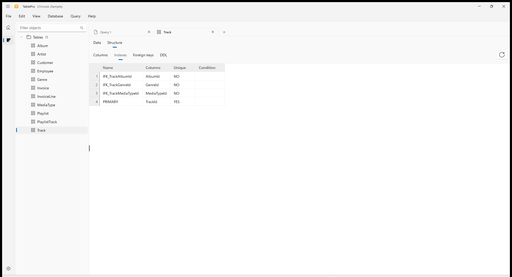
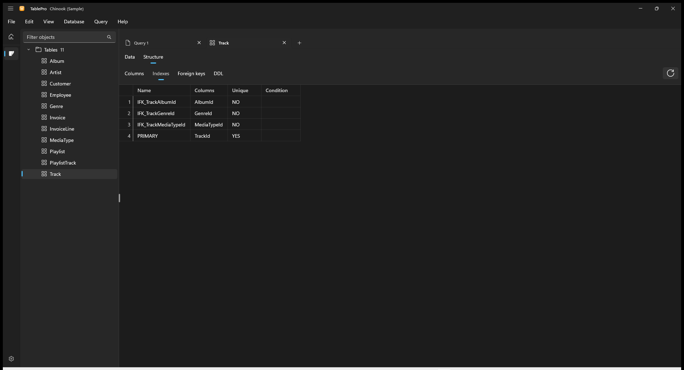
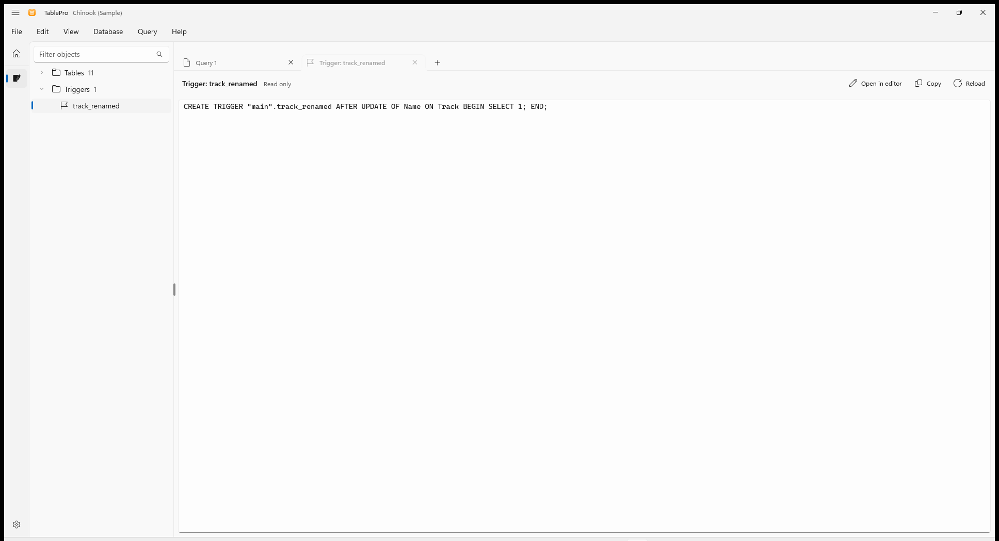
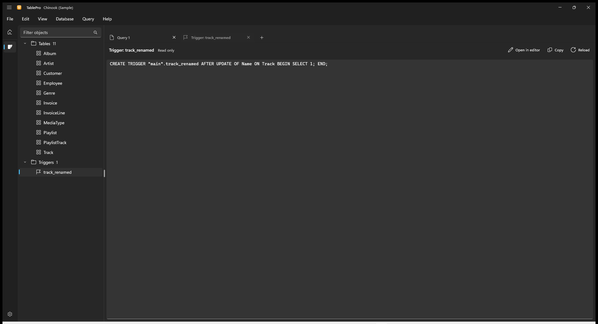

Every object in the tree opens in a tab. Tables and views open as rows, and functions, procedures, triggers and sequences open as their source, read only.

## Filter rows

Click **Filter** in a table tab, or press `Ctrl+Shift+F`, to show the filter bar above the rows.

<Steps>
  <Step title="Pick a column and an operator">
    The operators match the column's type: text offers **contains** and **starts with**, numbers and dates offer **greater than** and **between**, and every column offers **is NULL**.
  </Step>
  <Step title="Type the value">
    **between** takes two values. **in list** takes values separated by commas: `3, 7, 12`.
  </Step>
  <Step title="Apply">
    Click **Apply** or press `Enter` in a value box. The tab reads the first page again and counts the rows the filter picks.
  </Step>
</Steps>

<Frame caption="GenreId equals 5 picks 12 of the Track table's rows">
  
  
</Frame>

Add a rule with **+**. With two or more rules, choose **Match all** or **Match any**. **Raw SQL** takes one condition as you would write it after `WHERE`, such as `length(name) > 6`. **Clear** reads the whole table again.

- A rule missing its value is pointed out before anything runs.
- A filter the database refuses keeps the filter you had, and the results say why. Refresh reads the rows again.
- Changing the filter while edits are pending asks before it discards them.
- The filter stays with the tab when TablePro restarts.

## Read a table's structure

Switch a table tab from **Data** to **Structure**.

<Frame caption="Indexes of the Track table">
  
  
</Frame>

| Section | Shows |
|---|---|
| Columns | Name, type, nullable, default, primary key, auto increment, comment |
| Indexes | Name, columns in order with `DESC` where descending, unique, condition of a partial index |
| Foreign keys | Columns, the table and columns they reference, on delete and on update actions |
| DDL | The `CREATE TABLE` statement, with **Copy** |

The DDL section is empty for a view, whose columns come from its query. Right-click a table in the tree and choose **Show structure** to open it on Structure directly.

## Open functions, procedures, triggers and sequences

Click one in the tree to open its source in a read-only tab. **Reload** reads it again from the database, and **Copy** copies it.

<Frame caption="A trigger's source opens read only">
  
  
</Frame>

**Open in editor** puts the text in a new query tab, where you change it and run it. On MySQL, that tab runs in the database the object belongs to. When running the text would not recreate the object as it is, the button is replaced by a note saying so.

Which objects show their source depends on the database:

| Database | Shows the source of |
|---|---|
| PostgreSQL, SQL Server | Functions, procedures, triggers, sequences |
| MySQL, MariaDB | Functions, procedures, triggers, and MariaDB sequences |
| SQLite | Triggers |
| ClickHouse | Functions |

## Export results

Choose **File > Export results** or press `Ctrl+Shift+E`.

<Steps>
  <Step title="Pick a format">
    CSV, JSON, Excel, Markdown, HTML or XML. From a table tab, **SQL INSERT** writes one statement per row for that table.
  </Step>
  <Step title="Pick the rows, in a table tab">
    **Current page** writes the rows on screen. **Entire table** reads every row the filter and sort pick, however many pages they span.
  </Step>
  <Step title="Choose where to save">
    The file appears only once every row is written. A failed or cancelled export leaves no file behind.
  </Step>
</Steps>

From a query tab, export writes the result shown. Export waits until the run has finished. CSV is the default; pick Excel for a spreadsheet, which holds up to 1,048,575 rows.

## Find a past query

Choose **View > Show query history** to open the history beside the tabs. Every query you run in a query tab is kept with its time, duration and outcome, newest first. Type in the search box to find one by any words it contains.

- Double-click a query, or select it and press `Enter`, to open it in a new query tab.
- Right-click a query to copy or delete it.
- **Clear history** removes the history of every connection, after asking.

A statement that can hold a password, such as one that creates a user, is never kept. Sorting a result and committing or rolling back a transaction are not kept either.

## Keyboard shortcuts

| Action | Shortcut |
|---|---|
| Show or hide the filter bar | `Ctrl+Shift+F` |
| Apply the filter | `Enter` in a value box |
| Export results | `Ctrl+Shift+E` |
