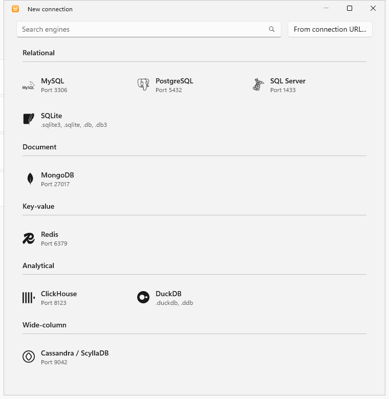
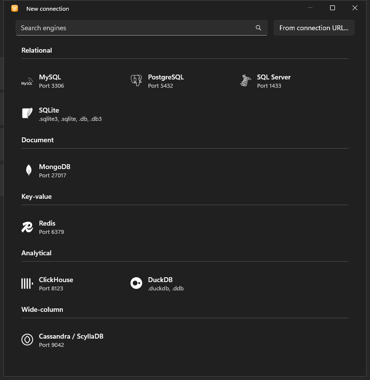
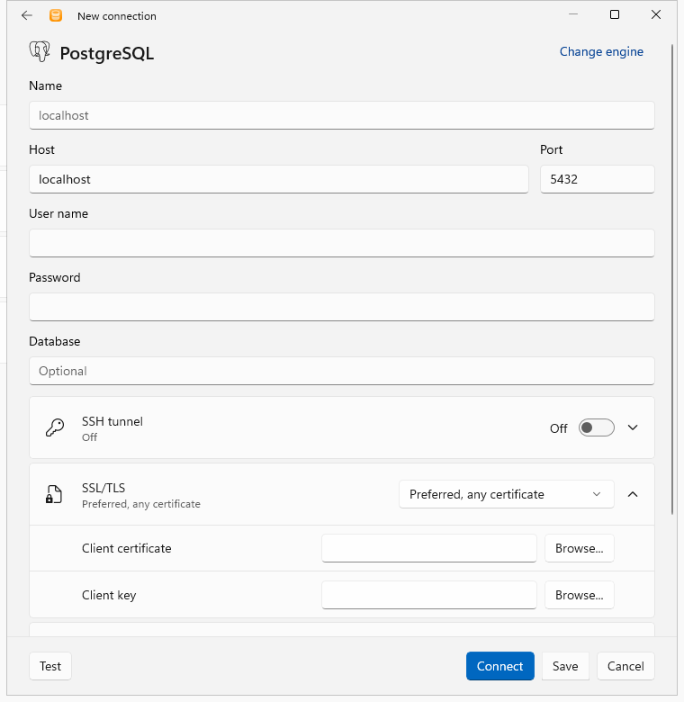
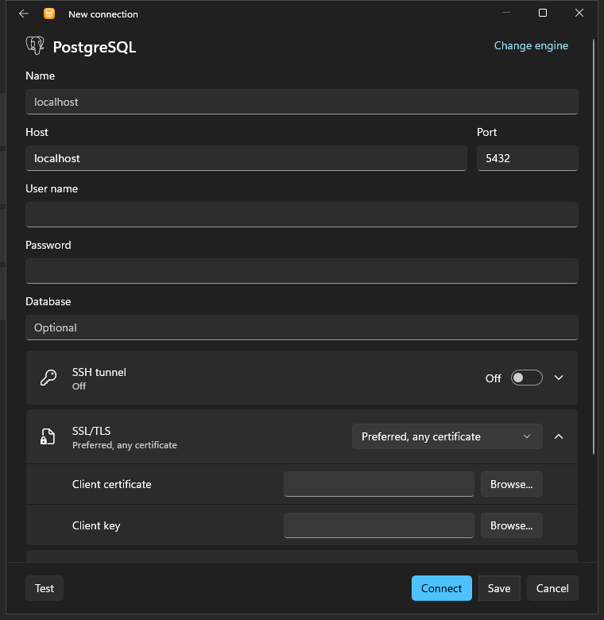

The Connections page is where a session starts: **New connection** (`Ctrl+N`), **New from URL**, **Open file** (`Ctrl+O`) and **Import** sit at its top. `Ctrl+Shift+H` comes back to it from any connection. Each open connection is an item on the rail at the window's left edge, with its own tabs and object tree.

## Engines

Every driver is built into the app.

| Engine | Pick | Default port |
|---|---|---|
| PostgreSQL | **PostgreSQL** | 5432 |
| MySQL and MariaDB | **MySQL** | 3306 |
| SQL Server | **SQL Server** | 1433 |
| ClickHouse | **ClickHouse** | 8123 |
| Cassandra and ScyllaDB | **Cassandra / ScyllaDB** | 9042 |
| Redis | **Redis** | 6379 |
| MongoDB | **MongoDB** | 27017 |
| SQLite | **SQLite** | No port: a file |
| DuckDB | **DuckDB** | No port: a file |

<Frame caption="Engines grouped as the Mac app groups them">
  
  
</Frame>

## Add a connection

<Steps>
  <Step title="Open the form">
    Click **New connection**. The form opens in a window of its own, so the rest of the app stays usable.
  </Step>
  <Step title="Pick the engine">
    Click its card, or type in **Search engines**. **Change engine** at the top of the next page goes back.
  </Step>
  <Step title="Fill in the server">
    **Host**, **Port**, **User name**, **Password** and **Database**. **Port** starts on the engine's default, and **Database** is optional.
  </Step>
  <Step title="Test, then connect">
    **Test** connects once and reports, **Connect** saves the connection and opens it, and **Save** keeps it without connecting. `Escape` closes the form.
  </Step>
</Steps>

A field with a problem says so under it, and the section holding it opens. The password goes to Windows Credential Manager. An empty password is saved as empty, for a server that takes none. Editing a connection keeps its stored password unless you type a new one.

<Frame caption="The PostgreSQL form with the SSL/TLS section open">
  
  
</Frame>

### From a connection URL

Click **From connection URL...** on the engine page, or **New from URL** on the Connections page, and paste a URL such as `postgresql://ada@db.example.com:5432/shop`. `Ctrl+V` on the Connections page does the same with a URL on the clipboard. The form opens filled in, so you see what the URL holds before anything connects.

A MongoDB URL with `mongodb+srv://`, several hosts or an authentication database, and any URL naming a local socket, cannot be kept yet. The form says which setting it cannot keep.

### SQL Server sign-in

**Authentication** picks **User name and password** or **Windows authentication**. Windows authentication signs in as the Windows user running TablePro, with no password in the form.

## Options

| Row | Sets |
|---|---|
| **Safe Mode** | What is asked before a write. See the next table |
| **External clients** | What MCP clients and the `tablepro` command may do: **Blocked**, **Read only** (the default) or **Read and write**. See [MCP server](/windows/mcp#external-clients) |
| **AI assistant** | Whether the assistant may send this connection's table structure: **Ask each time** (the default), **Always allow** or **Never** |
| **Query timeout** | Seconds a statement may run on this connection. Empty follows the one in Settings |

| Safe Mode | Does |
|---|---|
| **Off**, the default | Asks only before DROP, TRUNCATE, and DELETE or UPDATE without WHERE |
| **Confirm writes** | Asks before every statement that changes the database, listing each one in full |
| **Read only** | Refuses every run that holds a write |

Pick **Read only** for a production server you only read. A change applies at once to the connection's open sessions. Moving to or from **Read only** reconnects them, after asking about open transactions.

**Appearance** sets a **Color** and a **Group**. The front connection's color tints the title bar, the menu bar and its tab strip, so a production connection stands out.

## TLS

**SSL/TLS** picks the mode:

| Mode | Connection |
|---|---|
| **Off** | Plain, no TLS |
| **Preferred, any certificate** | PostgreSQL and MySQL only. Encrypted if the server offers TLS, otherwise plain. The certificate is not checked |
| **Required, any certificate** | Encrypted. The certificate is not checked |
| **Required, verify the certificate and host** | Encrypted. The certificate must be valid for the host |
| **Strict (TDS 8.0), verify the certificate and host** | SQL Server only. TLS before the login, as TDS 8.0 needs it |

A new connection starts where the engine's own client starts:

| Engine | Starts on |
|---|---|
| PostgreSQL, MySQL | **Preferred, any certificate** |
| SQL Server | **Required, verify the certificate and host** |
| ClickHouse | **Off**, or **Required, verify the certificate and host** on ports 443 and 8443 |
| MongoDB, Cassandra, Redis | **Off** |

Choose **Required, verify the certificate and host** to check the server. For a server signed by your own certificate authority, choose its file in **CA certificate** rather than dropping to **Required, any certificate**. **Client certificate** and **Client key** sign in with a certificate, and **Certificate host name** checks the certificate against another name than **Host**.

A failed handshake says what went wrong and offers the fix beside it: **Choose CA certificate** for an unknown issuer, **Set TLS server name** for a name mismatch, **Change encryption** when the server wants another mode.

## SSH tunnels

Turn on **SSH tunnel**, then fill **SSH host**, **SSH port** and **SSH user name**.

| Authentication | Uses |
|---|---|
| **SSH agent** | Keys from the Windows OpenSSH agent service, or from Pageant |
| **Private key** | A key file. A passphrase is asked for when you connect |
| **Password** | The SSH server's own password |
| **Keyboard interactive** | The server's own questions, such as a one-time code |

**Jump hosts** takes servers to pass through first, as `user@host:port`, separated by commas.

The first connect to a server shows its key's fingerprint under **Trust this SSH server?**. Check it with whoever runs the server, then click **Trust and connect**. A key that changed since shows **SSH server identity changed**: connect only once you know why, and click **Forget saved key** to accept the new one.

## SQLite and DuckDB files

**Open file** (`Ctrl+O`) opens a SQLite or DuckDB file without saving a connection. The file's header picks the engine, whatever its name. Opening a `.db`, `.sqlite`, `.sqlite3` or `.duckdb` file with TablePro from Explorer does the same; [Links and files](/windows/links#files) lists every extension.

To keep the file as a connection, pick **SQLite** or **DuckDB** in **New connection**. **File** replaces the server fields: **Browse...** picks an existing file, and **New file...** names one that is made when you connect.

**Try the sample database** on a fresh Connections page, or **Open the sample database** in the **Help** menu, copies Chinook, a small music store, and saves it as **Chinook (Sample)**.

## The Connections page

The list has **Favorites**, **Recent** and **All connections**, the last with your groups. Type in **Search connections** to match name, host, database, user, engine, group or tag; `Enter` connects to the first match.

| To | Do this |
|---|---|
| Connect | Double-click the row, or select it and press `Enter` |
| Rename | Press `F2`, or choose **Rename** in the row's menu |
| Delete | Press `Delete`, then confirm |
| Copy with its passwords | Choose **Duplicate** in the row's menu |
| Group | Drag the row onto a group, or choose **Move to group** |
| Tag | Choose **Tags** in the row's menu. **Tags** at the top renames, recolors or deletes a tag |
| Act on several | Click **Select**, check the rows, then **Connect**, **Add to Favorites**, **Move to group** or **Delete** |

A connection with no saved password asks for it when you connect. Select **Save it in Credential Manager** to keep it once it signs in.

A connect that fails shows the reason with **Retry**, **Edit connection** and **Copy details**.

## While connected

**Database** in the menu bar holds **Edit connection...**, **Reconnect** and **Disconnect**.

On an engine with several databases, the first row of the object tree names the database, and `Ctrl+K` opens it to switch. On MySQL, MariaDB, ClickHouse, Cassandra and MongoDB the pick changes where new query tabs run. On PostgreSQL and SQL Server it opens that database as a rail item of its own, named for the connection and the database.

A lost connection shows a bar over the tabs while TablePro reconnects. When it gives up, click **Reconnect**. A query tab's own connection is never reopened behind your back, since its transaction would be gone: the next run opens a new one and says so.

When you start TablePro, it reopens the connections and tabs you had, and connects only the one in front. **Reopen the previous session** in Settings turns that off.
