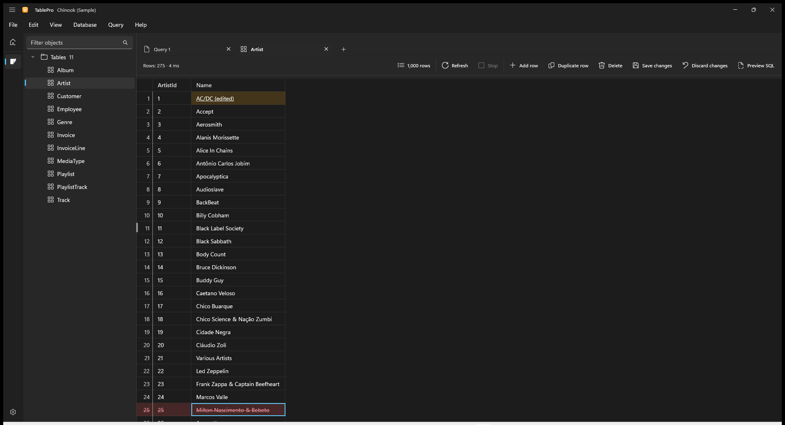
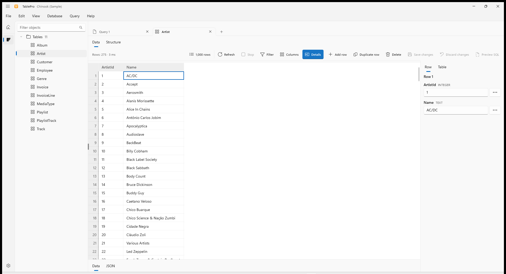
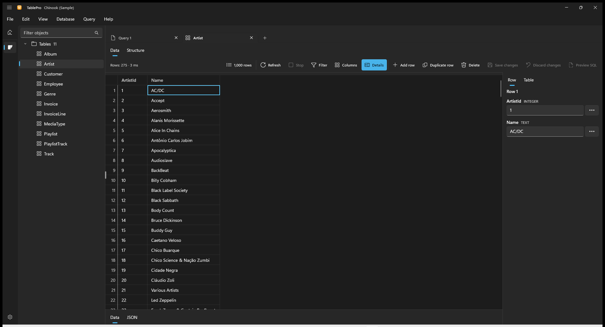
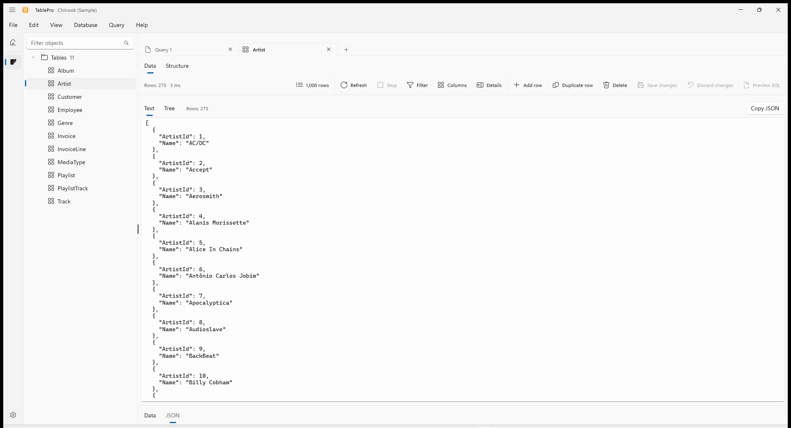
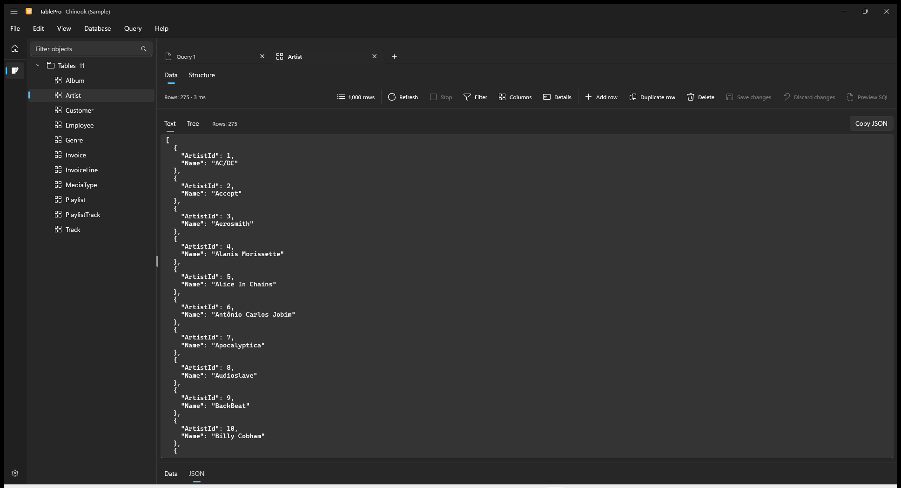

A table opened from the object tree shows one page of rows, 1,000 by default. Edit its cells, add and delete rows, and save the changes together.

<Frame caption="Pending changes stay marked until Save">
  
  
</Frame>

## Page through a table

**First page**, **Previous page**, **Next page** and **Last page** sit in the table's command bar, and the status reads `1,001-2,000 of 3,503 rows · 15 ms`. Click **Page 3 of 36** between them to type a page number.

The **1,000 rows** button sets the page size for this tab: 5, 10, 20, 100, 500 or 1,000 rows, **Custom...** up to 1,000,000, or **All rows...**, which asks first. A new size keeps the page holding the first row on screen. **Settings > Pagination > Default page size** sets it for new tabs: 100, 500, 1,000, 5,000 or 10,000.

Cassandra pages on the server, so it has no **Last page**, **Go to page** or **All rows...**, and **Count rows** stays off.

### Count a large table

A table counts its rows when it opens, so **Last page** and **Go to page** know where the end is. A table the database estimates at more rows than **Settings > Pagination > Count rows if estimate less than** skips that count: the status reads `1-1,000 of about 2,000,000 rows`, and **Count rows** in the toolbar counts it on request.

| Setting | Default | Choices |
|---|---|---|
| Count rows if estimate less than | 100,000 | 1,000; 10,000; 100,000; 1,000,000; Always count |

A table whose database keeps no estimate is always counted.

## Edit rows

Editing works in a table tab on a table with a primary key, on a connection whose Safe Mode is not Read only. A saved row's key, and every column the server fills, stay as they are.

| To | Press |
|---|---|
| Edit the focused cell | `F2`, `Enter` or a double-click |
| Keep the edit | `Enter` |
| Keep it and edit the next or previous cell | `Tab`, `Shift+Tab` |
| Cancel the edit | `Escape` |
| Add a row | `Ctrl+Shift+N` |
| Duplicate the selected rows | `Ctrl+Shift+D` |
| Mark the selected rows for deletion | `Delete` |

A value with a line break edits on several lines, and `Ctrl+Enter` keeps it. Right-click a cell and open **Set value** for **Empty**, **NULL** or **Default**, each where the column takes it. A duplicate starts its key, and every column the server fills, the way a new row does. Right-click a row marked for deletion and choose **Undo delete** to keep it.

An edited cell is underlined on a yellow fill, a new row on green, and a row marked for deletion is struck through on red. Typing a cell back to its stored value drops the edit.

### Editors by column type

| Column | `F2`, `Enter` or a double-click |
|---|---|
| Boolean | Toggles the value. NULL and false become true |
| Enum with up to 100 values | A menu of the values, the current one checked |
| MySQL `SET` | A menu with a check per value; each pick adds or removes it |
| Date, time, timestamp | A calendar, a time picker with **Set**, or both. The seconds, fraction and offset the value had stay |

Each menu ends with **Edit as text**, and `Tab` into a cell always opens the text box. JSON is checked when you keep the edit.

## Save or discard

**Save changes** (`Ctrl+S`) writes every change in one batch and reloads the page. **Preview SQL** (`Ctrl+Shift+P`) shows the statements first, each with the values it sends. **Discard changes** drops them all after asking.

- A save that deletes rows asks first.
- With Safe Mode set to Confirm writes, the save shows its statements and runs after **Execute**.
- A save the server refuses writes nothing and keeps every change pending, with the row it stopped at selected.
- Sorting, paging or refreshing asks before it discards pending changes. Closing the tab, disconnecting or quitting offers to save them.

Pending changes are kept in the session as you type. After a crash, a forced sign-out or an update, the table reopens with them pending again, and a bar counts any it could not place on the page, with **Discard**. When a save was cut off before its answer, **Save** is refused with "The last save may have been written" until you discard and read the rows again.

## Edit a query result

A query tab's result edits like a table's page, with the same keys, marks and questions, when all of these hold:

- the run returned one result set, from one `SELECT` on one table, with its primary key;
- the run left no transaction open;
- the tab runs in the connection's own database.

Otherwise the grid stays read only, and trying to edit says why, such as "Rows from more than one table, a subquery or a CTE can't be edited." `Ctrl+S` saves the changes while the grid has focus; from the editor it saves the SQL file. After a save, the statement runs again to show what the table holds. Pending changes in a query result are not kept across a restart.

## Row and table details

Click **Details** in the table's command bar to open a pane beside the rows.

<Frame caption="Details shows the focused row's fields">
  
  
</Frame>

**Row** lists each column of the focused row with its type, in a box that edits the cell. The edit is kept when the box loses focus or on `Ctrl+Enter`, and `Escape` puts the value back. The **...** menu beside a field sets **Empty**, **NULL** or **Default** and copies the value.

**Table** shows the row estimate, the data, index and total size, and the table's comment. A figure the engine does not keep reads **Not reported**.

## Arrange columns

Right-click a header for **Hide column**, **Show all columns**, **Move column left** and **Move column right** (`Alt+Left`, `Alt+Right`), **Freeze up to this column** and **Unfreeze columns**. Drag a header to move its column. **Columns** in the command bar lists every column with a check, with **Show all columns** and **Reset columns**.

Each table keeps its order, hidden columns and frozen columns, by column name: a column added since goes last. A freeze that would leave less than a third of the grid to scroll is refused. A query result keeps no layout.

## Sum a selection

Select two or more cells and the bar under the grid shows **Sum**, **Average** and **Count**. Click it for every figure, each with **Copy**: count, numbers, empty cells, cells that are not a number, sum, average, minimum and maximum.

Numeric columns are summed exactly; a column the engine could not type is summed where its text reads as a number. Rows marked for deletion are left out, and pending edits count.

## Read rows as JSON

**JSON** at the bottom of a results pane shows the rows the grid shows as JSON, in the grid's column order with hidden columns left out. **Text** is the indented array with **Copy JSON**; **Tree** opens a node per row. Select rows on the row numbers to narrow it.

<Frame caption="The Artist table as JSON text">
  
  
</Frame>

NULL is `null`, numbers and booleans keep their exact digits, and a JSON column, a MongoDB document's nested field included, nests as written. The view stops at 1,000 rows or about 1 MB and says so. Pending edits show as typed, and rows marked for deletion are left out.

## Values, copies and keys

| To | Do this |
|---|---|
| Copy cells | `Ctrl+C`. Cells go out tab-separated, as a spreadsheet reads them, and NULL as an empty cell |
| Read a long value | Right-click the cell and choose **View value...**, then **Text**, **JSON**, **Hex** or **Image** |
| Open the row a foreign key points to | Right-click the cell and choose **Open referenced row** |
| List the rows that point at this one | Right-click a cell in the row and choose **Show referencing rows** |
| Filter by the cell's value | Right-click the cell and open **Filter**; see [Filter rows](/windows/browsing#filter-rows) |
