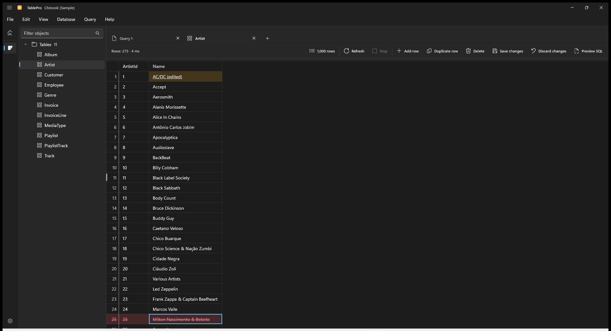

A table opened from the object tree shows one page of rows, 1,000 by default. Edit its cells, add and delete rows, and save the changes together.

<Frame caption="Pending changes stay marked until Save">
  
  
</Frame>

## Edit rows

Editing works in a table tab on a table with a primary key, on a connection whose Safe Mode is not Read only. A saved row's key, and every column the server fills, stay as they are.

| To | Press |
|---|---|
| Edit the focused cell | `F2`, `Enter` or a double-click |
| Keep the edit | `Enter` |
| Keep it and edit the next or previous cell | `Tab`, `Shift+Tab` |
| Cancel the edit | `Escape` |
| Add a row | `Ctrl+Shift+N` |
| Duplicate the selected rows | `Ctrl+Shift+D` |
| Mark the selected rows for deletion | `Delete` |

A value with a line break edits on several lines, and `Ctrl+Enter` keeps it. Right-click a cell and open **Set value** for **Empty**, **NULL** or **Default**, each where the column takes it. A duplicate starts its key, and every column the server fills, the way a new row does. Right-click a row marked for deletion and choose **Undo delete** to keep it.

An edited cell is underlined on a yellow fill, a new row on green, and a row marked for deletion is struck through on red. Typing a cell back to its stored value drops the edit.

## Save or discard

**Save changes** (`Ctrl+S`) writes every change in one batch and reloads the page. **Preview SQL** (`Ctrl+Shift+P`) shows the statements first, each with the values it sends. **Discard changes** drops them all after asking.

- A save that deletes rows asks first.
- With Safe Mode set to Confirm writes, the save shows its statements and runs after **Execute**.
- A save the server refuses writes nothing and keeps every change pending, with the row it stopped at selected.
- Sorting, paging or refreshing asks before it discards pending changes. Closing the tab, disconnecting or quitting offers to save them.
