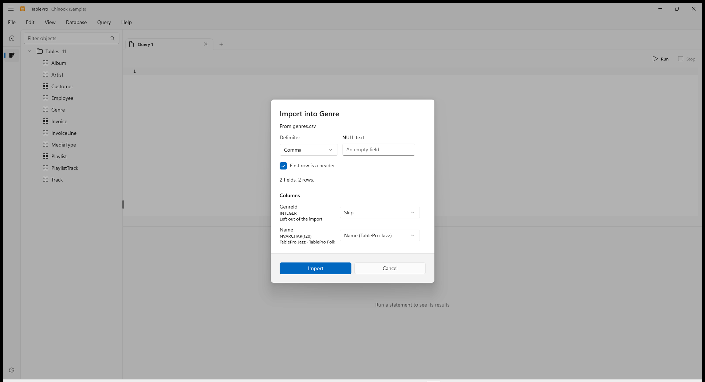
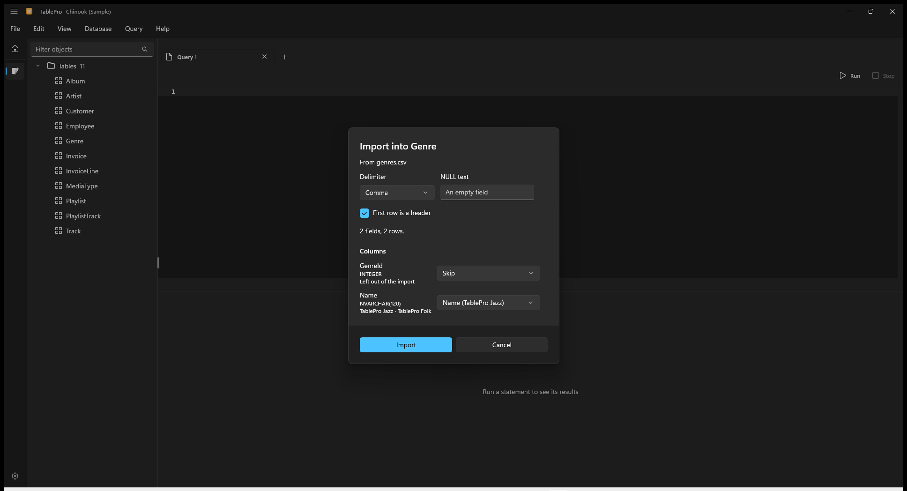
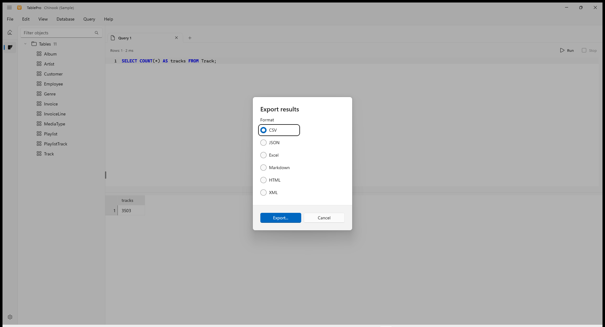
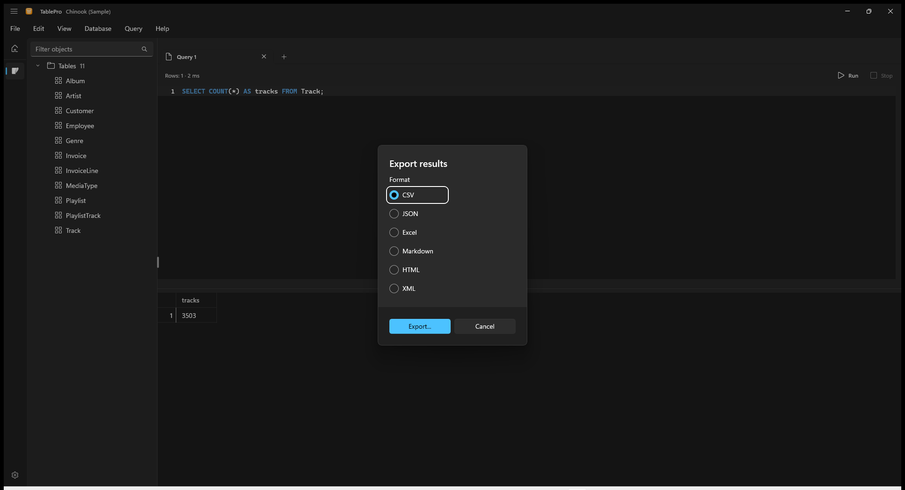
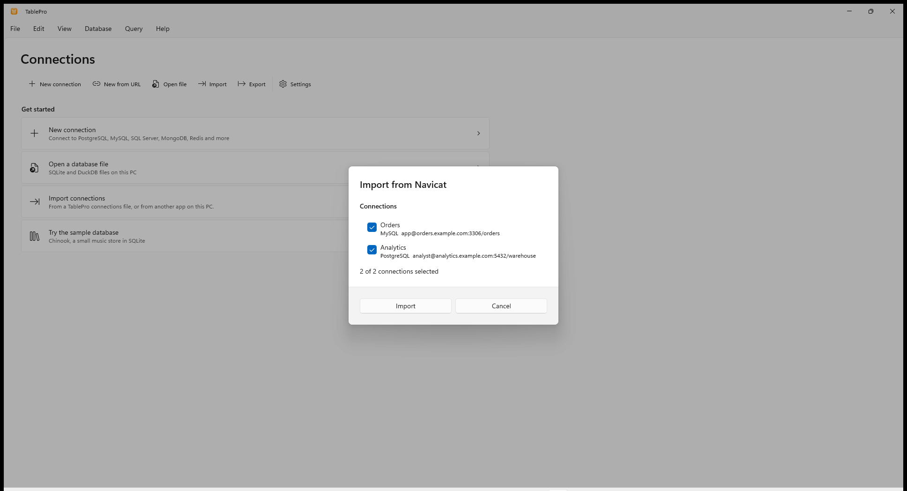
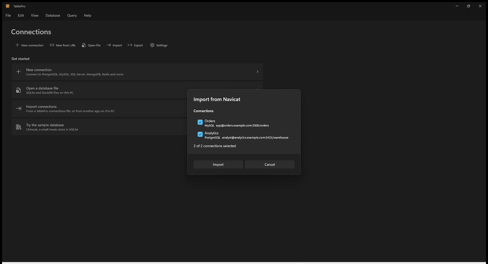

Rows come in from a CSV file, one table at a time, and go out to a file from any result or table. Connections travel in a TablePro connections file, or straight from another app on this PC.

## Import a CSV file

<Steps>
  <Step title="Pick the table">
    Right-click the table in the object tree and choose **Import CSV...**, then pick the file.
  </Step>
  <Step title="Read the file">
    Set **Delimiter** (**Comma**, **Semicolon**, **Tab** or **Pipe**; a `.tsv` file starts on Tab), whether **First row is a header**, and the **NULL text**, the field text that means NULL. Empty, it means an empty field. The dialog counts the fields and rows.
  </Step>
  <Step title="Map the columns">
    Each column takes a field, or **Skip**. Fields whose header names a column start mapped. A column the database fills says so and is left to it.
  </Step>
  <Step title="Import">
    Click **Import**. The dialog asks before it writes, with the number of rows and statements.
  </Step>
</Steps>

<Frame caption="Each column takes a field from the file, or Skip">
  
  
</Frame>

- The file must be UTF-8 and at most 64 MiB.
- A field a column cannot read keeps the dialog open, naming its line and column, before anything is written.
- Safe Mode treats the import as a save: Confirm writes lists the statements first, and Read only refuses it.
- A failure names the lines of the statement that failed and says whether the table may hold any of the rows. On an engine without transactions, rows written before the failure can stay.

## Export results

Choose **Export results...** in the **File** menu, or press `Ctrl+Shift+E`.

<Frame caption="Export results from a query tab">
  
  
</Frame>

<Steps>
  <Step title="Pick a format">
    CSV, JSON, Excel, Markdown, HTML, XML or **SQL INSERT**. From a table tab, SQL INSERT writes one statement per row for that table. From a query tab it writes into `query_results`, with the result's column names.
  </Step>
  <Step title="Pick the rows, in a table tab">
    **Current page** writes the rows on screen. **Entire table** reads every row the filter and sort pick, however many pages they span.
  </Step>
  <Step title="Choose where to save">
    A bar counts the rows as they are written, with **Cancel**. The file appears only once every row is written. A failed or cancelled export leaves no file behind.
  </Step>
</Steps>

From a query tab, export writes the result shown, once its run has finished. CSV is the default; pick Excel for a spreadsheet, which holds up to 1,048,575 rows.

## Move connections in a file

**Export connections...** in the **File** menu, or **Export** on the Connections page, writes every saved connection to a `.json` connections file. Passwords are not in the file.

**Import** on the Connections page, then **Import from file...**, reads that file back, as does **Import connections...** in the **File** menu. Each imported connection asks for its password the first time it connects.

To copy one connection on this PC with its passwords, right-click it on the Connections page and choose **Duplicate**.

## Import from another app

<Steps>
  <Step title="Open the importer">
    Click **Import** on the Connections page and choose **Import from another app...**, or choose it in the **File** menu.
  </Step>
  <Step title="Pick the app">
    Each app shows what was found on this PC, or **Not found on this PC**. An app that keeps its connections only in an export file asks for that file; export it with its passwords.
  </Step>
  <Step title="Choose what comes across">
    **Import passwords** and **Import saved queries** say where the app keeps each, and are dimmed where Windows does not let TablePro read them or the app keeps none.
  </Step>
  <Step title="Review and import">
    Check the connections to bring. A connection that matches one you have starts deselected and offers **Add as copy**, **Replace**, or **Keep existing, add queries**. Click **Import**.
  </Step>
</Steps>

<Frame caption="Review what comes across before anything is written">
  
  
</Frame>

Passwords come across from an app's own encrypted files, a password file it keeps, or a key it stores in Credential Manager. An app that keeps them in another app's protected store leaves them behind, and a bar says so. Saved queries come across where the app ties each one to a connection, as scripts or query consoles; those with a default name start deselected. Each row lists what changes on the way, such as an SSL mode TablePro words differently. The import writes once: the connections, their passwords into Credential Manager, then the saved queries. A connection whose password stayed behind asks for it when you connect.
