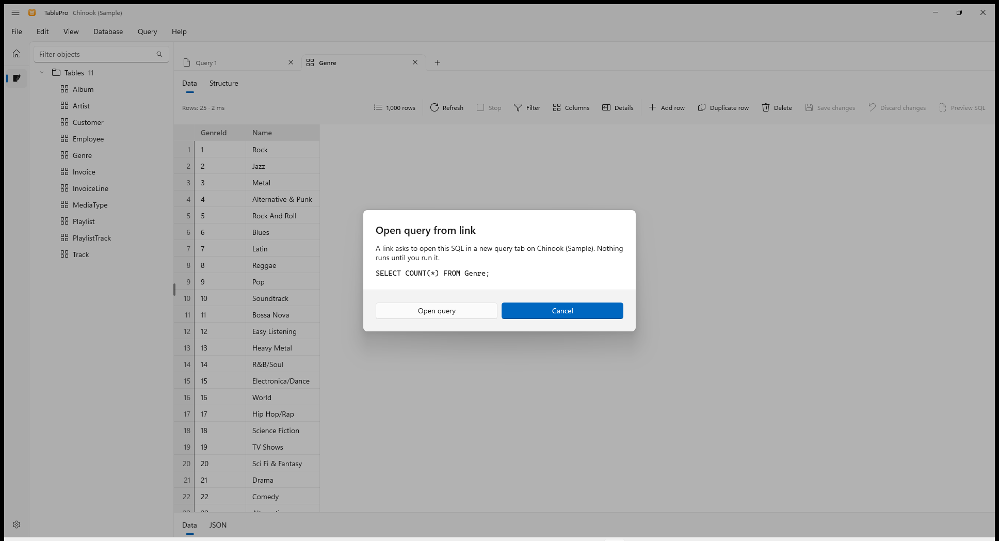
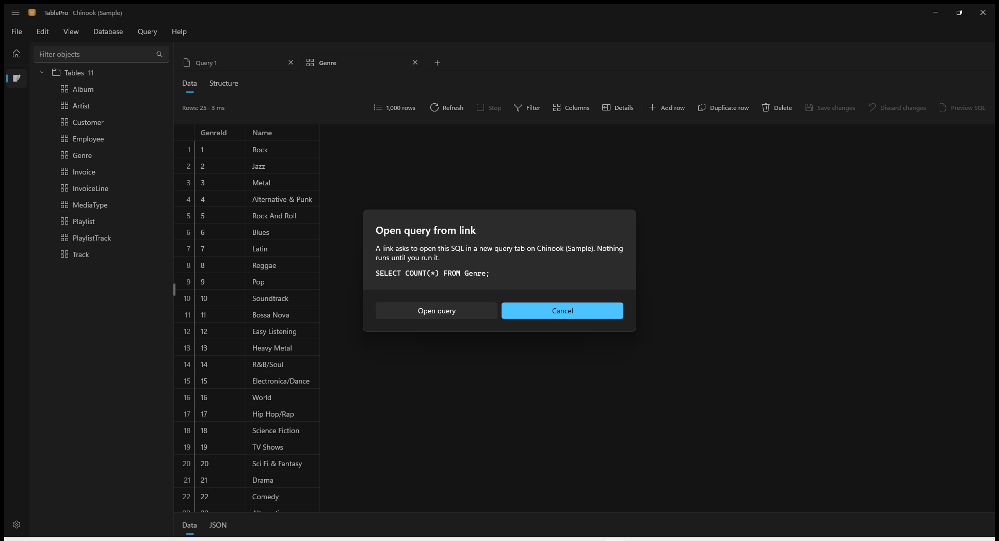

Windows hands TablePro every file type, URL scheme and `tablepro://` link on this page, from Explorer, a browser, another app or the [tablepro command](/windows/command-line#open-files-and-links). When TablePro is already running, the running app takes them.

## Files

| Extension | Opens |
|---|---|
| `.sql`, `.psql`, `.pgsql` | A query tab on the connection in front, without running. With none connected, it waits for the next connection |
| `.db`, `.db3`, `.s3db`, `.sl3`, `.sqlite`, `.sqlite3`, `.sqlitedb` | The file as a SQLite or DuckDB session, without saving a connection |
| `.duckdb`, `.ddb` | The same |

The file's own header picks SQLite or DuckDB, whatever the extension. Choose TablePro under **Open with** in Explorer when another app owns the extension.

## Database URLs

| Engine | Schemes |
|---|---|
| PostgreSQL | `postgresql`, `postgres` |
| MySQL and MariaDB | `mysql`, `mariadb`, `mysqlx` |
| SQL Server | `sqlserver`, `mssql` |
| ClickHouse | `clickhouse`, `ch` |
| Cassandra and ScyllaDB | `cassandra`, `cql`, `scylla`, `scylladb` |
| Redis | `redis`, `rediss`, `valkey`, `valkeys` |
| MongoDB | `mongodb`, `mongodb+srv` |
| SQLite | `sqlite`, `sqlite3` |
| DuckDB | `duckdb` |

A SQLite or DuckDB URL opens the file and saves nothing. Any other URL opens the connection form filled in, so nothing reaches a server before you look at it and click **Connect**. A `jdbc:` wrapper around one of these works from the command line only.

## tablepro links

| Link | Opens |
|---|---|
| `tablepro://connect/<id>` | The saved connection, or brings it forward |
| `tablepro://connect/<id>/table/<name>` | That table, once connected |
| `tablepro://connect/<id>/database/<db>/table/<name>` | A table in another database or schema of the connection |
| `tablepro://connect/<id>/database/<db>/schema/<schema>/table/<name>` | A table in a named schema of another database |
| `tablepro://connect/<id>/query?sql=<SQL>` | A query, after asking. The SQL is URL-encoded, up to 51,200 characters |
| `tablepro://settings` | Settings |
| `tablepro://share/...` | A [shared link's](/windows/browsing#share-a-result-or-query) SQL in a new query tab, without running |
| `tablepro://integrations/start-mcp` | Nothing on screen: it restarts the [MCP server](/windows/mcp#start-the-server-from-a-link) when its last start failed |

`<id>` is a saved connection's id: `tablepro connections` prints them. An id no connection has shows **Connection failed** and says so.

A query link never runs anything. **Open query from link** shows the SQL and the connection, with **Cancel** as the default; **Open query** puts it in a new query tab, or brings forward a tab that already holds exactly that SQL.

<Frame caption="A query link shows its SQL before it opens">
  
  
</Frame>

A link TablePro cannot read opens nothing and says nothing, as on the Mac. `tablepro://import` and `tablepro://integrations/pair` open nothing yet. The Mac app's full grammar is in [URL scheme](/developers/url-scheme).
