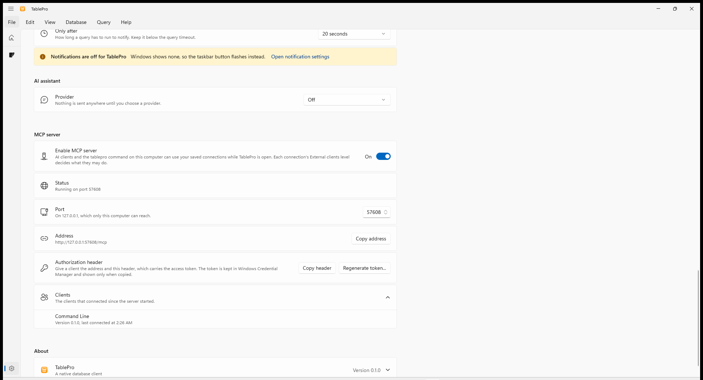
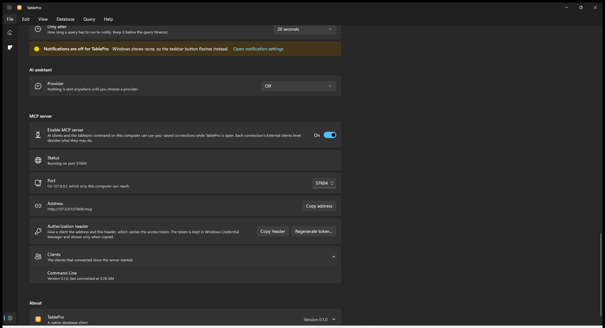

The server is off until you turn it on, and it runs only while TablePro is open. Clients reach the connections you have open in the app, through the same server the [tablepro command](/windows/command-line) uses.

## Turn it on

<Steps>
  <Step title="Enable the server">
    Under **Settings > MCP server**, turn on **Enable MCP server**. **Status** reads **Running on port** and the port.
  </Step>
  <Step title="Copy the address">
    Click **Copy address**. It is `http://127.0.0.1:23508/mcp` unless you change **Port**, which takes 1024 to 65535.
  </Step>
  <Step title="Copy the header">
    Click **Copy header**. The clipboard gets `Bearer` and the access token: the value of the `Authorization` header a client sends.
  </Step>
  <Step title="Give both to the client">
    Add the server to the client's configuration as an HTTP server, with that address and header.
  </Step>
</Steps>

<Frame caption="The server running, with the command line among its clients">
  
  
</Frame>

Many clients take a JSON entry of this shape:

```json
{
  "mcpServers": {
    "tablepro": {
      "url": "http://127.0.0.1:23508/mcp",
      "headers": { "Authorization": "Bearer <token>" }
    }
  }
}
```

The token is kept in Windows Credential Manager and never shown on screen, so a screenshot of Settings never carries it. **Regenerate token...** replaces it after asking; clients holding the old one are refused until you give them the new header.

**Clients** lists each client that connected since the server started, with its version and when it last connected.

## Who can connect

The server listens on 127.0.0.1 only, and answers a client only when its process runs as your Windows user. A client started as administrator while TablePro is not can be refused.

A port another program holds says so under **Status**: choose another port, or click **Try again** once it is free.

## External clients

Each connection's **External clients** option, under **Options** in its form, sets what clients may do there.

| Level | Clients |
|---|---|
| **Blocked** | Do not see the connection |
| **Read only**, the default | Read the schema and the data. Every write is refused |
| **Read and write** | Can also write. Each statement waits for your approval |

A connection opened from a file without saving it is never offered to clients.

When a client asks to open a closed connection, TablePro opens it as **Connect** does. A connection that fails to open is brought forward, and the client is told.

## Approve a write

Under **Read and write**, a client's write brings its connection's window forward and asks **Run statement from MCP client?**, with the full statement. **Cancel** is the default; **Run** sends it. The question comes down unanswered if the client goes away.

The question shows whatever the Safe Mode level, and Safe Mode's **Read only** still refuses the write. A client's statements are kept in the query history under the same rules as your own.

## Start the server from a link

`tablepro://integrations/start-mcp` starts the server again when **Enable MCP server** is on and its last start failed. It shows nothing and leaves the window where it is. A server that is running keeps its clients, and one that is off stays off.
