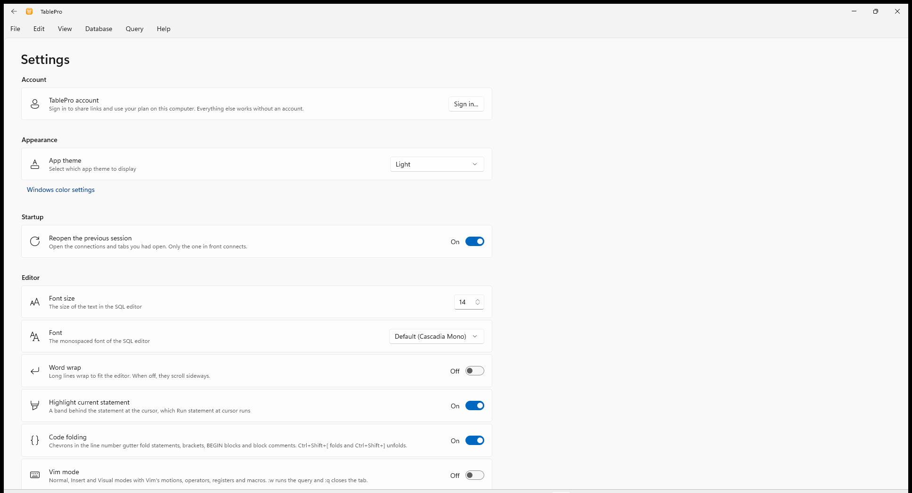
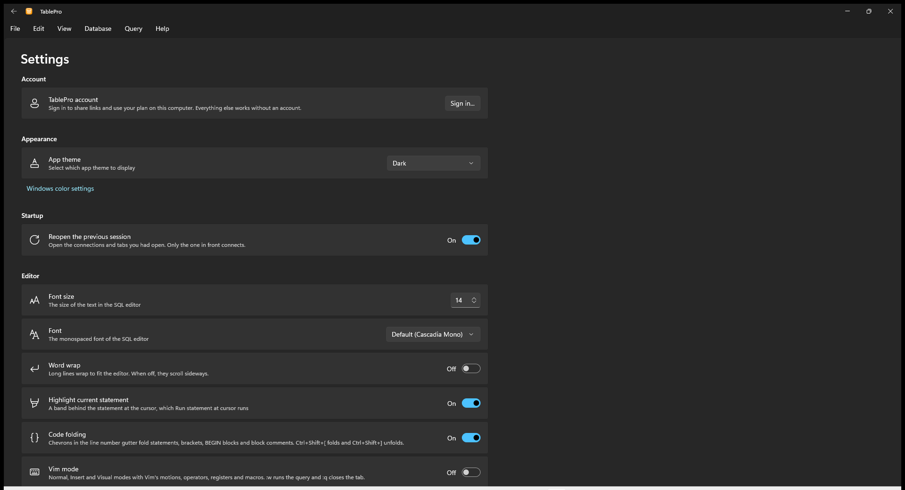

Choose **Settings** in the **File** menu, or click **Settings** on the Connections page or at the bottom of the rail. A change applies as you make it; there is no Save. `tablepro://settings` opens the page too.

<Frame caption="Settings opens on Account, Appearance, Startup and Editor">
  
  
</Frame>

## Account

Sign in, check your plan and manage your devices: see [TablePro account](/windows/account).

## Appearance and startup

| Setting | Default | Choices |
|---|---|---|
| App theme | Use system setting | Light, Dark, Use system setting |
| Reopen the previous session | On | On, Off |

**Reopen the previous session** brings back the connections and tabs you had, and connects only the one in front. A Windows contrast theme keeps its own colors, and connection colors are not applied.

## Editor

| Setting | Default | Choices |
|---|---|---|
| Font size | 14 | 8 to 36 |
| Font | Cascadia Mono | The monospaced fonts installed |
| Word wrap | Off | On, Off |
| Highlight current statement | On | On, Off |
| Code folding | On | On, Off |
| Vim mode | Off | On, Off |
| Light color scheme, Dark color scheme | Default | The Mac app's built-in editor themes |

**Highlight current statement** shades the statement **Run statement at cursor** runs. [Edit](/windows/sql-editor#edit) covers folding and [Vim mode](/windows/sql-editor#vim-mode) the Vim keys.

## Data grid

| Setting | Default | Choices |
|---|---|---|
| Font | Segoe UI | The fonts installed |
| Font size | 14 | 8 to 36 |
| NULL display | `NULL` | Up to 20 characters |

The fonts and the NULL text reach open editors and grids at once.

## Queries and pagination

| Setting | Default | Choices |
|---|---|---|
| Row limit | 10,000 | 1 to 1,000,000 rows each result keeps |
| Results kept per run | No limit | 10, 20, 50, 100, 200, 500 or 1,000 of the newest |
| Query timeout | 0 | 0 to 86,400 seconds. 0 leaves it to the connection |
| Default page size | 1,000 | 100, 500, 1,000, 5,000, 10,000 |
| Count rows if estimate less than | 100,000 | 1,000; 10,000; 100,000; 1,000,000; Always count |

A connection's own **Query timeout** in its [Options](/windows/connect#options) takes the place of this one. [Count a large table](/windows/data-grid#count-a-large-table) explains the count threshold.

## Query history

| Setting | Default | Choices |
|---|---|---|
| Keep runs for | 90 days | 7, 30, 90 or 180 days, 1 year, Forever |
| Maximum runs | 10,000 | 100, 500, 1,000, 5,000, 10,000, Unlimited |

Pinned runs are never removed by either limit. **Clear history...** removes every connection's runs, pinned ones too, after asking.

## Notifications

| Setting | Default | Choices |
|---|---|---|
| Notify when long-running work finishes | On | On, Off |
| Only after | 20 seconds | 5, 10, 20 or 30 seconds, or 1, 2, 5 or 10 minutes |

Keep **Only after** below the query timeout, or a query that would notify is stopped first. [Notifications](/windows/sql-editor#notifications) says when one shows.

## AI assistant

| Setting | Default | Choices |
|---|---|---|
| Provider | Off | Anthropic, OpenAI, Ollama or compatible server |
| Server address | `http://localhost:11434/v1` | An http or https address with its version path, for a compatible server |
| API key | None | Kept in Credential Manager with **Save key**, removed with **Remove key** |
| Model | `claude-opus-5-5` for Anthropic, none for the others | Any model id; open the list to read the provider's models |

A key goes over plain http only to this computer. [AI assistant](/windows/sql-editor#ai-assistant) covers the pane.

## MCP server

| Setting | Default | Choices |
|---|---|---|
| Enable MCP server | Off | On, Off |
| Port | 23508 | 1024 to 65535, on 127.0.0.1 |

**Address**, **Authorization header**, **Regenerate token...** and **Clients** are in [MCP server](/windows/mcp).

## Software update

| Setting | Default | Choices |
|---|---|---|
| Update channel | The channel you installed from | Stable, Beta |

The section shows the version, when TablePro last checked, and **Check now** or **Install update...**. **What's new in this version** opens the release notes. A build not installed from its package says it does not check. [Updates](/windows/install#updates) covers the rest.

## About

The version, **Documentation**, **Report an issue**, and **Open the data folder**, which opens the folder [Where your data lives](/windows/install#where-your-data-lives) describes.
