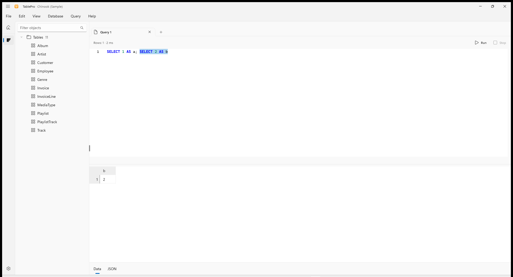
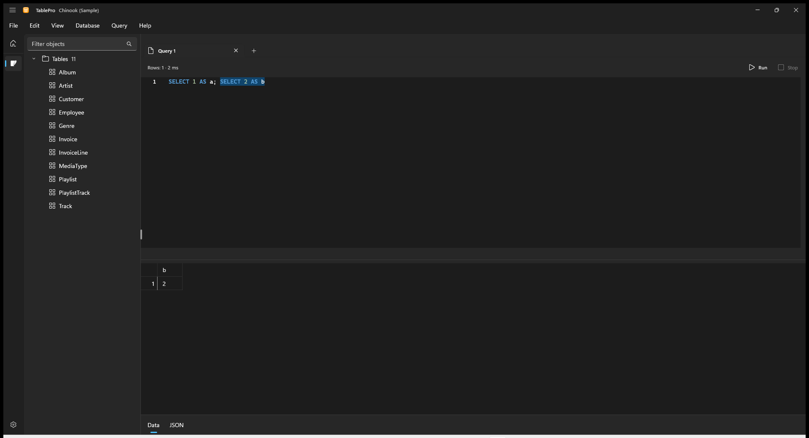

`Ctrl+T` opens a query tab on the connection in front. Each query tab runs on a connection of its own, opened at its first run, so a transaction in one tab never reaches another.

<Frame caption="Run statement at cursor selects what it ran">
  
  
</Frame>

## Run

| To run | Press | Or choose in **Query** |
|---|---|---|
| The selection, or the whole text | `Ctrl+Enter` | **Run** |
| The statement at the cursor | `Ctrl+Shift+Enter` | **Run statement at cursor** |
| Stop the run | `Shift+F5` | **Stop** |

**Run statement at cursor** runs the statement the cursor is in, or the last one before it, and selects it so you see what ran. **Highlight current statement** in Settings shades that statement while you type.

Safe Mode reads each statement before anything is sent. When it asks, the dialog lists every statement in full, with **Cancel** as the default. Under **Read only**, a run that holds any write is refused whole.

A statement stops after the query timeout: the connection's own, or **Settings > Queries > Query timeout**, where 0 leaves it to the connection.

## Results

The grid shows the first rows as soon as they arrive. A run that returns several result sets lists them in a picker over the grid, such as **Result 2 (50)**; a `+` after the count means the row limit cut that set short. Each result keeps up to **Settings > Queries > Row limit** rows, 10,000 by default, and [Keep fewer results from a script](/windows/browsing#keep-fewer-results-from-a-script) caps how many sets a run keeps.

Click a column header to sort. A single statement that reads runs again with that `ORDER BY`, so the sort covers every row, not only those loaded. For a script, a write, `SHOW` or `EXPLAIN`, the rows already held are sorted, and the status says so.

When the server prints notices, such as PostgreSQL's `RAISE NOTICE`, **Messages** appears beside **Results** with one line per notice. A run with no rows opens on Messages.

**Data** and **JSON** at the bottom of the pane switch the result between the grid and JSON; see [Data grid](/windows/data-grid#read-rows-as-json). A result from one table with its primary key can be edited in place: [Edit a query result](/windows/data-grid#edit-a-query-result).

A failed statement shows the server's message in an error bar. When the server says where it failed, **Go to Error** puts the cursor there. With the AI assistant set up, **Fix with AI** sends the statement and the error.

## Transactions

A statement that leaves a transaction open shows **Transaction open** over the tab's results, with **Commit** and **Roll back**. Roll back asks first. Other tabs show a bar naming the tab that holds one, with **Show**.

Closing that tab, disconnecting or exiting asks first, since each rolls the transaction back. If the connection drops, its transaction is gone: the tab says so, and the next run opens a new connection.

## Edit

| To | Press |
|---|---|
| Find, Find and replace | `Ctrl+F`, `Ctrl+H` |
| Next match, previous match | `F3`, `Shift+F3` |
| Replace all | `Ctrl+Alt+Enter` in the find bar |
| Comment or uncomment lines | `Ctrl+/` |
| Fold, unfold | `Ctrl+Shift+[`, `Ctrl+Shift+]` |
| Move lines up or down | `Alt+Up`, `Alt+Down` |
| Copy lines up or down | `Shift+Alt+Up`, `Shift+Alt+Down` |
| Delete lines | `Ctrl+Shift+K` |
| Select the next match of the word | `Ctrl+D` |
| Add a cursor above or under | `Ctrl+Alt+Up`, `Ctrl+Alt+Down` |
| Zoom in, out, back | `Ctrl+=`, `Ctrl+-`, `Ctrl+0` |

The find bar has **Match case**, **Match whole word** and **Use regular expression**. Folding works on statements, brackets, `BEGIN` blocks and block comments, from the chevrons in the line number gutter; turn it off with **Code folding** in Settings.

### Vim mode

Turn on **Vim mode** under **Settings > Editor**. A badge on the query bar shows the mode: NORMAL, INSERT, VISUAL, VISUAL LINE or REPLACE. Motions, operators, counts, registers, marks, macros and text objects work as in Vim, and a closed fold counts as one line. `:w` runs the query and `:q` closes the tab.

In Normal mode, `Ctrl+A`, `Ctrl+B`, `Ctrl+D`, `Ctrl+F` and `Ctrl+P` are Vim's commands. Reach **Select all**, **Find**, **Object tree** and **Filter objects** from the **Edit** and **View** menus instead. In Insert mode, `Ctrl+W` deletes a word and `Ctrl+T` indents; they do not close or open a tab.

Visual block mode, `:s` and `:{line}` are not there, as on the Mac.

## Tabs

| To | Do this |
|---|---|
| Rename a query tab | Press `F2` on the tab, or double-click it |
| Reopen the last closed tab | `Ctrl+Shift+T`. Each connection keeps its last 20 |
| Go to a tab | `Ctrl+1` to `Ctrl+8`, `Ctrl+9` for the last |
| Give a tab its own window | Drag it out of the strip, or choose **Move tab to new window** in the **File** menu |

A tab moved to its own window keeps its session: its transaction and results come with it, and it can be dragged back into any window of the same connection.

On an engine with several databases, each query tab names its database in its command bar. Pick another there to run in it; the pick waits while the tab runs or holds a transaction. A `USE` typed in the tab moves it too.

## SQL files

`Ctrl+O` opens a `.sql`, `.psql` or `.pgsql` file in a query tab of the connection in front, and **Open recent** in the **File** menu lists the last 10. Dropping a file on the editor opens it the same way. With no connection open, the file waits for the next one to connect.

The tab is named for the file, with a dot while the text differs from it. `Ctrl+S` saves the file and `Ctrl+Shift+S` saves it under another name. A file another program changed shows a bar with **Reload**; a save over that change asks to **Overwrite** or **Reload from disk**.

The file keeps its encoding: its byte order mark, else UTF-8, else Latin-1. A save that would lose a character the encoding cannot store leaves the file untouched; **Save as...** writes UTF-8.

## Saved queries

Choose **Save query...** in the **Query** menu to keep the tab's text under a name, in a folder once you have folders. From the history, a run's menu has **Save query...** too.

**Show saved queries** in the **View** menu opens them beside the tabs, where the history pane sits. Double-click a query to insert it: it replaces an empty query tab's text, follows the tab's text after a blank line, or opens a new tab. Its menu has **Insert in editor**, **Open in new tab**, **Copy query**, **Edit...**, **Move to** and **Delete**.

Saved queries belong to a saved connection. A file opened without saving keeps none, and deleting a connection deletes its saved queries.

[Find a past query](/windows/browsing#find-a-past-query) covers the query history.

## Redis and MongoDB

On a Redis connection the editor takes Redis commands. On MongoDB it takes mongosh statements such as `db.orders.find()`. A Redis key opens in a key tab from the object tree, with its type, length and expiry over its entries; **Load more** reads the next 500.

## AI assistant

<Steps>
  <Step title="Pick a provider">
    Under **Settings > AI assistant**, choose **Anthropic**, **OpenAI** or **Ollama or compatible server**. Nothing is sent anywhere while the provider is **Off**, which is where it starts.
  </Step>
  <Step title="Save the key">
    Paste the API key and click **Save key**. It goes to Credential Manager and is never shown again. A server on this computer usually needs none.
  </Step>
  <Step title="Pick the model">
    Open **Model** to list the provider's models, or type a model id.
  </Step>
</Steps>

**Show AI assistant** in the **View** menu opens a chat beside the tabs. Each question goes with the structure of the tables involved, never their rows. `Enter` sends and `Shift+Enter` starts a new line. A code block in a reply has **Copy** and **Insert in editor**.

**Review with AI**, **Explain with AI** and **Optimize with AI**, in the **Query** menu and the editor's menu, send the selection or the statement at the cursor.

The connection's **AI assistant** option decides what may be sent. Under **Ask each time**, the first request names the provider and host the data goes to, and your answer lasts until the connection disconnects. **Never** turns the assistant off for that connection.

## Notifications

A query that runs longer than **Settings > Notifications > Only after**, 20 seconds by default, posts a Windows notification when it ends somewhere you are not looking: another app in front, the window minimized, or another tab showing. Click it to go to the tab. A failure says only that it failed; the message stays in the tab.

When Windows notifications are off for TablePro, the taskbar button flashes instead, and Settings links to Windows' notification settings.
